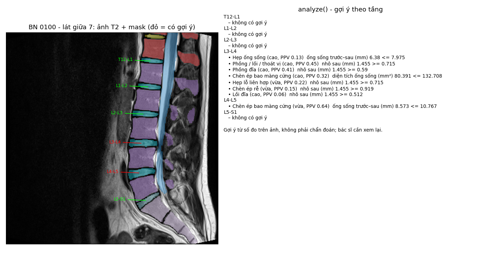

# `ai/` – Module AI cho worker của BE

Các hàm Python mà **worker của BE gọi trực tiếp** (import, không qua HTTP) để xử lý một ảnh MRI
(chụp cộng hưởng từ) do người dùng upload. Hợp đồng đầy đủ với BE / FE: [`../docs/spec.md`](../docs/spec.md)
mục 3.3.1 (payload), mục 5 (worker), mục 8 (mã lỗi).

```
Ảnh NIfTI upload ─► segment()  ─► mask ─► analyze() ─► số đo + gợi ý bệnh ─► BE lưu SQLite ─► FE hiển thị
                    segment.py            analyze.py
```

| File | Việc | Chạy trên | Thời gian / ca |
|---|---|---|---|
| [`dicom_to_nifti.py`](dicom_to_nifti.py) | Zip một study DICOM → tự chọn series T2 sagittal (quy tắc của s02, đọc từ header) → NIfTI; xóa DICOM gốc sau khi chuyển. Chưa nối vào BE / spec | CPU | < 1 s |
| [`segment.py`](segment.py) | Gọi CLI TotalSpineSeg, phân đoạn đốt sống, đĩa đệm, tủy sống, ống sống | GPU (CPU được nhưng chậm) | ~18 s GPU, ~14 phút CPU |
| [`analyze.py`](analyze.py) | Từ ảnh + mask: QC tầng, số đo theo tầng, gợi ý bệnh | CPU | ~2 s |
| [`demo/`](demo/) | Kết quả chạy thật trên BN 100 – dữ liệu mẫu cho FE | – | – |

## Khác gì với `pipeline/`

- [`../pipeline/`](../pipeline/README.md): **nghiên cứu** trên bộ 515 bệnh nhân – chạy theo lô, sinh bảng
  / hình cho báo cáo, **học** bảng ngưỡng (bước 6, `s11_threshold_rules.py`).
- `ai/`: **chạy cho từng ca mới** trên web. `analyze.py` dùng lại code đo (`s09_level_features.py`) và
  bảng ngưỡng của `pipeline/`, không học gì thêm.

## `segment.py` – phân đoạn

```python
from ai.segment import segment, SegmentationError

r = segment("input.nii.gz", "output/", iso=False, step1=False, timeout=900)
r.mask_path          # output/step2_output/<tên>.nii.gz – mask cuối cùng
r.labels_present     # [1, 2, 41, 42, ..., 100] – nhãn có trong mask
r.duration_seconds
```

- Gọi `totalspineseg INPUT OUTPUT [--iso] [--step1]` qua `subprocess` (không qua shell), ghi toàn bộ
  log vào `logs/totalspineseg.log` cạnh thư mục output.
- Quá `timeout` hoặc BE tắt giữa chừng → kill cả cây tiến trình con của nnU-Net (không để tiến trình
  mồ côi giữ RAM / GPU).
- Lỗi → `SegmentationError(code, message, log_tail)` với `SEGMENTATION_FAILED`, `OUTPUT_NOT_FOUND`,
  `TIMEOUT`. Lỗi này làm job `failed`.

## `analyze.py` – phân tích sau segmentation

```python
from ai.analyze import analyze, AnalysisError

a = analyze("input.nii.gz", r.mask_path)   # dict = result.analysis (spec mục 3.3.1)
```

Các bước:

1. **Kiểm tra hình học** – mask cùng lưới với ảnh (segment với `iso=False`), ảnh là sagittal (mặt cắt dọc).
2. **QC nhãn** – thiếu đốt L1–L5 / xương cùng / đĩa đệm, có đốt sống chuyển tiếp (lumbosacral
   transitional vertebra, 6 đốt thắt lưng), thứ tự tầng sai → `qc.ok = false`, vẫn trả số đo nhưng
   **không gợi ý** (không chắc đánh số tầng).
3. **Đo** 8 số đo cho mỗi tầng T12-L1 … L5-S1 bằng `measure_case()` của s09 – cùng cách đo với 513
   bệnh nhân dùng để học ngưỡng: chiều cao đĩa, DHI (chỉ số chiều cao đĩa), tín hiệu đĩa / DNT (dịch
   não tủy), tín hiệu đĩa / thân đốt, độ nhô ra sau của đĩa, đường kính trước–sau và diện tích ống sống,
   độ trượt đốt sống.
4. **Gợi ý bệnh** – so với `pipeline/outputs/tables/analysis/threshold_rules.csv`:
   - chỉ quy tắc `use = True` (cận dưới khoảng tin cậy 95 % của AUC ≥ 0,70);
   - mỗi (bệnh, tầng) dùng **một** quy tắc: ngưỡng riêng của tầng trước, không có mới dùng ngưỡng z chung;
   - **bỏ quy tắc có PPV < 0,05** (PPV – giá trị dự đoán dương: trong các lần báo "nghi bệnh", bao
     nhiêu % bác sĩ cũng ghi có bệnh), với ngưỡng z chung dùng PPV tại đúng tầng đó.

Lỗi → `AnalysisError(code, message)` với `GEOMETRY_MISMATCH`, `NOT_SAGITTAL`, `ANALYSIS_FAILED`.
Lỗi này **không** làm job `failed`: BE ghi vào `analysis.error`, mask vẫn xem được.

Mỗi gợi ý ghi rõ quy tắc đã khớp (`value rule threshold`), phân vị so với 513 bệnh nhân cùng tầng,
độ tin cậy (`cao` / `vừa`), độ nhạy, độ đặc hiệu, PPV khi kiểm chứng chéo (cross-validation).

Với các số đo có ngưỡng y văn (đường kính trước–sau ống sống, diện tích ống sống, độ trượt), trường
`literature` cho biết giá trị rơi vào mức nào theo y văn, ví dụ `"theo y văn: < 10 mm - hẹp tuyệt đối"`.
Ngưỡng khai báo một chỗ ở `LIT_CUTOFFS` của `pipeline/src/analysis/s12_literature_compare.py`. Chỉ để
tham khảo: thang đo của s09 thấp hơn y văn khoảng 2 mm với đường kính ống sống và độ trượt.

Ví dụ đầy đủ: [`demo/analysis_0100.json`](demo/analysis_0100.json).

## Cài đặt và chạy

Chạy **từ gốc repo** – `analyze.py` tìm `pipeline/src/` và 3 bảng CSV trong
`pipeline/outputs/tables/analysis/` theo đường dẫn tương đối với file của nó.

| Module | Thư viện cần |
|---|---|
| `segment.py` | gói `totalspineseg[nnunetv2]` **cùng venv** (CLI tìm cạnh `sys.executable`), `nibabel`, `numpy`, `psutil` |
| `analyze.py` | `numpy`, `pandas`, `SimpleITK`, `scipy`, `matplotlib` (xem `../pipeline/requirements.txt`) |

Biến môi trường `TOTALSPINESEG_DATA` = thư mục weights của mô hình (lần đầu tự tải về, nên warm-up
trước buổi demo).

Thử một ca từ dòng lệnh:

```bash
python ai/segment.py <ảnh.nii.gz> <thư_mục_output> [timeout_giây]
python ai/analyze.py <ảnh.nii.gz> <mask.nii.gz>      # in JSON
```

## `demo/` – BN 100 của bộ dữ liệu

Chạy trọn `segment()` → `analyze()` trên CPU (821 s).

| File | Nội dung |
|---|---|
| `0100_seg.nii.gz` | Mask TotalSpineSeg – trùng khớp hoàn toàn với mask chạy trên Kaggle GPU (Dice 1,000 cho 14 cấu trúc) |
| `analysis_0100.json` | Kết quả `analyze()` – **dữ liệu mẫu cho FE** / mock mode của BE |
| `demo_0100.png` | Lát giữa + mask + gợi ý theo tầng |
| `totalspineseg_0100.log` | Log TotalSpineSeg |

Ảnh gốc: `pipeline/outputs/nifti/sag/0100.nii.gz` (không đưa lên Git – tạo bằng `pipeline/src/dicom/s02_select_convert.py`).



Kết quả: QC đạt; L3-L4 có 7 gợi ý, gồm cả 3 bệnh bác sĩ ghi – phồng đĩa đệm (disc bulge), hẹp lỗ
liên hợp (foraminal stenosis), chèn ép bao màng cứng (thecal sac compression) – và hẹp ống sống
(spinal canal stenosis) mà bác sĩ không ghi (ống sống 6,38 mm, phân vị 6).

## Giới hạn

- **Gợi ý để bác sĩ xem lại, không phải chẩn đoán.** FE luôn hiện `disclaimer`.
- Chỉ dùng cho ảnh **sagittal T2 cột sống thắt lưng** – ngưỡng học trên đúng loại ảnh này, từ một bộ
  dữ liệu (515 bệnh nhân), chưa kiểm định trên máy chụp / bệnh viện khác.
- Nhãn huấn luyện là nhãn yếu từ ghi chú bác sĩ: "không ghi" ≠ "bình thường" → bệnh hiếm ở một tầng
  (vd hẹp khoang đĩa ở L4-L5, 1 ca) không có gợi ý dù số đo rất bất thường; số đo vẫn có trong `measures`.
- PPV vẫn thấp ở nhiều quy tắc (0,05–0,2): phần lớn gợi ý cho bệnh hiếm là báo động giả.
- Một số đo vượt ngưỡng có thể kéo theo nhiều gợi ý (vd độ nhô sau → phồng đĩa, lồi đĩa, hẹp lỗ liên
  hợp, chèn ép rễ thần kinh) – FE nên gom theo số đo hoặc chỉ hiện vài gợi ý PPV cao nhất.
