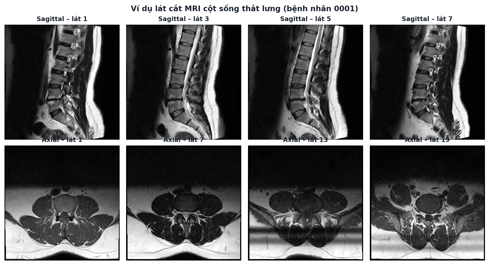

# Bộ dữ liệu: MRI cột sống thắt lưng + Ghi chú bác sĩ

Giải thích ngắn gọn về bộ dữ liệu trong thư mục này, viết cho người **không có kiến
thức y khoa**. Nếu bạn chỉ cần biết "trong này có gì" để dùng lại code ở
`../totalspineseg`, đọc phần 1–3 là đủ. Phần 5–8 giải thích ghi chú bác sĩ, giải phẫu cột sống và từ điển thuật ngữ Anh – Việt.

---

## 1. Bộ dữ liệu gồm những gì?

| Thư mục / file | Nội dung | Định dạng |
|---|---|---|
| `MRI_Data/01_MRI_Data/0001 … 0575/` | Ảnh chụp cộng hưởng từ (MRI) cột sống thắt lưng của 515 bệnh nhân | Ảnh DICOM (`.ima`) |
| `Radiologists Report.xlsx` | Ghi chú (văn bản tự do) của bác sĩ X-quang, mô tả những gì họ thấy trên ảnh của từng bệnh nhân (575 dòng, 515 có ghi chú) | Excel |

Hai phần này **mô tả cùng một nhóm bệnh nhân**: ảnh cho máy "nhìn", ghi chú cho biết
bác sĩ con người đã kết luận gì khi nhìn ảnh đó. Trong `totalspineseg/`, module NLP đọc
ghi chú Excel để tạo nhãn (label), rồi dùng nhãn đó để huấn luyện một mô hình học
từ ảnh.

Nguồn dữ liệu gốc: *Lumbar Spine MRI Dataset*, Sudirman *et al.*, Mendeley Data 2019
(xem trích dẫn đầy đủ ở `../totalspineseg/README.md`, mục "Nguồn dữ liệu và trích dẫn").

---

## 2. MRI là gì, tại sao lại nhiều file đến vậy?

**MRI (cộng hưởng từ)** là một cách chụp ảnh bên trong cơ thể bằng từ trường mạnh,
không dùng tia X. Nó cho ảnh rất rõ các mô mềm (đĩa đệm, dây thần kinh, dịch...) —
đây là lý do nó được dùng để chẩn đoán đau lưng, thay vì chụp X-quang thường.

Máy MRI không chụp một tấm ảnh phẳng duy nhất. Nó chụp cơ thể thành **nhiều lát cắt
mỏng liên tiếp**, giống như cắt một ổ bánh mì thành từng lát để nhìn được bên
trong. **Mỗi lát cắt = một file `.ima`.** Đó là lý do một bệnh nhân có hàng chục,
thậm chí hàng trăm file ảnh.

<p align="center">
  
</p>

**Cách đọc hình trên:**
- **Hàng trên (Sagittal)** — cắt dọc cơ thể từ trước ra sau, giống nhìn cột sống
  từ bên hông. Bạn thấy rõ chồng các đốt xương (màu xám) và đĩa đệm (khối tối
  giữa hai đốt) chạy dài từ trên xuống dưới, mảng sáng phía sau là dịch bao quanh
  tủy sống.
- **Hàng dưới (Axial)** — cắt ngang cơ thể, giống cắt một khoanh giò. Mỗi lát chỉ
  thấy **một** đốt sống, hình tròn/bầu dục ở giữa là thân đốt và ống tủy, phần
  hình cánh bướm hai bên là cơ lưng.

Vì mặt **sagittal** cho thấy toàn bộ các tầng đĩa đệm trong một lát, nó được ưu
tiên dùng để phân đoạn bằng TotalSpineSeg (xem `../totalspineseg/README.md`, bước 2).

### "T1" và "T2" là gì?
Máy MRI có thể chụp cùng một vị trí theo nhiều "chế độ" khác nhau, gọi là chuỗi
xung (sequence). Hai chuỗi phổ biến nhất trong bộ dữ liệu này:
- **T1** — mô mỡ sáng, dịch/nước tối → nhìn rõ hình dạng giải phẫu tổng thể.
- **T2** — dịch/nước sáng → nhìn rõ chỗ viêm, chỗ chứa dịch, bao quanh tủy sống.

Có thể tưởng tượng như chụp cùng một cảnh bằng hai loại kính lọc máy ảnh khác
nhau — mỗi loại làm nổi bật một chi tiết khác nhau. Pipeline ưu tiên dùng **T2**
vì nó cho thấy rõ tổn thương đĩa đệm hơn.

### Vài lát ảnh gọi là "localizer" — chúng là gì?
Trước khi chụp ảnh chính thức, máy chụp vài lát rất nhanh, mờ, chỉ để kỹ thuật
viên canh đúng vị trí — giống việc ngắm thử trước khi bấm máy ảnh thật. Các lát
này **không dùng để chẩn đoán** nên bị loại khỏi dữ liệu huấn luyện.

---

## 3. Cấu trúc thư mục ảnh (`MRI_Data/`)

```
01_MRI_Data/
└── 0001/                                     ← mã bệnh nhân (4 chữ số)
    └── L-SPINE_LSS_20160309_091629_240000/   ← một lần đi chụp (study)
        ├── LOCALIZER_0001/                   ← ảnh canh vị trí, không dùng
        ├── T1_TSE_SAG_320_0003/              ← T1, mặt sagittal
        ├── T2_TSE_SAG_384_0002/              ← T2, mặt sagittal  (được ưu tiên)
        ├── T1_TSE_TRA_0005/                  ← T1, mặt axial (tra = transverse = ngang)
        ├── T2_TSE_TRA_384_0004/              ← T2, mặt axial
        └── POSDISP_[4]_T2_TSE_TRA_384_5001/  ← chuỗi phụ trợ đo khoảng cách
```

Mỗi thư mục con (series) chứa nhiều file `.ima` — mỗi file là một lát cắt.
Một số bệnh nhân có **nhiều hơn 1 lần đi chụp** (nhiều thư mục study).

---

## 4. Vài con số để hình dung quy mô

| Chỉ số | Giá trị |
|---|---|
| Số bệnh nhân | 515 |
| Tổng số lát cắt (file `.ima`) | 48.345 |
| Lát cắt mặt sagittal | 21.781 |
| Lát cắt mặt axial | 21.060 |
| Lát cắt localizer (bỏ qua) | 7.423 |
| Số lát cắt mỗi bệnh nhân | 62 – 783 (trung vị 80) — chênh lệch rất lớn giữa các ca |
| Độ phân giải phổ biến nhất | 320×320 điểm ảnh |
| Độ sâu màu | 12-bit (4.096 mức sáng, nhiều hơn ảnh thường 8-bit/256 mức) |
| Máy chụp | 1 máy Siemens 1,5 Tesla duy nhất |
| Tuổi bệnh nhân | 17–89 (trung bình 41,8), nữ chiếm 38,4% |
| Dung lượng | ~12,5 GB |

(Số bệnh nhân, tổng số lát, tuổi/giới đã kiểm chứng lại bằng pipeline hiện tại –
`dicom_index.csv`, `patient_features.csv` – xem `../totalspineseg/README.md`, bước 1 và 7. Các con
số còn lại lấy từ phiên bản phân tích trước, có thể lệch nhẹ do cách đếm, vd số lát
localizer: bước 1 đếm 5.544 localizer + 1.895 POSDISP.)

---

## 5. File ghi chú bác sĩ (`Radiologists Report.xlsx`)

### 5.1. Cấu trúc file

| Thuộc tính | Giá trị |
|---|---|
| Số sheet | 1 (`Sheet1`) |
| Cột | `Patient ID` (số nguyên, **không** có số 0 đứng đầu) · `Clinician's Notes` (văn bản tự do, tiếng Anh) |
| Số dòng | 575 (ID 1 → 575) |
| Dòng có ghi chú | **515**, khớp 1–1 với 515 thư mục ảnh |
| Dòng trống | 60, đúng là 60 ID **không có ảnh** trong `MRI_Data` |

> ⚠️ Khi ghép với ảnh: thư mục ảnh tên `0001`, trong Excel là `1`, nên phải ép về cùng
> kiểu số nguyên trước khi join.

Mỗi dòng là đoạn văn bản bác sĩ X-quang viết khi đọc ảnh. Đây là dữ liệu **phi cấu
trúc** (câu văn tự nhiên, không phải bảng số), nên trong `totalspineseg/` có hẳn một module NLP
(`src/nlp_rules.py`, `src/s02_nlp_extract.py`) để đọc và "dịch" các câu này thành
nhãn có cấu trúc: bệnh gì, ở tầng nào, bên nào, mức độ nào, có phủ định hay không.

### 5.2. Ví dụ ghi chú thật (kèm bản dịch)

**Bệnh nhân 1: nhiều bệnh ở cùng một tầng**

> L4-5: degenerative annular disc bulge is noted more to the left side compressing
> thecal sac, compressing left nerve root and narrowing right neural foramen. //
> Evidence of hyperintense signal within the annulus fibrosus at left
> paramedian/posterolateral area which probably represents a torn annulus.

*Dịch:* Ở tầng L4-L5, đĩa đệm bị phồng do thoái hóa, lệch về bên trái. Đĩa này chèn
ép bao màng cứng, chèn ép rễ thần kinh trái và làm hẹp lỗ liên hợp phải. Có tín hiệu
sáng trong vòng xơ ở vùng cạnh giữa/sau-bên trái, nhiều khả năng là rách vòng xơ.

→ Nhãn ở tầng **L4-L5**: `disc_bulge` (trái), `thecal_sac_compression`,
`nerve_root_compression` (trái), `foraminal_stenosis` (phải), `annular_tear`.

**Bệnh nhân 2: phim bình thường, toàn câu phủ định**

> No evidence of disc herniation.
> No significant thecal sac or nerve root compression noted.

*Dịch:* Không thấy thoát vị đĩa đệm. Không có chèn ép đáng kể bao màng cứng hay rễ
thần kinh.

→ **Không có nhãn bệnh nào.** Nếu chỉ dò từ khóa mà không xử lý phủ định, ca này sẽ bị
gán sai là thoát vị đĩa đệm và chèn ép.

**Bệnh nhân 3: vừa khẳng định vừa phủ định, có phát hiện không gắn tầng**

> LSS MRI
> Features of muscle spasm.
> small central disc protrusion noted at L5-S1 level abutting the thecal sac.
> no significant thecal sac or nerve root compression noted.

*Dịch:* MRI cột sống thắt lưng. Có dấu hiệu co cứng cơ. Lồi đĩa đệm nhỏ ở trung tâm
tại tầng L5-S1, chạm vào bao màng cứng. Không có chèn ép đáng kể.

→ `disc_protrusion` ở **L5-S1**. `muscle_spasm` không gắn tầng nào nên thuộc nhóm `UNSPEC`.

**Bệnh nhân 4: nhiều tầng trong một câu**

> Feature of muscle spasm.
> Diffuse disc bulges noted at L4/L5 &L5/S1 levels, mildly compressing the thecal
> sac and encroaching exit nerve roots

*Dịch:* Co cứng cơ. Phồng đĩa đệm lan tỏa ở tầng L4-L5 và L5-S1, chèn ép nhẹ bao màng
cứng và lấn vào các rễ thần kinh đi ra.

→ Cùng một bộ nhãn được gán cho **cả hai tầng** L4-L5 và L5-S1.

### 5.3. Những "cái bẫy" khi xử lý văn bản

| Hiện tượng | Ví dụ trong dữ liệu | Cách xử lý trong `nlp_rules.py` |
|---|---|---|
| Tên tầng viết nhiều kiểu | `L4-5`, `L4/L5`, `L4-L5`, `L4/L5 &L5/S1` | Chuẩn hóa về `L4-L5` |
| Phủ định | `No evidence of …`, `no significant …` | Nhận diện mệnh đề phủ định, không gán nhãn |
| Nhiều câu, ngắt dòng tùy ý | `\n`, `//`, thiếu dấu chấm | Tách thành từng mệnh đề |
| Lỗi chính tả | `noted ar L4/L5` (đáng lẽ là `at`), thừa khoảng trắng | Bảng sửa lỗi chính tả (`nlp_typo_hits.csv`) |
| Viết tắt | `Lt`, `Rt`, `LSS` | Từ điển viết tắt |
| Phát hiện không gắn tầng | `muscle spasm`, `scoliosis` | Gán tầng `UNSPEC`, chỉ dùng ở mức bệnh nhân |
| Bác sĩ chỉ ghi tầng **bất thường** | Phần lớn ghi chú chỉ nhắc 1–2 tầng | Tầng không được nhắc **chưa chắc** là bình thường, nên nhãn 0 ở mức tầng là nhãn yếu |

### 5.4. Tần suất bệnh lý (đầu ra của NLP, 515 bệnh nhân)

Số liệu từ bộ rule NLP đã được chấm trên bộ chuẩn vàng (F1 = 0,971 ở mức bệnh nhân – xem
`../totalspineseg/README.md`, bước 5d). Nguồn: `../totalspineseg/outputs/tables/5_nlp/labels_patient.csv`.

| Bệnh lý | Số bệnh nhân | % |
|---|---:|---:|
| Phồng đĩa đệm (disc bulge) | 343 | 66,6 |
| Chèn ép bao màng cứng (thecal sac compression) | 339 | 65,8 |
| Co cứng cơ (muscle spasm) | 228 | 44,3 |
| Hẹp lỗ liên hợp (foraminal stenosis) | 219 | 42,5 |
| Chèn ép rễ thần kinh (nerve root compression) | 148 | 28,7 |
| Lồi đĩa đệm (disc protrusion) | 137 | 26,6 |
| Mất nước đĩa đệm (disc desiccation) | 73 | 14,2 |
| Hẹp ống sống (spinal canal stenosis) | 32 | 6,2 |
| Rách vòng xơ (annular tear) | 29 | 5,6 |
| Tổn thương tủy xương (bone marrow lesion) | 29 | 5,6 |
| Thoái hóa tấm tận (endplate degeneration) | 26 | 5,0 |
| Trượt đốt sống (spondylolisthesis) | 24 | 4,7 |
| Phì đại dây chằng vàng | 20 | 3,9 |
| Nốt Schmorl | 17 | 3,3 |
| Thoái hóa khớp mặt | 16 | 3,1 |
| Hẹp khoang đĩa (disc space narrowing) | 14 | 2,7 |
| **Thoát vị đĩa đệm (disc herniation)** | **10** | **1,9** |
| Nang Tarlov | 10 | 1,9 |
| Gãy / lún đốt sống | 9 | 1,7 |
| Gai xương | 6 | 1,2 |
| Vẹo cột sống | 5 | 1,0 |

57 bệnh nhân (11,1 %) không có phát hiện khẳng định nào; 201 bệnh nhân (39,0 %) có bệnh ở ≥ 2 tầng.

**Thoát vị đĩa đệm không phải 0 ca** như phiên bản phân tích trước: chữ "herniation" xuất hiện
nhiều nhưng **luôn nằm trong câu phủ định** ("No evidence of disc herniation"), còn 10 ca thoát vị
thật được bác sĩ mô tả bằng từ khác – "sequestrated / extruded / detached disc fragment" (quy ước Q3).

Số ca theo tầng đĩa đệm (`labels_level.csv`):

| Tầng | Phồng đĩa | Lồi đĩa | Chèn ép bao màng cứng | Chèn ép rễ | Hẹp lỗ liên hợp | Mất nước đĩa |
|---|---:|---:|---:|---:|---:|---:|
| T12-L1 | 1 | 1 | 1 | 0 | 1 | 0 |
| L1-L2 | 4 | 4 | 5 | 2 | 0 | 0 |
| L2-L3 | 20 | 4 | 17 | 4 | 12 | 0 |
| L3-L4 | 88 | 6 | 68 | 23 | 45 | 2 |
| **L4-L5** | **255** | 54 | **250** | **93** | **157** | 18 |
| **L5-S1** | 128 | **77** | 146 | 69 | 73 | **20** |

→ Bệnh tập trung gần như hoàn toàn ở **hai tầng dưới cùng, L4-L5 và L5-S1**, là đoạn
chịu lực nhiều nhất khi cúi và nâng vật. (Mất nước đĩa thường được ghi chung "dissicating disc
material" không kèm tầng, nên số theo tầng thấp hơn số bệnh nhân.)

---

## 6. Giải phẫu cơ bản: đốt sống, đĩa đệm, "tầng" là gì?

### 6.1. Các đoạn cột sống

Cột sống là một chồng các khối xương gọi là **đốt sống (vertebra)**. Giữa hai đốt kề
nhau có một **đĩa đệm (intervertebral disc)** đóng vai trò miếng đệm giảm xóc.

| Đoạn | Tiếng Anh | Ký hiệu | Số đốt |
|---|---|---|---|
| Cổ | Cervical | C1–C7 | 7 |
| Ngực | Thoracic | T1–T12 | 12 |
| **Thắt lưng** | **Lumbar** | **L1–L5** | **5** |
| Cùng | Sacrum | S (S1–S5 dính liền) | 1 khối |
| Cụt | Coccyx | Co | — |

Bộ dữ liệu này là MRI **cột sống thắt lưng (L-spine)**, nên chỉ quan tâm L1–L5 và S1.
Số được đánh **từ trên xuống**: L1 cao nhất, L5 thấp nhất, ngay trên xương cùng.

### 6.2. `L4` khác `L4-L5` thế nào?

```
        ┌──────┐
        │  L3  │   ← đốt sống (xương)
        └──────┘
        ░░░░░░░░   ← đĩa đệm L3-L4
        ┌──────┐
        │  L4  │
        └──────┘
        ░░░░░░░░   ← đĩa đệm L4-L5   ★ hay bệnh nhất
        ┌──────┐
        │  L5  │
        └──────┘
        ░░░░░░░░   ← đĩa đệm L5-S1   ★ hay bệnh nhì
       ╱  S1    ╲   ← xương cùng
```

- **`L1` … `L5`**: một **đốt xương** cụ thể.
- **`L1-L2` … `L5-S1`**: một **tầng (level)**, tức đĩa đệm nằm giữa hai đốt đó cùng các
  cấu trúc xung quanh. Vùng thắt lưng có 5 tầng: L1-L2, L2-L3, L3-L4, L4-L5, L5-S1.

Ghi chú bác sĩ **gần như luôn nói theo tầng** ("disc bulge at L4-L5"), vì phần lớn
bệnh đau lưng xuất phát từ đĩa đệm. Vì vậy `labels_level.csv` dùng khóa
`(patient_id, level)` với `level = "L4-L5"`.

### 6.3. Bên trong một tầng (nhìn cắt ngang)

```
                  phía bụng (anterior)
               ┌──────────────────────┐
               │      ĐĨA ĐỆM         │  nhân nhầy (nucleus pulposus) ở giữa
               │                      │  + vòng xơ (annulus fibrosus) bọc ngoài
               └──────────┬───────────┘
   lỗ liên hợp   ◯        │        ◯   lỗ liên hợp
   (foramen)     ↑ rễ thần kinh chui ra hai bên
                    ╭─────┴─────╮
                    │ BAO MÀNG  │  nằm trong ống sống (spinal canal),
                    │   CỨNG    │  chứa dịch não tủy + các rễ thần kinh
                    ╰───────────╯
             dây chằng vàng, khớp mặt (facet joint)
                  phía lưng (posterior)
```

---

## 7. Mặt cắt nào cho thấy bệnh nào?

Bác sĩ luôn đọc **cả hai mặt cắt** rồi mới kết luận. Sagittal cho biết **tầng nào**
bệnh, còn axial cho biết bệnh **lệch về bên nào, chèn vào đâu**.

| Bệnh lý | Sagittal | Axial | Ghi chú |
|---|:-:|:-:|---|
| Mất nước đĩa đệm | ✅✅ | ✅ | So độ sáng giữa các đĩa trên cùng một ảnh |
| Phồng / lồi đĩa đệm | ✅ | ✅✅ | Axial phân biệt phồng đều hay lồi khu trú, trung tâm hay lệch bên |
| Rách vòng xơ | ✅ | ✅ | Vệt sáng trên T2 |
| Trượt đốt sống | ✅✅ | ❌ | Chỉ thấy khi nhìn nghiêng |
| Nốt Schmorl, thoái hóa bờ đốt | ✅✅ | ❌ | |
| Hẹp ống sống, chèn ép bao màng cứng | ✅ | ✅✅ | Axial đo được diện tích ống sống |
| **Chèn ép rễ thần kinh** | ⚠️ | ✅✅ | Rễ nằm hai bên, gần như chỉ thấy rõ trên axial |
| Hẹp lỗ liên hợp | ✅ (lát lệch bên) | ✅✅ | Trên sagittal phải xem lát ở rìa, không phải lát giữa |
| Phì đại dây chằng vàng, thoái hóa khớp mặt | ⚠️ | ✅✅ | Cấu trúc phía sau, hai bên |

✅✅ mặt cắt chính · ✅ thấy được · ⚠️ khó thấy · ❌ không thấy

Ví dụ: chi tiết *"compressing **left** nerve root and narrowing **right** neural
foramen"* của bệnh nhân 1 được đọc từ ảnh axial. Mô hình chỉ dùng sagittal (M2) vì vậy
yếu ở nhãn chèn ép rễ thần kinh.

---

## 8. Từ điển thuật ngữ Anh – Việt

### 8.1. Thuật ngữ về ảnh MRI

| Tiếng Anh | Tiếng Việt | Giải thích ngắn |
|---|---|---|
| MRI (Magnetic Resonance Imaging) | Chụp cộng hưởng từ | Chụp bằng từ trường, không dùng tia X |
| DICOM | Chuẩn ảnh y tế DICOM | Định dạng file ảnh y tế, gồm pixel + thông tin (header) |
| Study | Lần chụp | Một lần bệnh nhân vào máy, gồm nhiều series |
| Series / Sequence | Chuỗi ảnh / chuỗi xung | Một loạt lát cắt cùng chế độ chụp |
| Slice | Lát cắt | Một ảnh 2D, ứng với một file `.ima` |
| Sagittal (SAG) | Mặt cắt dọc | Nhìn nghiêng từ bên hông |
| Axial / Transverse (TRA) | Mặt cắt ngang | Cắt ngang như khoanh giò |
| Coronal (COR) | Mặt cắt đứng ngang | Nhìn từ trước ra sau (không có trong bộ dữ liệu) |
| Mid-sagittal / Parasagittal | Lát giữa / lát cạnh giữa | Lát đi qua đường giữa / lệch sang bên |
| T1-weighted (T1W) | Ảnh trọng T1 | Mỡ sáng, nước tối, cho thấy giải phẫu |
| T2-weighted (T2W) | Ảnh trọng T2 | Nước sáng, cho thấy dịch và viêm |
| TSE (Turbo Spin Echo) | Chuỗi xung TSE | Kỹ thuật chụp nhanh dùng cho T1/T2 |
| Localizer / Scout | Ảnh định vị | Ảnh chụp nhanh để canh vị trí, không dùng chẩn đoán |
| Hyperintense / Hypointense | Tăng tín hiệu / Giảm tín hiệu | Sáng hơn / tối hơn mô xung quanh |
| Field of view (FOV) | Trường nhìn | Vùng cơ thể được chụp |
| Voxel spacing | Khoảng cách điểm ảnh | Kích thước thật (mm) của một điểm ảnh, dùng để đo |
| Segmentation / Mask | Phân đoạn / mặt nạ | Tô màu từng cấu trúc trên ảnh |
| LSS (Lumbar Spinal Stenosis) | Hẹp ống sống thắt lưng | Cũng xuất hiện trong tên study (`L-SPINE_LSS_…`) |

### 8.2. Giải phẫu

| Tiếng Anh | Tiếng Việt |
|---|---|
| Vertebra / Vertebral body | Đốt sống / Thân đốt sống |
| Intervertebral disc (IVD) | Đĩa đệm |
| Nucleus pulposus | Nhân nhầy (lõi đĩa đệm) |
| Annulus fibrosus | Vòng xơ (vỏ đĩa đệm) |
| Endplate | Tấm tận (mặt trên/dưới thân đốt, tiếp giáp đĩa) |
| Spinal canal | Ống sống |
| Thecal sac / Dural sac | Bao màng cứng |
| Spinal cord | Tủy sống (ở thắt lưng chỉ tới khoảng L1–L2) |
| Cauda equina | Chùm đuôi ngựa (các rễ thần kinh dưới tủy) |
| Nerve root / Exit (exiting) nerve root | Rễ thần kinh / Rễ thần kinh đi ra |
| Neural foramen / Intervertebral foramen / Exit canal | Lỗ liên hợp (lỗ cho rễ thần kinh chui ra) |
| Ligamentum flavum | Dây chằng vàng |
| Facet joint | Khớp mặt (khớp nhỏ phía sau) |
| Paraspinal muscles | Cơ cạnh sống |
| Sacrum | Xương cùng |

### 8.3. Bệnh lý (đúng tên nhãn trong `labels_*.csv`)

| Nhãn trong code | Tiếng Anh trong ghi chú | Tiếng Việt | Hình dung |
|---|---|---|---|
| `disc_bulge` | disc bulge, diffuse bulge | Phồng đĩa đệm | Đĩa phình đều ra xung quanh, như lốp xe non hơi |
| `disc_protrusion` | disc protrusion | Lồi đĩa đệm | Đĩa lồi khu trú một chỗ |
| `disc_herniation` | disc herniation | Thoát vị đĩa đệm | Nhân nhầy chui hẳn ra ngoài vòng xơ |
| `annular_tear` | annular tear, torn annulus | Rách vòng xơ | Vỏ đĩa nứt, thấy vệt sáng trên T2 |
| `disc_desiccation` | disc desiccation, dehydrated disc | Mất nước đĩa đệm | Đĩa lão hóa, tối hơn trên T2 |
| `thecal_sac_compression` | compressing / indenting the thecal sac | Chèn ép bao màng cứng | Đĩa đè vào ống chứa dây thần kinh |
| `nerve_root_compression` | compressing / encroaching nerve root | Chèn ép rễ thần kinh | Gây đau lan xuống chân (đau thần kinh tọa) |
| `foraminal_stenosis` | narrowing neural foramen, exit canal | Hẹp lỗ liên hợp | Lỗ hai bên bị hẹp |
| `spinal_canal_stenosis` | canal stenosis, narrowed canal | Hẹp ống sống | Ống ở giữa bị hẹp |
| `spondylolisthesis` | spondylolisthesis, listhesis | Trượt đốt sống | Một đốt trượt ra trước/sau so với đốt kế bên |
| `endplate_degeneration` | endplate changes, Modic changes | Thoái hóa tấm tận | Mặt thân đốt sát đĩa bị biến đổi |
| `ligamentum_flavum_hypertrophy` | ligamentum flavum hypertrophy | Phì đại dây chằng vàng | Dây chằng dày lên, làm hẹp ống sống |
| `facet_arthropathy` | facet arthropathy, facet hypertrophy | Thoái hóa khớp mặt | Khớp nhỏ phía sau bị thoái hóa |
| `schmorl_nodes` | Schmorl's node | Nốt Schmorl | Đĩa lún vào thân đốt sống |
| `bone_marrow_lesion` | marrow signal change, hemangioma | Tổn thương tủy xương | Thay đổi tín hiệu trong thân đốt |
| `muscle_spasm` | muscle spasm | Co cứng cơ | Cơ lưng co cứng, cột sống mất độ cong. Không gắn tầng |
| `scoliosis` | scoliosis | Vẹo cột sống | Cột sống cong sang bên. Không gắn tầng |

### 8.4. Từ chỉ vị trí, mức độ, mức chắc chắn

| Tiếng Anh | Tiếng Việt |
|---|---|
| central / median | Trung tâm |
| paramedian / paracentral | Cạnh trung tâm (hơi lệch) |
| posterolateral / foraminal | Sau-bên / tại lỗ liên hợp (lệch hẳn sang bên) |
| left (Lt) / right (Rt) / both | Trái / phải / hai bên |
| anterior / posterior | Phía trước (bụng) / phía sau (lưng) |
| mild / moderate / severe / significant | Nhẹ / vừa / nặng / đáng kể |
| small / minimal / diffuse | Nhỏ / tối thiểu / lan tỏa |
| abutting / indenting / compressing / encroaching | Chạm vào / ấn lõm / chèn ép / lấn vào |
| degenerative | Do thoái hóa |
| noted / evidence of / features of | Ghi nhận / có bằng chứng / có dấu hiệu |
| probably represents | Nhiều khả năng là |
| no evidence of / no significant / adequate | Không thấy / không đáng kể / bình thường (đủ rộng) |

---

## 9. Vì sao dữ liệu không nằm trong Git

Thư mục này bị `.gitignore` loại khỏi commit vì hai lý do: dung lượng lớn
(~12,5 GB) và đây là **dữ liệu y tế**. Cách tải lại dữ liệu gốc và chạy toàn bộ
pipeline được mô tả chi tiết trong [`../totalspineseg/README.md`](../totalspineseg/README.md).
