# Hướng dẫn sử dụng

Trang web dùng để tải ảnh MRI cột sống thắt lưng lên, chờ hệ thống phân đoạn, rồi xem mask và các gợi ý theo từng tầng đĩa đệm.

Ảnh trong tài liệu chụp từ bản chạy với BE giả (`npm run mock`), nên phần ảnh nền trong viewer là mask chứ không phải ảnh MRI thật. Khi chạy với BE thật, ảnh nền là ảnh bạn tải lên.

## 1. Tải ảnh lên

Mở trang web, trang đầu tiên là **Tải ảnh MRI lên**.

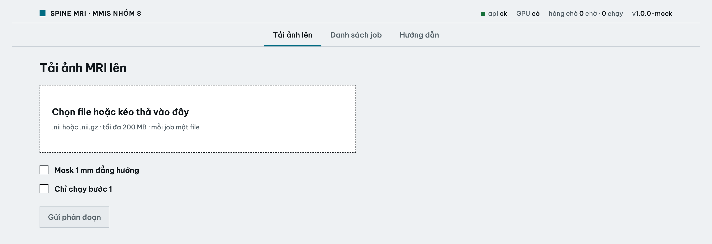

1. Bấm vào khung nét đứt để chọn file, hoặc kéo file thả vào khung.
2. Chỉ nhận file `.nii` hoặc `.nii.gz`, tối đa 200 MB, mỗi lần một file.
3. Hai ô tùy chọn để trống nếu không có yêu cầu gì đặc biệt:
   - **Mask 1 mm đẳng hướng**: trả mask ở độ phân giải 1 mm.
   - **Chỉ chạy bước 1**: chạy nhanh hơn, mọi đốt sống chung một nhãn.

   Bật một trong hai ô thì sẽ **không có bảng phân tích**.

Nếu chọn sai loại file, trang báo lỗi ngay bên dưới khung:

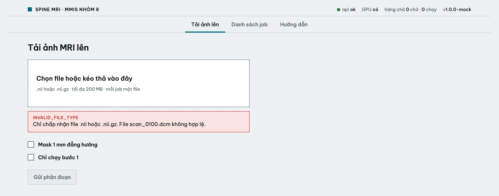

Chọn đúng file thì tên và dung lượng file hiện ra, nút **Gửi phân đoạn** sáng lên. Bấm nút để gửi.

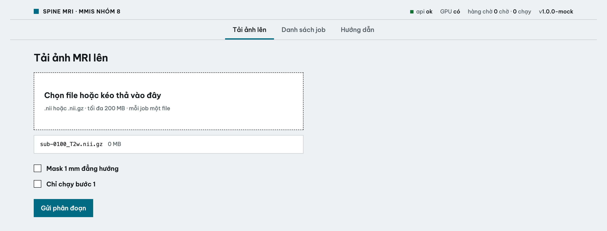

## 2. Theo dõi job

Sau khi gửi, trang chuyển sang trang của job. Thanh ở trên cho biết job đang ở bước nào. Trang tự cập nhật, không cần tải lại.

**Đang chờ**: số lớn là vị trí của job trong hàng chờ.

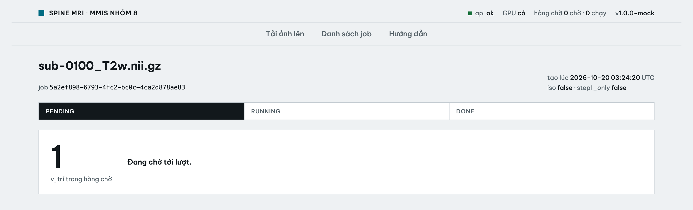

**Đang chạy**: số lớn là thời gian đã chạy. Trên GPU mỗi ca mất khoảng 20 giây.

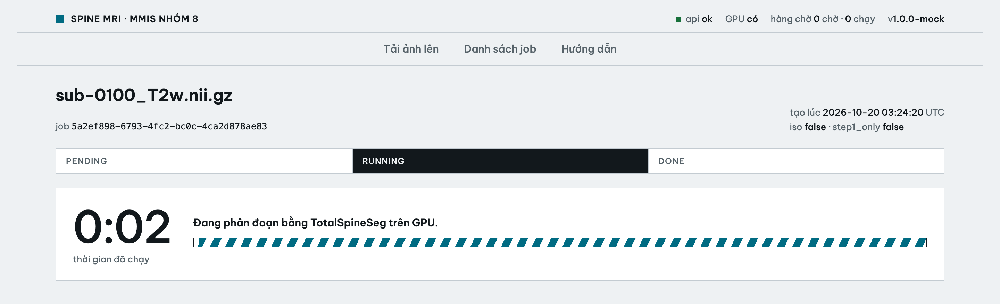

Địa chỉ trang có mã job (ví dụ `/jobs/6f57f25b-...`). Có thể lưu lại hoặc gửi cho người khác để mở lại sau.

## 3. Xem kết quả

Khi xong, trang hiện viewer ở bên trái và bảng phân tích ở bên phải.

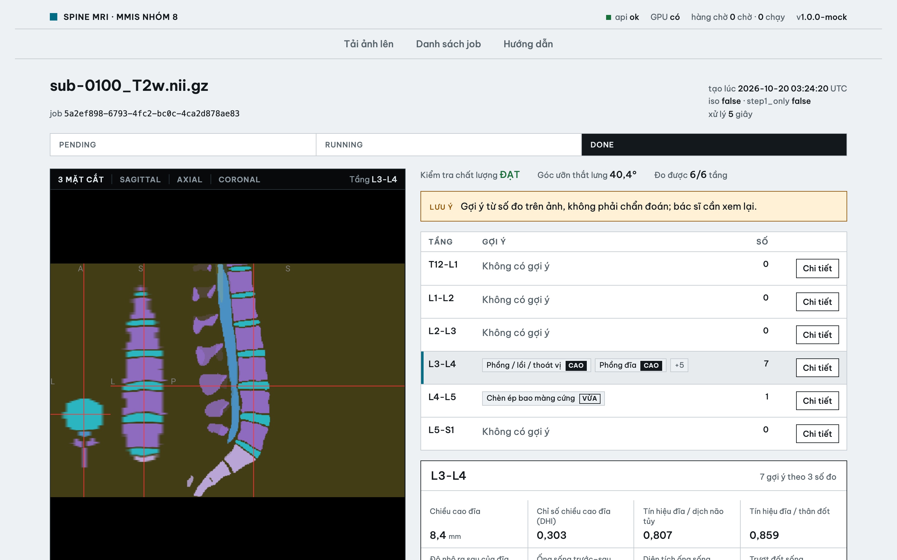

- Dòng trên cùng của bảng: kết quả kiểm tra chất lượng, góc ưỡn thắt lưng, số tầng đo được.
- Ô **Lưu ý** màu vàng: gợi ý chỉ để bác sĩ xem lại, không phải chẩn đoán.
- Bảng có 6 tầng từ T12-L1 đến L5-S1. Mỗi dòng ghi các bệnh gợi ý, độ tin cậy **CAO** hoặc **VỪA**, và tổng số gợi ý.

### Xem chi tiết một tầng

Bấm vào một dòng hoặc nút **Chi tiết**. Phần chi tiết hiện bên dưới bảng, và viewer nhảy tới đĩa đệm của tầng đó.

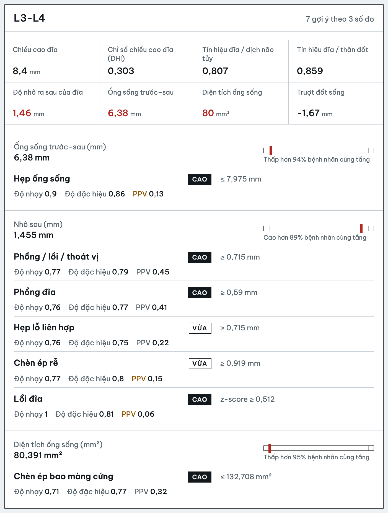

- 8 ô số đo của tầng. Số màu đỏ là số đo đã vượt ngưỡng.
- Các gợi ý được gom theo số đo. Thanh ngang cho biết số đo này cao hay thấp hơn bao nhiêu phần trăm so với 513 bệnh nhân cùng tầng.
- Mỗi gợi ý ghi ngưỡng, độ nhạy, độ đặc hiệu và PPV. PPV màu cam (dưới 0,2) nghĩa là phần lớn các lần báo là báo nhầm.

### Dùng viewer

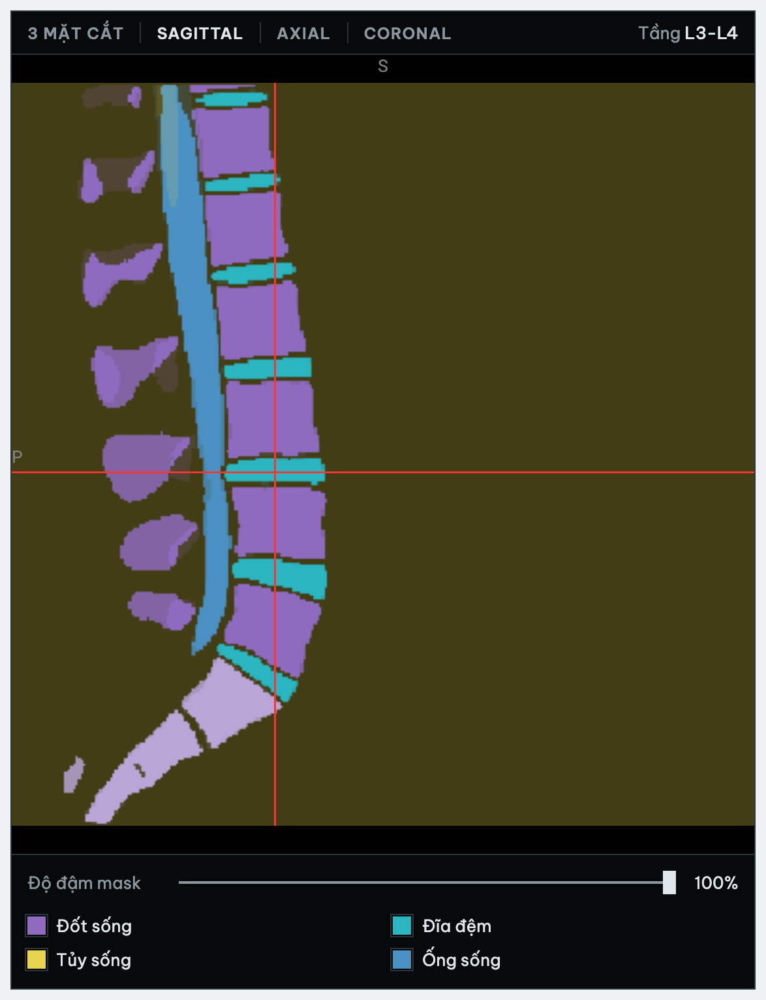

- Các nút trên cùng đổi cách xem: **3 mặt cắt**, **Sagittal**, **Axial**, **Coronal**.
- Bấm lên ảnh để đặt chữ thập đỏ tại điểm muốn xem. Lăn chuột để chuyển lát cắt.
- **Độ đậm mask**: kéo về trái để mask mờ đi, nhìn rõ ảnh gốc hơn.
- Bấm vào tên nhóm ở chú thích để ẩn hoặc hiện nhóm đó. Ví dụ dưới đây đã ẩn nhóm **Đốt sống** (chữ mờ đi, đốt sống chuyển sang xám):

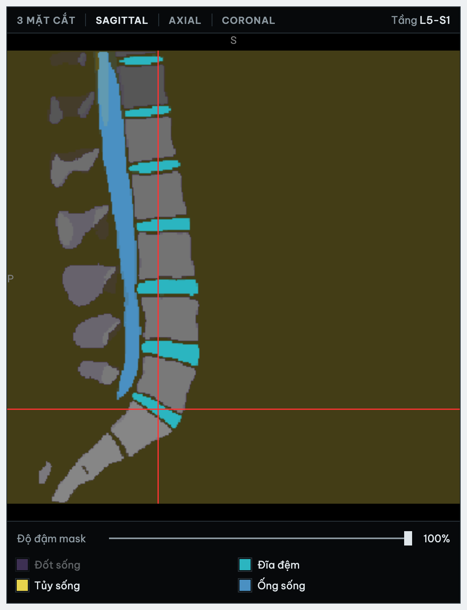

## 4. Danh sách job

Bấm **Danh sách job** trên thanh menu. Job mới nhất nằm trên cùng.

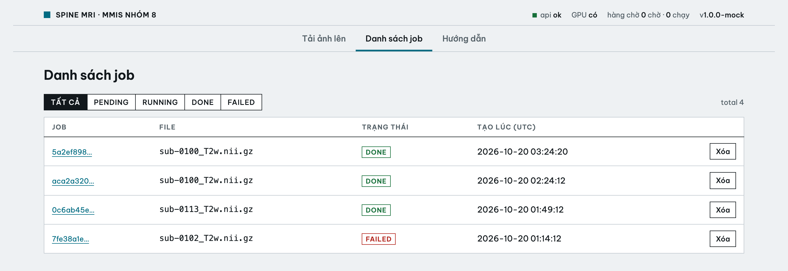

- Các nút **Tất cả / Pending / Running / Done / Failed** để lọc theo trạng thái.
- Bấm mã job (chữ xanh gạch chân) để mở job đó.

### Xóa job

Bấm **Xóa** ở cuối dòng, rồi bấm **Xác nhận xóa**. Bấm **Hủy** nếu đổi ý. Job đang chạy thì không xóa được, nút Xóa bị mờ.

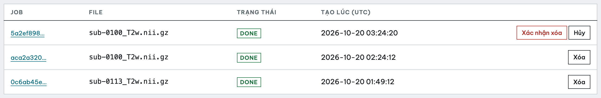

## 5. Khi job bị lỗi

Thanh trạng thái chuyển đỏ, trang hiện mã lỗi, lý do và việc nên làm.

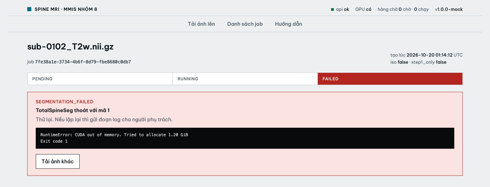

| Mã lỗi | Nên làm |
|---|---|
| `SEGMENTATION_FAILED` | Tải ảnh lên lại. Nếu vẫn lỗi, gửi đoạn log màu đen cho người phụ trách. |
| `TIMEOUT` | Ảnh có thể quá lớn, hoặc máy không có GPU. Báo người phụ trách. |
| `WORKER_INTERRUPTED` | Máy chủ vừa khởi động lại. Tải ảnh lên lại. |
| `OUTPUT_NOT_FOUND` | Lỗi hệ thống. Báo người phụ trách. |

Bảng phân tích có thể báo lỗi riêng trong khi mask vẫn xem được:

| Mã lỗi | Ý nghĩa |
|---|---|
| `NOT_SAGITTAL` | Ảnh không phải mặt cắt dọc. Chỉ phân tích được ảnh sagittal T2 thắt lưng. |
| `GEOMETRY_MISMATCH` | Tải lại ảnh, để trống ô **Mask 1 mm đẳng hướng**. |
| `ANALYSIS_FAILED` | Lỗi hệ thống. Báo người phụ trách. |

Nếu ô **Cảnh báo** hiện phía trên bảng (ví dụ ảnh có 6 đốt thắt lưng), bảng vẫn có số đo nhưng không có gợi ý, vì hệ thống không chắc đã đánh số tầng đúng.

## 6. Trên điện thoại

Trang dùng được trên điện thoại. Viewer và bảng phân tích xếp chồng lên nhau, kéo xuống để xem bảng.

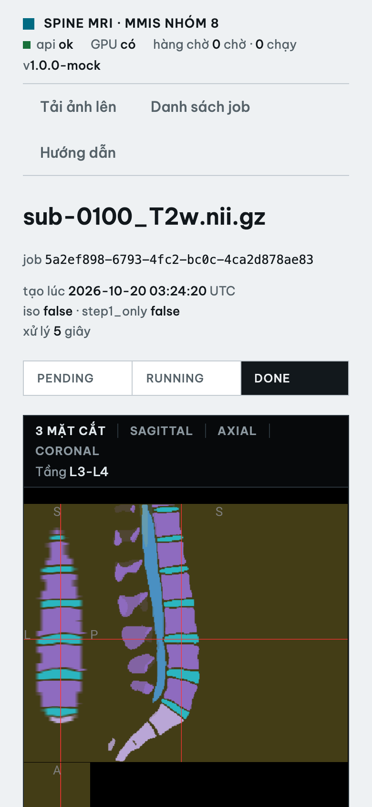

## Thanh trạng thái

Góc trên bên phải luôn hiện tình trạng máy chủ: **api ok** là kết nối được, **GPU có/không**, số job đang chờ và đang chạy. Nếu thấy **api không kết nối**, máy chủ đang tắt hoặc mất mạng.
