# Pipeline xử lý dữ liệu – MRI (chụp cộng hưởng từ) cột sống thắt lưng + ghi chú bác sĩ

Mã nguồn cho assignment môn **Modern Management Information Systems (CO5111)**, đề tài
*More Precise Diagnosis for Low Back Pain*.

**Ý tưởng chung:** đưa cả ảnh lẫn văn bản về **bảng có cấu trúc dùng chung khóa
`(patient_id, level)`** rồi mới ghép lại để phân tích:

```
MRI (DICOM) ─► s01 lập chỉ mục ─► s02 chọn series + NIfTI ─► TotalSpineSeg ─► mask ─► số đo / tầng ─┐
                                                                                                  ├─► ghép (patient_id, level) ─► insight
Ghi chú (xlsx) ─► NLP: tầng + bệnh + phủ định ─────────────────────────────────────► nhãn / tầng ──┘
```

Giải thích về bộ dữ liệu, giải phẫu và thuật ngữ y khoa: xem [`../data/README.md`](../data/README.md).

| Bước | Script (`src/…`) | Việc | Trạng thái |
|---|---|---|---|
| [1. DICOM (chuẩn ảnh y tế) → NIfTI](#1-bước-1--dicom--nifti-srcdicom) | `dicom/s01_index_dicom.py` | Lập chỉ mục header DICOM (chuẩn ảnh y tế) | ✅ Xong |
| | `dicom/s02_select_convert.py` | Chọn series (chuỗi ảnh) T2 (ảnh trọng T2, nước sáng), chuyển sang NIfTI | ✅ Xong |
| [2. Phân đoạn](#2-bước-2--phân-đoạn-totalspineseg-srcsegmentation) | `segmentation/s03_tss_pilot.py` | Cài TotalSpineSeg, chạy thử trên CPU (BN 1: phân đoạn tốt, **~15 phút/ca**) | ✅ Xong |
| | `segmentation/s04_pack_for_kaggle.py` + [`kaggle/`](kaggle/README.md) | Chạy trên Kaggle GPU (T4): **514/515 ca, ~18 s/ca, 2 giờ 41 phút**. Ca thiếu (BN 515) do chọn nhầm series phóng to → sửa quy tắc ở `s02`, chạy lại riêng ca này trên CPU | ✅ Xong |
| | `segmentation/s05_tss_qc.py` | Gộp kết quả 515 ca, QC phân đoạn: **514/515 đạt, 513 dùng được theo tầng** | ✅ Xong |
| [3. NLP ghi chú](#3-bước-3--trích-xuất-nhãn-từ-ghi-chú-bác-sĩ-bằng-rule-srcnlp) | `nlp/s06_gold_sample.py` | Tách 435 dev / 80 gold, tạo `annotations/gold_annotation.xlsx`; nhãn gold do Claude Opus 5.5 gán (silver standard) | ✅ Xong |
| | `nlp/nlp_rules.py` + `nlp/s07_nlp_extract.py` | Bộ rule (LLM tạm hoãn), lặp 4 vòng trên dev ([mục 3.10](#310-s07_nlp_extractpy--cài-đặt-và-kết-quả-trên-tập-dev)) | ✅ Xong |
| | `nlp/s08_nlp_eval.py` | Chấm rule trên gold: **F1 0,959** (tầng – khẳng định), 0,971 (bệnh nhân); nhãn cuối 515 ghi chú ([mục 3.11](#311-s08_nlp_evalpy--chấm-bộ-rule-trên-bộ-gold-và-tạo-nhãn-cuối)) | ✅ Xong |
| [4. Số đo](#4-bước-4--tính-số-đo-theo-tầng-từ-mask-srcmeasurements) | `measurements/s09_level_features.py` | 13 số đo theo tầng + góc ưỡn | ✅ Xong |
| [5. Phân tích](#5-bước-5--ghép-ảnh--văn-bản-phân-tích-srcanalysis) | `analysis/s10_level_analysis.py` | Ghép số đo ảnh × nhãn văn bản, phân tích | ✅ Xong |
| [6. Gợi ý bệnh](#6-bước-6--gợi-ý-bệnh-theo-tầng-từ-ảnh-srcanalysiss11_threshold_rulespy) | `analysis/s11_threshold_rules.py` | Học ngưỡng số đo → gợi ý bệnh theo tầng khi chỉ có ảnh, kiểm chứng chéo theo bệnh nhân: **35/54 tổ hợp dùng được** | ✅ Xong |
| [7. So với y văn](#7-bước-7--so-với-ngưỡng-y-văn-srcanalysiss12_literature_comparepy) | `analysis/s12_literature_compare.py` | Đặt ngưỡng học được cạnh ngưỡng y văn (Schönström, đường kính ống sống, độ trượt): **diện tích ống sống khớp y văn; đường kính ống sống, độ trượt lệch ~2 mm** | ✅ Xong |

`src/common.py` khai báo đường dẫn dùng chung; `src/s00_shared_data.py` tải / đóng gói mask dùng
chung trong nhóm (mục 0). Tên thư mục con trong `src/`, `outputs/tables/`, `outputs/figures/` trùng
nhau, nên script ở `src/nlp/` ghi bảng vào `outputs/tables/nlp/`.

---

## Kiến trúc hệ thống

Ba góc nhìn: (A) kiến trúc tổng thể theo tầng, đọc từ trái sang phải theo mô hình **đầu vào → xử
lý → đầu ra** – phần **đã xây** nền xanh lá, phần **đề xuất** viền đứt, người dùng nền xanh dương; (B) luồng dữ liệu đã hiện thực trong project; (C) kịch bản sử dụng khi
triển khai tại khoa chẩn đoán hình ảnh.

Ảnh PNG để chèn vào báo cáo / slide: `outputs/figures/architecture/a_layers.png`, `b_dataflow.png`, `c_use_case.png`
(render từ chính các khối Mermaid dưới đây bằng `npx @mermaid-js/mermaid-cli`).

### A. Kiến trúc tổng thể theo tầng

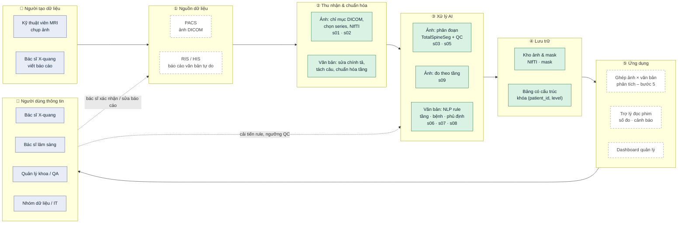

| Tầng | Thành phần | Vai trò trong hệ thống thông tin | Trạng thái |
|---|---|---|---|
| ① Nguồn | Máy MRI (cộng hưởng từ), PACS, RIS/HIS | Dữ liệu giao dịch hằng ngày của khoa (ảnh + báo cáo). Project dùng bộ dữ liệu công khai thay cho PACS/RIS thật | Thay bằng dữ liệu Mendeley |
| ② Thu nhận | s01, s02, nạp ghi chú | Làm sạch, chuẩn hóa – biến dữ liệu thô không đồng nhất thành dạng máy xử lý được | ✅ |
| ③ Xử lý AI | TotalSpineSeg, QC, đo đạc; NLP rule, bộ chuẩn vàng | Biến ảnh và văn bản thành **dữ liệu có cấu trúc** theo cùng khóa `(patient_id, level)` | ✅ |
| ④ Lưu trữ | Kho ảnh/mask; bảng có cấu trúc | Ảnh lớn tách khỏi bảng nhỏ; bảng là "kho dữ liệu" cho phân tích | ✅ (dạng file) |
| ⑤ Ứng dụng | Phân tích, dashboard, trợ lý đọc phim, màn hình duyệt | Tạo **thông tin** cho từng nhóm người dùng; vòng phản hồi cải tiến hệ thống | Bước 5 + đề xuất |

### B. Luồng dữ liệu đã hiện thực (môi trường chạy)

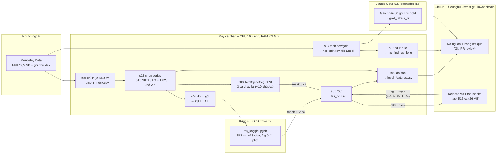

Điểm thiết kế đáng chú ý:
- **Tách tính toán nặng ra GPU đám mây** (Kaggle): CPU cá nhân ~15 phút/ca → GPU ~18 s/ca.
- **Ảnh y tế không vào Git**; chỉ mã nguồn + bảng nhỏ. Kết quả tốn kém (mask) chia sẻ qua
  Release có kiểm tra SHA-256 – thành viên khác không cần GPU.
- **Kiểm soát chất lượng ở mọi chặng**: QC hình học (s02), QC phân đoạn (s05), QC đo đạc (ảnh
  overlay s09), bộ chuẩn vàng cho NLP (s06, s08).

### C. Kịch bản sử dụng đề xuất: hỗ trợ bác sĩ đọc một ca mới

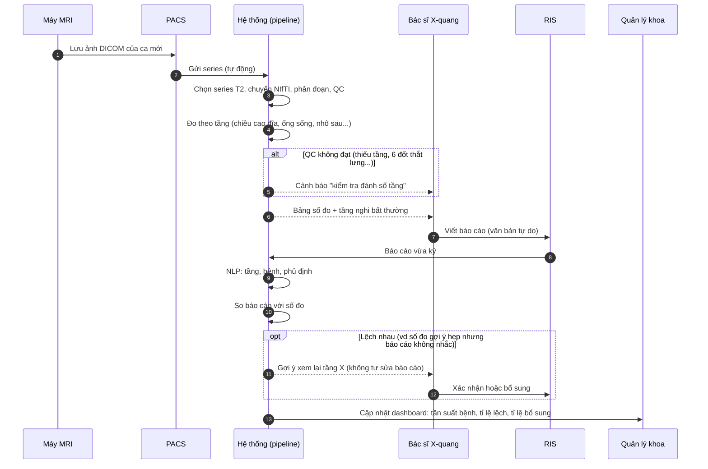

Hệ thống **không thay bác sĩ chẩn đoán**: nó chuẩn hóa dữ liệu, đo lường, và **gợi ý** chỗ cần
xem lại; mọi kết luận do bác sĩ ký (human-in-the-loop). Dashboard biến dữ liệu vận hành thành
thông tin quản lý (chất lượng báo cáo, phân bố bệnh, năng suất).

---

## 0. Chuẩn bị

```
mmis-gr8-lowbackpain/      # gốc repo
├── data/
│   ├── MRI_Data/01_MRI_Data/0001 … 0575/    # ảnh DICOM (.ima), 515 bệnh nhân
│   └── Radiologists Report.xlsx
└── pipeline/                                 # thư mục này (code + kết quả)
    ├── src/
    │   ├── common.py, s00_shared_data.py     # dùng chung
    │   ├── dicom/                            # bước 1: s01, s02
    │   ├── segmentation/                     # bước 2: s03, s04, s05
    │   ├── nlp/                              # bước 3: nlp_rules.py, s06, s07, s08
    │   ├── measurements/                     # bước 4: s09
    │   └── analysis/                         # bước 5, 6, 7: s10, s11, s12
    ├── annotations/                          # nhãn chuẩn vàng cho NLP (s06, s08)
    ├── kaggle/                               # notebook chạy TotalSpineSeg trên GPU
    └── outputs/                              # do script sinh ra
        ├── tables/, figures/                 # chia theo cùng nhóm như src/
        └── nifti/, tss/, kaggle/, release/   # file lớn, không đưa lên Git
```

```bash
cd pipeline
pip install -r requirements.txt
python src/dicom/s01_index_dicom.py        # ~2 phút
python src/dicom/s02_select_convert.py     # ~2 phút
```

### Nguồn dữ liệu và trích dẫn

Dữ liệu **không** nằm trong Git (12,5 GB, dữ liệu y tế). Tải về và đặt vào `data/` ở gốc repo theo cấu trúc trên:

| Dữ liệu | Nguồn |
|---|---|
| Ảnh MRI – cộng hưởng từ (`MRI_Data/`) | *Lumbar Spine MRI Dataset* – https://data.mendeley.com/datasets/k57fr854j2/2 (DOI 10.17632/k57fr854j2.2) |
| Ghi chú bác sĩ (`Radiologists Report.xlsx`) | *Radiologists' Notes* – https://data.mendeley.com/datasets/s6bgczr8s2/2 (DOI 10.17632/s6bgczr8s2.2) |

Khi sử dụng, trích dẫn:
- Sudirman S. *et al.*, "Lumbar Spine MRI Dataset", Mendeley Data V2, 2019. doi: 10.17632/k57fr854j2.2
- Sudirman S. *et al.*, "Radiologists' Notes for Lumbar Spine MRI Dataset", Mendeley Data V2, 2019. doi: 10.17632/s6bgczr8s2.2
- Natalia F. *et al.*, "Automated measurement of anteroposterior diameter and foraminal widths in MRI images for lumbar spinal stenosis diagnosis", *PLoS ONE* 15(11), 2020.
- TotalSpineSeg: https://github.com/neuropoly/totalspineseg

### Dữ liệu dùng chung trong nhóm

| Dữ liệu | Lấy ở đâu | Ghi chú |
|---|---|---|
| Ảnh MRI (cộng hưởng từ) + ghi chú bác sĩ (12,5 GB) | Mendeley (bảng trên) → đặt vào `data/` | Nguồn chính thức, mỗi người tự tải |
| **Mask TotalSpineSeg 515 ca** (~29 MB) | **GitHub Release `v0.1-tss-masks`** của repo | Tốn ~2,7 giờ GPU + 30 phút CPU để tạo lại → tải về thay vì chạy lại bước 2 |
| Preview mask (1 ảnh/ca, tùy chọn) | Cùng release | Để xem QC bằng mắt |
| NIfTI (2,1 GB) | Tự tạo: `python src/dicom/s02_select_convert.py` (~2 phút) | Không chia sẻ |
| Bảng kết quả, hình, nhãn gold | Git | – |

Tải mask (không cần GPU, không cần cài TotalSpineSeg):

```bash
python src/s00_shared_data.py --fetch              # mask -> outputs/tss/sag/, kiem tra SHA-256
python src/s00_shared_data.py --fetch --previews   # them anh preview
```

Sau đó chạy tiếp `s05` → `s12` (cần ảnh gốc + `s01`, `s02` cho bước đo tín hiệu ở `s09`).
Người tạo release dùng `python src/s00_shared_data.py --pack` để đóng gói lại từ
`outputs/tss/sag/` (zip + `MANIFEST.json` ghi commit, ngày, số ca, SHA-256 từng file).

### Bảng kết quả (`outputs/tables/`)

Các bảng chia thư mục con theo nhóm, trùng tên thư mục con trong `src/`. **⭐ = bảng dùng cho báo cáo hoặc làm đầu vào
cho bước sau**; các bảng còn lại là số liệu trung gian để kiểm tra / chạy lại.

| Thư mục | Bảng | Script tạo | Dùng để |
|---|---|---|---|
| `dicom/` | `dicom_index.csv` | s01 | Danh mục 48.345 file ảnh (bệnh nhân, mặt cắt, T1/T2 (ảnh trọng T1 / T2)…) – 24 MB, không đưa lên Git |
| | `series_selected.csv` | s02 | Series T2 (ảnh trọng T2, nước sáng) được chọn cho từng bệnh nhân |
| | `nifti_volumes.csv` | s02 | Thông số từng file NIfTI (số lát, pixel, QC khoảng cách lát) |
| `segmentation/` | `tss_pilot_log.csv` | s03 | Thời gian, RAM khi chạy thử TotalSpineSeg |
| | ⭐ `tss_qc.csv` | s05 | Ca nào đạt QC; cột `use_level` = 513 ca dùng được theo tầng |
| | `tss_label_stats.csv` | s05 | Thể tích, trọng tâm từng đốt / đĩa |
| `nlp/` | `nlp_split.csv` | s06 | Ghi chú thuộc tập dev hay gold |
| | `nlp_findings_long_{dev,all}.csv` | s07 | Mỗi phát hiện rule tìm được 1 dòng, kèm câu gốc (`dev` = 435 ghi chú, `all` = 515) |
| | `nlp_sentences_{dev,all}.csv` | s07 | Từng câu: tầng gán, số phát hiện |
| | `nlp_unmatched_{dev,all}.csv` | s07 | Câu rule chưa hiểu – để bổ sung mẫu |
| | `nlp_typo_hits_{dev,all}.csv` | s07 | Số lần sửa từng lỗi chính tả |
| | ⭐ `nlp_eval_summary.csv` | s08 | **F1 tổng** của bộ rule trên bộ gold |
| | ⭐ `nlp_eval_per_finding.csv` | s08 | F1 từng bệnh |
| | `nlp_eval_errors.csv` | s08 | 28 lỗi của rule, kèm câu gốc |
| | ⭐ `labels_level.csv` | s08 | **Nhãn cuối theo tầng** – đầu vào bước 5 |
| | ⭐ `labels_patient.csv` | s08 | **Nhãn cuối theo bệnh nhân** – bảng tần suất bệnh |
| `measurements/` | ⭐ `level_features.csv` | s09 | **13 số đo mỗi tầng** – đầu vào bước 5 |
| | `patient_features.csv` | s09 | Góc ưỡn, tuổi, giới |
| `analysis/` | `analysis_level_dataset.csv` | s10 | Bảng đã ghép số đo × nhãn (trung gian) |
| | ⭐ `analysis_assoc.csv` | s10 | **AUC, ngưỡng** từng cặp số đo ↔ nhãn |
| | ⭐ `analysis_discordance.csv` | s10 | **Số ca lệch** giữa ảnh và báo cáo |
| | `analysis_discordance_cases.csv` | s10 | Danh sách từng ca lệch (để bác sĩ xem lại) |
| | ⭐ `analysis_patient.csv` | s10 | Tuổi ↔ tín hiệu đĩa, góc ưỡn ↔ co cứng cơ |
| | ⭐ `threshold_rules.csv` | s11 | **Ngưỡng gợi ý bệnh theo tầng** + số liệu kiểm chứng chéo |
| | `threshold_cv_by_level.csv` | s11 | Ngưỡng z chung: kiểm chứng chéo tách theo tầng |
| | `measure_reference.csv` | s11 | Trung bình, độ lệch chuẩn, phân vị số đo theo tầng (tính z cho BN mới) |
| | `literature_compare.csv` | s12 | Ngưỡng y văn đặt cạnh ngưỡng học được: độ nhạy / độ đặc hiệu / PPV của cả hai trên cùng 513 BN |

Đường dẫn các thư mục này khai báo trong `src/common.py` (`T_*` cho bảng, `F_*` cho hình).
Các script dùng đa tiến trình (16 luồng CPU); thời gian ở trên đo trên máy CPU 16 luồng, RAM 7,3 GB.

---

## 1. Bước 1 – DICOM → NIfTI (`src/dicom/`)

Hai script: `s01` đọc header để biết mỗi bệnh nhân có series nào, `s02` chọn series T2 (ảnh trọng T2, nước sáng) và
chuyển sang NIfTI. Đầu ra: `outputs/tables/dicom/`, `outputs/figures/dicom/`, `outputs/nifti/`.

### 1.1. `s01_index_dicom.py` – Lập chỉ mục header DICOM (chuẩn ảnh y tế)

#### Mục đích
Đọc **chỉ phần header** (không đọc pixel) của toàn bộ 48.345 file `.ima` để biết mỗi
bệnh nhân có những series nào, mặt cắt gì, T1 hay T2 (ảnh trọng T1: mỡ sáng; ảnh trọng T2: nước, dịch sáng) – làm cơ sở chọn series ở s02.

#### DICOM (chuẩn ảnh y tế): mỗi file = header + pixel

```
┌──────────────────────────────────────────────┐
│ HEADER: hàng trăm tag (thông tin mô tả)      │  ← s01 chỉ đọc phần này
├──────────────────────────────────────────────┤
│ PIXEL DATA: ma trận ví dụ 384×384, 12-bit    │  ← s02 mới đọc
└──────────────────────────────────────────────┘
```

Tổ chức dữ liệu theo 4 cấp:

| Cấp | Ví dụ (BN 0001) | Ý nghĩa |
|---|---|---|
| Bệnh nhân | `0001/` | Một người |
| Study | `L-SPINE_LSS_20160309_091629_240000/` | Một lần vào máy chụp |
| **Series** | `T2_TSE_SAG_384_0002/` | Một lượt quét liên tục, cùng cài đặt (T2 (ảnh trọng T2, nước sáng), sagittal – mặt cắt dọc, nhìn nghiêng từ bên hông) |
| Instance | `T2_TSE_SAG__0001_001.ima` | Một lát cắt 2D |

#### Các tag được đọc

| Nhóm | Tag | Dùng để |
|---|---|---|
| Bệnh nhân | `PatientAge`, `PatientSex` | Thông tin nhân khẩu. `PatientID` **đã bị ẩn danh (rỗng)**, nên mã BN lấy từ **tên thư mục** |
| Tổ chức | `StudyInstanceUID`, `SeriesInstanceUID`, `SeriesNumber`, `SeriesDescription`, `InstanceNumber` | Nhóm lát thành series, nhận diện loại chuỗi xung |
| **Hình học** | `ImageOrientationPatient`, `ImagePositionPatient`, `PixelSpacing`, `SliceThickness`, `SpacingBetweenSlices` | Xác định mặt cắt, vị trí lát trong không gian, quy đổi pixel ra mm |
| Chụp | `EchoTime`, `RepetitionTime`, `MagneticFieldStrength` | Kiểm tra chéo T1/T2 (T2 (ảnh trọng T2, nước sáng) có TE – thời gian vang – > 60 ms) |

#### Quy tắc xác định mặt cắt
**Không tin tên thư mục.** Mặt cắt tính từ `ImageOrientationPatient` (6 số = 2 vector
hướng hàng và hướng cột của ảnh, trong hệ tọa độ bệnh nhân LPS: x → trái, y → sau
lưng, z → lên đầu):

- Pháp tuyến của lát = tích có hướng của 2 vector.
- Pháp tuyến gần trục **x** → **SAG (mặt cắt dọc)**; trục **y** → COR (mặt cắt đứng ngang); trục **z** → **AX (mặt cắt ngang)**.

Ví dụ BN 0001: T2 (ảnh trọng T2, nước sáng) SAG (mặt cắt dọc) có hàng (0, 1, 0), cột (−0,03, 0, −1) → pháp tuyến ≈ (−1, 0, 0)
→ sagittal (mặt cắt dọc).

Đồng thời đánh cờ `is_localizer` (ảnh định vị) và `is_posdisp` (ảnh phụ trợ máy tự
sinh) để loại.

#### Đầu ra
`outputs/tables/dicom/dicom_index.csv` – 48.345 dòng × 38 cột (mỗi file `.ima` một dòng).
In lại tóm tắt mà không đọc lại file: `python src/dicom/s01_index_dicom.py --summary`.

#### Kết quả

| Chỉ số | Giá trị |
|---|---|
| Bệnh nhân | 515 |
| Tổng lát | 48.345 = 5.544 localizer (ảnh định vị) + 1.895 POSDISP (ảnh phụ trợ) + **40.922 ảnh chính** |
| Có T2 TSE (chuỗi xung Turbo Spin Echo) SAG (mặt cắt dọc) / T2 TSE (chuỗi xung T2 nhanh) AX (mặt cắt ngang) | **515 / 515** và **515 / 515** |
| BN có > 1 study | 38 (vd BN 230 có thêm một study **chụp bụng**) |
| BN có > 1 series T2 TSE (chuỗi xung T2 nhanh) SAG (mặt cắt dọc) / AX (mặt cắt ngang) | 31 / 57 |

#### Phát hiện về dữ liệu
1. **Tên series có thể sai:** 75 lát của 4 BN (169, 230, 243, 532) tên `t2_tse_sag_…`
   nhưng hướng thực tế **không phải sagittal (mặt cắt dọc)** → xác nhận phải dùng tag hướng.
2. **Không phải cứ tên có "t2" là T2 (ảnh trọng T2, nước sáng) chuẩn:** 1.445 lát như `t2_tirm` (STIR – chuỗi xung xóa tín hiệu mỡ, TE (thời gian vang) 35 ms),
   `t2_trufi`, `t2_ciss3d` có độ tương phản khác → **chỉ dùng `t2_tse`**.
3. **Thứ tự thư mục không nói lên study nào là cột sống:** `ABDOMEN_…` đứng trước
   `L-SPINE_…` theo bảng chữ cái → chọn study theo nội dung, không theo thứ tự.

---

### 1.2. `s02_select_convert.py` – Chọn series và chuyển sang NIfTI

#### Vì sao phải chuyển DICOM (chuẩn ảnh y tế) → NIfTI

| | DICOM (gốc) | NIfTI (sau chuyển) |
|---|---|---|
| Cách lưu | **Mỗi lát một file**, hình học rải rác trong từng header | **Một file = cả khối 3D**, hình học gói trong một header |
| Ai dùng | Máy chụp, PACS bệnh viện | nnU-Net, **TotalSpineSeg**, SimpleITK, nibabel |

1. **TotalSpineSeg (nnU-Net) chỉ nhận `.nii.gz` 3D.**
2. **Làm sạch một lần, dùng chung cho mọi bước sau:** sắp lát, bỏ lát trùng, tách khối
   axial (mặt cắt ngang), loại series sai tên – nếu không thì mỗi bước sau phải tự xử lý lại.
3. **Gọn hơn:** 12,5 GB DICOM (chuẩn ảnh y tế) → 2,1 GB NIfTI nén (chỉ giữ T2 (ảnh trọng T2, nước sáng) cần dùng).

NIfTI giữ nguyên pixel và hình học (spacing, hướng, gốc tọa độ mm). Thông tin bệnh
nhân/series nằm ở `dicom_index.csv`, `series_selected.csv`. DICOM (chuẩn ảnh y tế) gốc không bị sửa.

#### Quy tắc chọn series

Chỉ xét ảnh chính, tên chứa `t2_tse`, mặt cắt theo **hướng thực tế**.

| | Thứ tự ưu tiên |
|---|---|
| **SAG (mặt cắt dọc)** | study `L-SPINE*` → **trường nhìn (FOV = `Rows` × `PixelSpacing`) ≥ 250 mm** → **tâm series cách tâm vùng ảnh axial (cùng study) ≤ 100 mm** → nhiều **vị trí lát khác nhau** nhất → series chụp sau (`SeriesNumber` lớn hơn, thường là chụp lại do lần đầu bị rung) |
| **AX (mặt cắt ngang)** | **cùng study với SAG (mặt cắt dọc) đã chọn** (để chung hệ tọa độ) → study `L-SPINE*` → nhiều vị trí lát nhất → chụp sau |

Kết quả: 0 ca AX (mặt cắt ngang) khác study với SAG (mặt cắt dọc).

**Vì sao cần điều kiện FOV (trường nhìn):** phiên bản đầu chỉ ưu tiên "nhiều lát nhất" nên với BN 515
đã chọn `t2_tse_sag_448` – ảnh **chụp phóng to** (25 lát, pixel 0,42 mm, FOV (trường nhìn) chỉ 160 mm)
thay vì `t2_tse_sag_384` chuẩn (15 lát, FOV (trường nhìn) 280 mm). Ảnh phóng to không đủ mốc giải phẫu
nên TotalSpineSeg không đánh số tầng được (ca duy nhất thất bại trên Kaggle). Sau khi thêm
điều kiện FOV (trường nhìn) ≥ 250 mm, chỉ BN 515 đổi series; 514 ca còn lại giữ nguyên (đã đối chiếu
`series_selected.csv` và `nifti_volumes.csv` trước/sau). FOV (trường nhìn) của series SAG (mặt cắt dọc) được chọn:
510 ca 280 mm, 4 ca 260–300 mm.

**Vì sao cần điều kiện gần vùng axial (mặt cắt ngang):** QC ở bước 2 phát hiện 2 ca có hai series T2 (ảnh trọng T2, nước sáng) SAG (mặt cắt dọc)
đặt ở **hai vùng khác nhau** và quy tắc cũ chọn nhầm: BN 420 chọn series vùng **ngực**
(C7–T12, tâm cách vùng axial (mặt cắt ngang) 237 mm thay vì series thắt lưng cách 3 mm); BN 542 chọn series
**lệch xuống chậu** (chỉ thấy L3 → xương cùng, cách 109 mm thay vì 11 mm). Ảnh axial (mặt cắt ngang) luôn
được chụp tại các đĩa thắt lưng nên dùng làm mốc: series SAG (mặt cắt dọc) đúng là series có tâm gần vùng
axial (mặt cắt ngang). Dùng **ngưỡng 100 mm** thay vì "gần nhất" để không đổi lựa chọn của các BN có series
chụp lại cùng vị trí (chỉ lệch vài mm). Kết quả: chỉ BN 420 và 542 đổi series; mọi series
SAG (mặt cắt dọc) được chọn cách vùng axial (mặt cắt ngang) tối đa 66 mm (trung vị 25 mm). Tâm lát tính theo z (đầu–chân):
`ImagePositionPatient` + nửa số hàng × hướng cột + nửa số cột × hướng hàng.

#### Vì sao ảnh axial (mặt cắt ngang) có nhiều khối

Đây là **quy trình chụp chuẩn**, không phải lỗi dữ liệu:

- Cột sống thắt lưng cong ưỡn → các đĩa **nghiêng khác nhau** (L5-S1 nghiêng nhất, ≈ 29°
  ở BN 0001). Kỹ thuật viên xoay mặt cắt **song song với từng đĩa** để lát cắt vuông góc
  qua đĩa; cắt chéo sẽ làm méo hình (đĩa trông như phồng, diện tích ống sống đo sai).
- Bệnh tập trung ở 3 đĩa dưới → chụp mỗi đĩa một khối 4–5 lát (≈ 16–20 mm) thay vì phủ
  liên tục ~150 mm → tiết kiệm khoảng 2/3 thời gian chụp.

```
        ┌──┐
        │L3│
        └──┘
   ━━━━ ════ ━━━━   ← khối b1: gần như nằm ngang
        ┌──┐
        │L4│
        └──┘
   ━━━━ ════ ━━━━   ← khối b2: hơi nghiêng
        ┌──┐
        │L5│
     ╲╲╲╲ ════ ╲╲╲  ← khối b3: nghiêng nhiều
           ╲S1╲
```

Vì vậy **không được gộp cả series axial (mặt cắt ngang) thành một khối 3D** (như chồng 3 xấp giấy
nghiêng khác nhau rồi coi là một ram thẳng → hình học sai). Mỗi khối thành một NIfTI riêng.

#### Các bước xử lý

1. **Tách khối axial (mặt cắt ngang):** gom lát theo hướng (`ImageOrientationPatient` làm tròn 2 chữ số),
   rồi tách tiếp nếu có **khoảng nhảy vị trí > 1,5 lần khoảng cách thường** (hai khối cho
   hai đĩa khác nhau tình cờ trùng góc nghiêng). Series SAG (mặt cắt dọc) có > 1 hướng thì giữ khối lớn nhất.
2. **Sắp lát theo vị trí thật** dọc pháp tuyến (`ImagePositionPatient · pháp tuyến`),
   không theo `InstanceNumber`.
3. **Bỏ lát trùng** (cùng vị trí).
4. **Ghép thành khối 3D** và gắn hình học: spacing = (`PixelSpacing` cột, hàng, khoảng cách
   lát trung vị), gốc = vị trí lát đầu, hướng = (vector hàng, vector cột, pháp tuyến).
   SimpleITK tự đổi hệ LPS (DICOM) sang RAS (NIfTI) khi ghi file.
5. **Kiểm tra** khoảng cách giữa các lát có đều không (sai lệch < 0,1 mm).
6. **Ảnh QC:** chiếu lát giữa của từng khối axial (mặt cắt ngang) lên lát sagittal (mặt cắt dọc) giữa bằng tọa độ mm thật.

#### Đầu ra

| File | Nội dung |
|---|---|
| `outputs/nifti/sag/0001.nii.gz` | 515 khối sagittal (mặt cắt dọc) |
| `outputs/nifti/ax/0001_b1.nii.gz`, `_b2`, … | 1.823 khối axial (mặt cắt ngang); `b1` = khối cao nhất (gần đầu), số tăng dần xuống dưới |
| `outputs/tables/dicom/series_selected.csv` | Series được chọn cho mỗi BN, số ứng viên, có cùng study không |
| `outputs/tables/dicom/nifti_volumes.csv` | Mỗi file NIfTI một dòng: số lát, spacing, số lát trùng đã bỏ, QC khoảng cách |
| `outputs/figures/dicom/qc_geometry.png` | Vị trí các khối axial (mặt cắt ngang) chiếu lên ảnh sagittal (mặt cắt dọc) |

`outputs/nifti/` nằm trong `.gitignore` (ảnh y tế, ~2,1 GB).

#### Kết quả

| | Sagittal (mặt cắt dọc) | Axial (mặt cắt ngang) |
|---|---|---|
| Số file | 515 | 1.823 khối |
| Số lát | 13–15 | đa số 4–5 / khối |
| Kích thước pixel | 0,68–0,88 mm | 0,50–0,89 mm |
| Khoảng cách lát | 4,8–5,4 mm | 3,6–6,0 mm |
| Khoảng cách lát không đều | 0 | 0 |

Số khối axial (mặt cắt ngang) mỗi bệnh nhân:

| Số khối | 1 | 2 | **3** | 4 | 5 | 6 |
|---|---|---|---|---|---|---|
| Số BN | 18 | 1 | **272** | 135 | 87 | 2 |

- **3 khối** = quy trình chuẩn (L3-L4, L4-L5, L5-S1).
- **4–5 khối** = chụp thêm tầng trên (L2-L3, L1-L2).
- **1 khối** (18 BN) = quy trình khác: một chồng 15–25 lát song song phủ cả vùng.

→ Ảnh axial (mặt cắt ngang) chỉ có ở **3–5 tầng dưới**; tầng trên (L1-L2) thường chỉ có sagittal (mặt cắt dọc).

#### Các vấn đề dữ liệu đã gặp và cách xử lý

| Vấn đề | Số ca | Xử lý |
|---|---|---|
| **Mỗi lát bị lưu 2 lần** (pixel giống hệt, chỉ khác `SOPInstanceUID`) – gây lỗi "spacing = 0" | 19 BN, 618 lát thừa | Bỏ lát trùng vị trí; khi chọn series đếm **số vị trí lát khác nhau** thay vì số file |
| **Hai khối axial (mặt cắt ngang) trùng góc nghiêng** bị gộp → khoảng nhảy 9–81 mm | 32 khối | Tách theo khoảng nhảy vị trí |
| Nhiều series ứng viên | 45 BN (SAG), 57 BN (AX) | Quy tắc ưu tiên ở trên, ghi lại trong `series_selected.csv` |
| Series tên "sag" nhưng thực tế không phải SAG (mặt cắt dọc) | 4 BN | Chọn theo hướng thực tế |
| Series SAG (mặt cắt dọc) **phóng to** (FOV (trường nhìn) 160 mm) có nhiều lát hơn series chuẩn | 1 BN (515) | Ưu tiên FOV (trường nhìn) ≥ 250 mm trước số lát |
| Hai series T2 (ảnh trọng T2, nước sáng) SAG (mặt cắt dọc) ở **hai vùng khác nhau** (ngực / chậu) | 2 BN (420, 542) | Ưu tiên series có tâm cách vùng axial (mặt cắt ngang) ≤ 100 mm |

#### Kiểm tra hình học (QC)

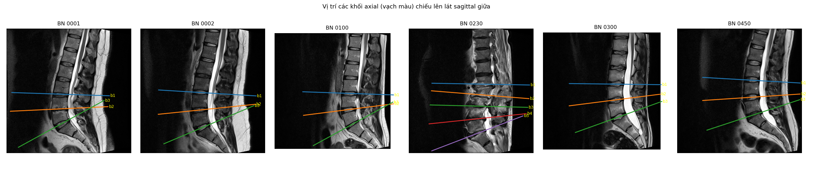

Các vạch màu (vị trí khối axial (mặt cắt ngang) b1, b2, …) rơi **đúng vào các đĩa thắt lưng dưới** trên
ảnh sagittal (mặt cắt dọc) → tọa độ ảnh sagittal (mặt cắt dọc) và axial (mặt cắt ngang) **khớp nhau** sau khi chuyển đổi (ảnh được vẽ
từ chính file NIfTI). Đây là điều kiện để sau này biết mỗi khối axial (mặt cắt ngang) thuộc tầng đĩa nào.

#### Lưu ý cho bước sau
Mỗi khối axial (mặt cắt ngang) chỉ 4–5 lát (16–20 mm) – có thể quá mỏng để TotalSpineSeg tự phân đoạn
tốt. Bước 2 sẽ chạy thử để kiểm chứng; nếu không ổn, dùng mask sagittal (mặt cắt dọc) để xác định tầng
của từng khối bằng phép chiếu tọa độ như ảnh QC ở trên.

---

## 2. Bước 2 – Phân đoạn TotalSpineSeg (`src/segmentation/`)

Ba script: `s03` chạy thử TotalSpineSeg trên CPU, `s04` đóng gói để chạy cả 515 ca trên Kaggle
GPU, `s05` gộp kết quả và QC. Đầu ra: `outputs/tss/`, `outputs/tables/segmentation/`,
`outputs/figures/segmentation/`.

### 2.1. `s03_tss_pilot.py` – Chạy thử trên CPU

Cài TotalSpineSeg và chạy thử trên vài ca để đo thời gian, RAM và xem kết quả. BN 1 phân đoạn
tốt nhưng mất **~15 phút/ca** (RAM đỉnh 3,9 GB) → 515 ca ≈ 5 ngày, quá chậm → chuyển sang GPU
(2.2). Script này cũng dùng để **chạy lại riêng** 3 ca sau khi sửa quy tắc chọn series (BN 515,
420, 542; ~10 phút/ca).

```bash
python src/segmentation/s03_tss_pilot.py sag 1 2 100 230 300     # ảnh sagittal
python src/segmentation/s03_tss_pilot.py ax 1                     # mọi khối axial của BN 1
```

Kết quả: `outputs/tss_pilot/<tên>/` + 1 dòng log trong `outputs/tables/segmentation/tss_pilot_log.csv`.

### 2.2. `s04_pack_for_kaggle.py` – Chạy 515 ca trên Kaggle GPU

`s04` đóng gói 515 ảnh NIfTI sagittal (mặt cắt dọc) thành `outputs/kaggle/lumbar_sag_nifti.zip` (1,2 GB) để
upload lên Kaggle; notebook [`kaggle/tss_kaggle.ipynb`](kaggle/README.md) chạy TotalSpineSeg trên
GPU T4: **514/515 ca, ~18 s/ca, 2 giờ 41 phút**, trả về `outputs/kaggle/tss_sag_results.zip`.
Ca thiếu (BN 515) do chọn nhầm series phóng to → sửa quy tắc ở `s02`, chạy lại trên CPU bằng `s03`.
Hướng dẫn từng bước: [`kaggle/README.md`](kaggle/README.md).

### 2.3. `s05_tss_qc.py` – QC kết quả phân đoạn

#### Mục đích
Kiểm tra mask của **cả 515 ca** trước khi dùng để đo đạc: mask sai tầng thì mọi số đo ở
bước 4 bị ghép nhầm với nhãn của tầng khác ở bước 5.

#### Đầu vào
- `outputs/kaggle/tss_sag_results.zip` – 514 ca chạy trên Kaggle (không cần giải nén tay).
- Các ca **chạy lại trên CPU** sau khi sửa quy tắc chọn series (s02), **ghi đè** kết quả
  Kaggle của chính ca đó: `outputs/tss_pilot/sag_0515/output/` (BN 515 – điều kiện FOV),
  `outputs/tss_pilot/sag_0420_0542/output/` (BN 420, 542 – điều kiện gần vùng axial).
  Mỗi ca ~10 phút trên CPU.
- `outputs/nifti/sag/*.nii.gz` – ảnh gốc, để so kích thước.

#### Các kiểm tra tự động (mỗi ca)

| Mã lỗi | Kiểm tra | Vì sao |
|---|---|---|
| `geom` | Mask cùng kích thước, spacing, gốc tọa độ với ảnh gốc | Mask lệch → mọi số đo sai |
| `missing_vert` | Có đủ đốt L1–L5 (41–45) và xương cùng (50) | Thiếu đốt → không đo được tầng đó |
| `missing_disc` | Có đủ đĩa L1-L2, L2-L3, L3-L4, L4-L5, L5-S (92–95, 100) | Như trên; T12-L1 (91) không bắt buộc |
| `missing_canal` | Có ống sống (2) | Cần để đo hẹp ống sống |
| `order` | Theo trục đầu–chân (z): L1 > đĩa L1-L2 > L2 > … > L5 > đĩa L5-S > xương cùng (tọa độ trọng tâm, mm) | Thứ tự sai = đánh số tầng sai |
| `fragmented` | Khối liền lớn nhất chiếm ≥ **90 %** thể tích nhãn (**đĩa**) / ≥ **70 %** (**đốt**) | Một nhãn nằm ở hai chỗ → khả năng gán nhầm nhãn |
| `volume_outlier` | Thể tích mỗi đốt/đĩa so với phân bố 515 ca: lệch quá 4 MAD so với trung vị, hoặc < 25 % trung vị | Mask quá nhỏ/quá to bất thường |
| `transitional` | Có nhãn **L6** (46) = 6 đốt thắt lưng (đốt sống chuyển tiếp) | Không chắc ghép đúng tầng với ghi chú bác sĩ (xem dưới) |

- Ca **đạt** (`qc_pass`) = không có lỗi `geom` → `fragmented`. `volume_outlier` chỉ là
  **cảnh báo** (có thể là bệnh thật, vd đĩa xẹp), không loại ca.
- **`use_level`** = đạt QC **và** không `transitional` → dùng cho phân tích **theo tầng** ở
  bước 5. Ca `transitional` vẫn dùng cho phân tích **mức bệnh nhân**.

#### Vì sao ngưỡng `fragmented` khác nhau cho đốt và đĩa
Lần chạy đầu dùng chung 90 % → **323 ca bị gắn cờ sai**. Phân tích lại:
- **Đĩa** luôn liền một khối (5 % thấp nhất vẫn ≥ 0,999).
- **Đốt**: phân bố hai nhóm – 55 % đốt ≥ 0,99 (liền khối), **26 % ở 0,80–0,90**, chỉ 2 đốt
  < 0,80. Kiểm tra 40 đốt bị tách ngẫu nhiên: phần tách ra **luôn nằm phía sau** thân đốt
  (trung vị 34 mm), **đúng đường giữa** (lệch trái/phải 1,8 mm), thấp hơn ~19 mm và trên
  các **lát giữa** → đó là **mỏm gai / bản sống**. Thân đốt và mỏm gai chỉ nối với nhau qua
  **cuống sống ở hai bên** (cách đường giữa ~10–15 mm); với lát sagittal (mặt cắt dọc) cách nhau 4,8 mm,
  cầu nối mảnh này thường rơi vào khe giữa hai lát → mask tách thành 2 khối. Đây là giới hạn
  độ dày lát, không phải lỗi phân đoạn.
- Một ca bị gắn cờ nếu **bất kỳ** đốt nào trong 5 đốt dưới ngưỡng → 323/515 ca.
- Ngưỡng 0,7 cho đốt nằm giữa nhóm bình thường (≥ 0,8) và nhóm bất thường thật.
- **Hệ quả cho bước 4:** khi đo thân đốt, chỉ giữ khối liền lớn nhất (thân đốt), bỏ mỏm gai.

#### Đốt sống chuyển tiếp (6 đốt thắt lưng) – BN 113, 245
TotalSpineSeg đếm từ trên xuống (từ T12) và gán nhãn L6 cho đốt dưới cùng. Bác sĩ chụp riêng
thắt lưng thường đếm từ dưới lên (từ xương cùng). Với 6 đốt, **cùng một đĩa có thể mang hai
tên** (vd "L4-L5" của bác sĩ = "L5-L6" của TotalSpineSeg). Không ghi chú nào trong 515 ghi chú
nhắc biến thể này (tìm "lumbarization", "sacralization", "transitional", "L6": 0 kết quả)
→ không biết bác sĩ đếm theo cách nào → loại 2 ca khỏi phân tích theo tầng (`use_level =
False`), giữ ở mức bệnh nhân. Đây cũng là một phát hiện cho báo cáo: báo cáo X-quang không
ghi lại biến thể giải phẫu – rủi ro sai tầng mà hệ thống tự động có thể cảnh báo.

#### Đầu ra
| File | Nội dung |
|---|---|
| `outputs/tss/sag/step2_output/`, `step1_levels/`, `preview/` | Kết quả gộp 515 ca, một nơi duy nhất cho các bước sau |
| `outputs/tables/segmentation/tss_qc.csv` | Mỗi ca một dòng: các cờ lỗi, `issues`, `qc_pass`, `transitional`, `use_level` |
| `outputs/tables/segmentation/tss_label_stats.csv` | Mỗi (ca, nhãn) một dòng: thể tích mm³, trọng tâm (x, y, z) mm, tỉ lệ khối liền lớn nhất – dùng lại ở bước 4 |
| `outputs/figures/segmentation/qc_random.png` | Preview 20 ca ngẫu nhiên (seed 2026) |
| `outputs/figures/segmentation/qc_flagged.png` | Preview các ca bị gắn cờ (tối đa 20) |

Chạy: `python src/segmentation/s05_tss_qc.py` (~1 phút)

#### Kết quả

| Chỉ số | Giá trị |
|---|---|
| Số ca | 515 (514 Kaggle + 3 ca chạy lại trên CPU, ghi đè) |
| **Đạt QC** | **514 / 515** |
| Lỗi hình học / thứ tự tầng / thiếu ống sống | **0 / 0 / 0** |
| Lỗi còn lại | BN 245 – thiếu nhãn đĩa L5-S1, do có 6 đốt thắt lưng |
| Đốt chuyển tiếp (L6) | 2 (BN 113, 245) |
| Cảnh báo thể tích | 4 (BN 113, 229, 344, 570) – xem ảnh thấy bình thường |
| Có đĩa T12-L1 | 515 / 515 |
| **Dùng cho phân tích theo tầng (`use_level`)** | **513 / 515** |

Thể tích trung vị (mm³) hợp lý về giải phẫu – thân đốt to dần từ L1 xuống L4, đĩa L4-L5
lớn nhất:

| L1 | L2 | L3 | L4 | L5 | xương cùng | ống sống |
|---|---|---|---|---|---|---|
| 30.709 | 36.275 | 40.601 | 41.357 | 39.915 | 100.083 | 38.784 |

| T12-L1 | L1-L2 | L2-L3 | L3-L4 | L4-L5 | L5-S1 |
|---|---|---|---|---|---|
| 4.504 | 6.526 | 8.858 | 10.683 | 11.076 | 8.969 |

**Quá trình QC đã phát hiện và sửa 3 lỗi chọn series ở s02** (BN 515, 420, 542 – xem
s02): cả 3 đều thấy rõ trên ảnh preview (vùng ngực, vùng chậu, ảnh phóng to) và sau khi
sửa đều đạt QC. Kiểm tra bằng mắt 20 ca ngẫu nhiên (`segmentation/qc_random.png`): cả 20 đánh số
tầng đúng thứ tự.

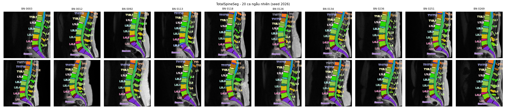

---

## 3. Bước 3 – Trích xuất nhãn từ ghi chú bác sĩ bằng rule (`src/nlp/`)

> Mục 3.1–3.9 là **thiết kế** (viết trước khi cài đặt); 3.10–3.11 là cài đặt và kết quả. Phần
> thiết kế là hợp đồng chung cho ba bên: (1) code rule, (2) người gán nhãn bộ chuẩn vàng, (3) một
> phương pháp LLM có thể thêm sau (tạm hoãn). Cả ba phải dùng **cùng định nghĩa** ở mục 3.4–3.6
> thì so sánh mới có ý nghĩa.

### 3.1. Mục tiêu

Biến 515 ghi chú tự do (tiếng Anh) trong `data/Radiologists Report.xlsx` thành nhãn có cấu
trúc **theo từng tầng đĩa đệm**, để bước 5 ghép với số đo từ ảnh theo khóa
`(patient_id, level)`.

| | |
|---|---|
| Đầu vào | `Radiologists Report.xlsx` – cột `Patient ID`, `Clinician's Notes`; 575 dòng, **515 có ghi chú** (60 dòng trống = 60 ID không có ảnh) |
| Đầu ra chính | `labels_level.csv` (bệnh nhân × tầng × bệnh), `labels_patient.csv` (bệnh nhân × bệnh) |
| Đầu ra phụ | `nlp_findings_long_<tập>.csv` (mỗi phát hiện 1 dòng, có câu trích dẫn), `nlp_unmatched_<tập>.csv` (câu rule chưa hiểu); `<tập>` = `dev` hoặc `all` |
| Phương pháp | Rule (regex + từ điển + NegEx), **không dùng LLM** ở giai đoạn này |

### 3.2. Đặc điểm dữ liệu (quét thực tế 515 ghi chú)

| Đặc điểm | Số liệu | Hệ quả cho rule |
|---|---|---|
| Độ dài | trung bình 182 ký tự, dài nhất 855; tổng ~94.000 ký tự | Ngắn, khuôn mẫu → rule khả thi |
| Kiểu viết tầng | `L4-L5` 175 · `L4/L5` 152 · `L5-S1` 124 · `L5/S1` 97 · `L3-L4` 59 · `L4-5` 13 · dính liền `L4/L5&L5/S1` | Phải chuẩn hóa về một dạng |
| Nhắc đốt đơn lẻ | `S1` 22 · `L5` 18 · `L4` 14 … | Phần lớn là **tên rễ thần kinh** ("Lt S1 nerve root") hoặc **thân đốt** ("L2 vertebral body"), **không phải tầng đĩa** |
| Ngắt câu | xuống dòng 1.595 · dấu chấm 1.019 · `//` 10 · `;` 1 | Tách mệnh đề theo các dấu này |
| Phủ định | `no significant` 103 · `no evidence of` 65 · `no` 36 · `no definite` 5 · `without` 3 · `not` 2 | NegEx với phạm vi trong mệnh đề |
| Câu "bình thường" | `adequate` 74 ("adequate spinal canal") · `normal` 5 · `preserved` 3 | Là **phủ định gián tiếp** |
| Không nhắc tầng nào | 98 ghi chú | Thường là ca bình thường hoặc chỉ có co cứng cơ → `UNSPEC` |
| Lỗi chính tả | `tehcal`, `compresiing`, `encraoching`, `nerrve`, `notred`, `noted ar`, `sequeatrated`, `veretbral`, `Difffuse` … | Bảng sửa lỗi + regex chịu lỗi |
| "herniation" | 77 ghi chú, **luôn trong câu phủ định** | Nhưng thoát vị vẫn xuất hiện dưới tên khác: `sequestrated` 6, `extruded` 2 (xem quy ước Q3) |
| Ngoài 17 nhãn cũ | nang Tarlov (nang quanh rễ thần kinh) 10 · gãy/lún đốt 10 (`fracture`, `wedging`) · gai xương 6 · nang khác | Thêm nhãn phụ (mục 3.4.2) |

### 3.3. Pipeline 6 bước

Ví dụ xuyên suốt – **bệnh nhân 4**:
> *Feature of muscle spasm.↵Diffuse disc bulges noted at L4/L5 &L5/S1 levels, mildly
> compressing the thecal sac and encroaching exit nerve roots*

#### ① Chuẩn hóa văn bản
- Chữ thường, gộp khoảng trắng; sửa lỗi chính tả theo **bảng sửa lỗi** lập từ dữ liệu
  (`TYPO_FIXES` trong code; mỗi lần sửa ghi đếm vào `nlp_typo_hits.csv`).
- Chuẩn hóa tầng bằng regex: `L4/L5`, `L4-5`, `L4 5`, `l4-l5` → `L4-L5`; `L5/S1`, `L5-S`,
  `L5S1` → `L5-S1`; `T12/L1` → `T12-L1`. Dải tầng `L3-L4 to L5-S1` → liệt kê đủ L3-L4, L4-L5, L5-S1.

#### ② Tách mệnh đề
Tách theo xuống dòng, dấu chấm (không tách số thập phân như `3.2 cm`), `//`, `;`. Mỗi
mệnh đề xử lý riêng → phủ định không lan sang câu khác.

```
[1] feature of muscle spasm
[2] diffuse disc bulges noted at L4-L5 & L5-S1 levels, mildly compressing the thecal sac and encroaching exit nerve roots
```

#### ③ Gán tầng cho mệnh đề

| Tình huống | Quy tắc |
|---|---|
| Có ≥ 1 tầng đĩa | Gán **mọi** tầng trong mệnh đề ([2] → L4-L5 **và** L5-S1) |
| Không có tầng, mệnh đề liền trước (cùng đoạn) có tầng | **Kế thừa** tầng đó. VD BN 1: *"L4-5: … bulge … // … torn annulus"* → câu sau vẫn là L4-L5 |
| Không có tầng nào | `UNSPEC` ([1] muscle spasm – co cứng cơ) |
| Đốt đơn + `nerve root` (`Lt S1 nerve root`) | **Không** phải tầng; ghi vào cột `root` |
| Đốt đơn + `vertebral body` / `endplate` / `fracture` (`L2 vertebral body`) | Ghi vào cột `vertebra`; `level = UNSPEC` trừ khi mệnh đề có tầng đĩa |
| Trượt đốt `L5 over S1`, `L4 on L5` | → tầng `L5-S1`, `L4-L5` |

Tầng hợp lệ: `T12-L1`, `L1-L2`, `L2-L3`, `L3-L4`, `L4-L5`, `L5-S1`, `UNSPEC`.

#### ④ Nhận diện bệnh (từ điển regex)
Xem mục 3.4. Mỗi bệnh có danh sách mẫu, chịu được lỗi chính tả phổ biến.
→ [2] khớp `disc_bulge` (phồng đĩa đệm), `thecal_sac_compression` (chèn ép bao màng cứng), `nerve_root_compression` (chèn ép rễ thần kinh).

#### ⑤ Phủ định (kiểu NegEx)
- **Từ kích hoạt (trước):** `no`, `no evidence of`, `no significant`, `no definite`,
  `no obvious`, `without`, `not`, `negative for`, `free of`.
- **Phạm vi:** từ sau từ kích hoạt đến **hết mệnh đề**, hoặc tới từ cắt `but`, `however`,
  `although`, `except`.
- **Phủ định gián tiếp (câu bình thường):** `adequate (spinal )?canal` → `spinal_canal_stenosis` (hẹp ống sống)
  = phủ định; `normal`/`preserved` + đối tượng tương ứng.
- Bệnh trong phạm vi phủ định → `present = False` (vẫn ghi lại, không bỏ).

VD BN 5 (`L5-S1`): *"… indenting thecal sac **but not causing significant nerve root
compression** …"* → `thecal_sac_compression` (chèn ép bao màng cứng) = True (trước `but`), `nerve_root_compression` (chèn ép rễ thần kinh)
= False (sau `not`).

#### ⑥ Mức độ và bên
Tìm trong cùng mệnh đề, ưu tiên từ gần bệnh nhất:
- **Mức độ:** `mild/mildly/minimal/small` → mild · `moderate` → moderate ·
  `severe/significant/marked/largely` → severe · không có → unspecified.
- **Bên:** `left/lt` → left · `right/rt` → right · `both/bilateral` → bilateral ·
  `central/median` → central · `paracentral/paramedian` + bên → bên đó · không có → unspecified.

### 3.4. Danh mục nhãn

#### 3.4.1. 17 nhãn chính

| Nhãn | Tiếng Việt | Mẫu nhận diện (ví dụ) | Ghi chú |
|---|---|---|---|
| `disc_bulge` | Phồng đĩa đệm | `bulg(e\|es\|ing)` | |
| `disc_protrusion` | Lồi đĩa đệm | `protru(sion\|ding)` | |
| `disc_herniation` | Thoát vị đĩa đệm | `herniat\w*`, `extru(sion\|ded)`, `sequest\w*` | Xem Q3 |
| `thecal_sac_compression` | Chèn ép bao màng cứng | `(compress\|indent\|displac)\w*` + `thecal\|dural sac` | `abut` **không** tính (Q1) |
| `nerve_root_compression` | Chèn ép rễ thần kinh | `(compress\|encroach\|impinge\|displac)\w*` + `nerve ?root\|exit(ing)? nerve` | |
| `foraminal_stenosis` | Hẹp lỗ liên hợp | `(narrow\|encroach\|compress)\w*` + `foram(en\|ina\|inal)\|exit canal` | |
| `spinal_canal_stenosis` | Hẹp ống sống | `canal stenosis`, `narrow\w* (spinal )?canal`, `lateral recess` | `adequate canal` = phủ định |
| `annular_tear` | Rách vòng xơ | `annular tear`, `torn annulus`, `(hyperintense\|high) signal … annul` , `fissure` | |
| `disc_desiccation` | Mất nước đĩa đệm | `desiccat\w*`, `dehydrat\w*`, `degenerat\w* disc`, `loss of (t2 )?signal` | |
| `muscle_spasm` | Co cứng cơ | `muscle spasm`, `straighten\w* … lordosis` | Gần như luôn `UNSPEC` |
| `spondylolisthesis` | Trượt đốt sống | `\w*listhesis` | Tầng từ "X over Y" |
| `endplate_degeneration` | Thoái hóa tấm tận | `end ?plate (degenerat\|irregular\|change)`, `modic` | |
| `schmorl_nodes` | Nốt Schmorl (đĩa lún vào thân đốt) | `schmorl` | Thường ghi theo đốt |
| `bone_marrow_lesion` | Tổn thương tủy xương | `marrow (edema\|oedema\|signal\|lesion)`, `ha?emangioma` | Theo đốt |
| `ligamentum_flavum_hypertrophy` | Phì đại dây chằng vàng | `(ligament\w* flavum\|flavum) … hypertroph\w*` | |
| `facet_arthropathy` | Thoái hóa khớp mặt | `facet\w* (arthropath\|hypertroph\|degenerat\|arthros)` | |
| `scoliosis` | Vẹo cột sống | `scolio\w*` | `UNSPEC` |

#### 3.4.2. Nhãn phụ (mới, ngoài bộ cũ)

| Nhãn | Tiếng Việt | Mẫu | Số ghi chú (ước tính) |
|---|---|---|---|
| `tarlov_cyst` | Nang Tarlov – nang quanh rễ thần kinh | `tarlov`, `perineural cyst` | ~10 |
| `vertebral_fracture` | Gãy / lún đốt sống | `fracture`, `wedg\w*`, `collapse` + vertebra/body | ~10 |
| `osteophyte` | Gai xương | `osteophyt\w*`, `spur` | ~6 |
| `disc_space_narrowing` | Hẹp khoang đĩa | `narrow\w* disc space`, `narrowed <tầng>` | ~6 trong dev – thêm ở s07 vì **đo được trực tiếp** từ mask (chiều cao đĩa, bước 4) |

Mệnh đề không khớp nhãn nào và không phải câu phủ định/bình thường → ghi vào
`nlp_unmatched_<tập>.csv` để người xem và bổ sung mẫu.

### 3.5. Quy ước gán nhãn (dùng chung cho rule + người gán nhãn + LLM)

| Mã | Câu hỏi | Quy ước | Lý do |
|---|---|---|---|
| Q1 | `abutting the thecal sac / nerve root` có phải chèn ép? | **Không** – ghi `present=False` cho compression, không tạo nhãn mới | "Chạm" ≠ "đè"; giữ nhãn chèn ép đúng nghĩa |
| Q2 | `encroaching (exit) nerve roots` | **Có** – `nerve_root_compression = True` | Bác sĩ dùng thay cho "compressing" |
| Q3 | `sequestrated / extruded disc fragment` | `disc_herniation = True` | Theo danh pháp Fardon (bộ thuật ngữ đĩa đệm chuẩn quốc tế): extrusion (thoát vị đẩy ra), sequestration (mảnh thoát vị tách rời) là dạng thoát vị |
| Q4 | `disc protrusion on top of disc bulge` | Gán **cả hai** `disc_protrusion` (lồi đĩa đệm) và `disc_bulge` (phồng đĩa đệm) | Hai hình thái cùng tồn tại |
| Q5 | `compressing … exit canal` | `foraminal_stenosis = True` | Exit canal = lỗ liên hợp |
| Q6 | `adequate spinal canal` | `spinal_canal_stenosis = False` (phủ định tường minh) | Câu bình thường |
| Q7 | Không nhắc tầng | `UNSPEC`, chỉ dùng ở mức bệnh nhân | Không ghép được với ảnh theo tầng |
| Q8 | `multilevel … noticeably at L3-L4 & L4-L5` | Chỉ gán các tầng **được nêu tên** | Không suy diễn tầng không được viết |
| Q9 | Tầng được nhắc chỉ để định vị (`posterior to L5 vertebral body below L4/L5 level`) | Gán tầng đĩa được nêu (L4-L5) | |
| Q10 | Nhãn mức tầng không được nhắc | `0` = **không được nhắc**, **không** có nghĩa đã kiểm tra là bình thường | Bác sĩ chủ yếu ghi tầng bất thường (nhãn yếu) |
| Q11 | `nerve roots` / `exit nerve roots` / `exit (neural) canals` (số nhiều) không nói bên | `side = bilateral` | Số nhiều = hai bên; khác `Lt S1 nerve root`, `exit canal` (một bên / số ít → `unspecified`). Mở rộng cho "canals" khi chốt bộ nhãn gold |
| Q12 | Câu **phủ định khuôn mẫu không có tầng** (vd "No significant thecal sac or nerve root compression", "adequate spinal canal") đứng sau câu có tầng | `level = UNSPEC`, **không** kế thừa tầng | Câu khuôn mẫu nói chung cho cả phim, không riêng tầng trước. Chỉ kế thừa tầng cho câu **khẳng định** nối tiếp (vd "… // torn annulus" sau "L4-5: …") |

Phát hiện quy ước mới khi làm → thêm dòng vào bảng này **trước** khi sửa code.

### 3.6. Định dạng đầu ra

#### `nlp_findings_long.csv` – mỗi phát hiện một dòng
| Cột | Kiểu | Ví dụ |
|---|---|---|
| `patient_id` | int | 4 |
| `clause_id` | int | 2 |
| `level` | T12-L1 … L5-S1 / UNSPEC | L4-L5 |
| `vertebra` | L1 … S1 / rỗng | |
| `root` | VD `S1` / rỗng | |
| `finding` | nhãn mục 3.4 | nerve_root_compression |
| `present` | bool | True |
| `severity` | mild / moderate / severe / unspecified | unspecified |
| `side` | left / right / bilateral / central / unspecified | bilateral |
| `evidence` | chuỗi trích nguyên văn mệnh đề | "diffuse disc bulges noted at …" |

#### `labels_level.csv` – bệnh nhân × tầng
Một dòng cho mỗi `(patient_id, level)` có ít nhất một phát hiện được nhắc; mỗi bệnh một
cột: `1` = khẳng định, `0` = không nhắc hoặc phủ định. Có thêm cột `n_negated` để phân biệt.

#### `labels_patient.csv` – bệnh nhân
Gộp mọi tầng (kể cả `UNSPEC`) bằng OR. Thêm `n_findings`, `normal_study` (không có phát
hiện khẳng định nào), `multilevel`.

### 3.7. Chia dữ liệu và đánh giá

| Tập | Số ghi chú | Dùng để |
|---|---|---|
| **Phát triển (dev)** | 435 | Viết và chỉnh rule, đọc `nlp_unmatched_dev.csv` |
| **Chuẩn vàng (gold)** | 80 | **Chỉ để chấm điểm** – không nhìn khi viết rule (tránh thổi phồng F1) |

- **Lấy mẫu gold phân tầng theo tỉ lệ** (seed 2026, script `s06_gold_sample.py`). Mỗi ghi
  chú được xếp vào **một** nhóm bằng regex đơn giản, độc lập với bộ rule (ưu tiên từ trên xuống):

  | Nhóm | Định nghĩa | Số ghi chú | Lấy vào gold |
  |---|---|---|---|
  | `uncommon` | Có từ khóa bệnh ít gặp: listhesis (trượt đốt sống), schmorl (nốt Schmorl), modic (thay đổi tấm tận), endplate (tấm tận), hemangioma (u máu), marrow (tủy xương), tarlov (nang Tarlov), fracture (gãy), wedg (lún hình chêm), sequest (mảnh thoát vị tách rời), extru (thoát vị đẩy ra), facet (khớp mặt), flavum (dây chằng vàng), scolio (vẹo cột sống), annul/tear (rách vòng xơ), desicca/dehydrat (mất nước đĩa), osteophyt (gai xương), cyst (nang) | 165 | 26 |
  | `multi` | Nhắc ≥ 2 tầng đĩa khác nhau | 119 | 18 |
  | `single` | Nhắc đúng 1 tầng | 137 | 21 |
  | `no_level` | Không nhắc tầng nào (87 % có câu phủ định – chủ yếu ca bình thường) | 94 | 15 |
  | | **Tổng** | **515** | **80** |

  Chia **theo tỉ lệ** để F1 trên gold phản ánh đúng phân bố dữ liệu thật; mỗi nhóm vẫn đủ ca.
  Kết quả: 435 dev / 80 gold; 20/80 ghi chú gold có câu phủ định. Ví dụ mẫu trong file Excel
  là BN 4 (thuộc dev).
- **Kỷ luật "không nhìn gold":** script tách mẫu không in nội dung ghi chú; khi viết rule
  (s07) chỉ đọc ghi chú thuộc tập dev. Nếu lỡ sửa rule dựa trên ghi chú gold thì F1 bị thổi
  phồng và phải ghi rõ trong báo cáo.
- **Gán nhãn gold:** nhóm gán tay theo mục 3.4–3.5 trong file Excel `annotations/gold_annotation.xlsx`:

  | Sheet | Nội dung |
  |---|---|
  | `HuongDan` | Đọc trước: các sheet, các bước, ý nghĩa từng cột, cách gán tầng |
  | `NhanBenh` | Bảng tra 23 nhãn: tên tiếng Việt, cách bác sĩ thường viết, ghi chú |
  | `QuyUoc` | Quy ước Q1–Q11, bảng chọn mức độ và bên |
  | `ViDu` | Một ghi chú **thuộc tập dev** đã gán nhãn mẫu, có cột giải thích |
  | `Notes` | 80 ghi chú gold (`patient_id`, `note`) + cột `da_gan` tự đếm số dòng đã nhập (đỏ = chưa gán) |
  | `Labels` | Bảng trống để điền – mỗi phát hiện một dòng: `patient_id`, `level`, `vertebra`, `root`, `finding`, `present`, `severity`, `side`, `comment`; các cột có danh sách chọn sẵn (data validation) kèm gợi ý khi chọn ô để tránh gõ sai |

  Quy tắc điền: ghi **mọi** phát hiện được nhắc, **kể cả phát hiện bị phủ định**
  (`present = FALSE`) để chấm được phần phủ định; ghi chú không có phát hiện nào → một dòng
  `finding = none`. Lý tưởng: **2 người gán độc lập** (copy thành `gold_labels_A.xlsx`,
  `gold_labels_B.xlsx`) → tính Cohen's κ, bàn và thống nhất các ca lệch thành bản cuối
  `gold_labels_final.xlsx`.
- **Chỉ số:** precision, recall, F1 cho từng bệnh ở hai mức – `(patient, level, finding)` và
  `(patient, finding)`; tổng hợp micro và macro F1. Đánh giá riêng độ đúng của `present`
  (phủ định), `severity`, `side`. Theo Q12, phát hiện **phủ định** chủ yếu nằm ở `UNSPEC` →
  chấm phần phủ định ở **mức bệnh nhân** `(patient, finding, present)`; mức tầng chỉ chấm các
  phát hiện **khẳng định** (đây cũng là thứ dùng ở bước 5).
- **Bộ nhãn hiện có:** `gold_labels_llm.*` do Claude Opus 5.5 gán (silver standard – nhật ký ở
  `annotations/gold_labels_llm_log.md`). Khi chốt: bỏ 3 dòng "extending to lateral recess" gán hẹp
  ống sống (BN 174, 253) cho khớp 3.4.1; chấp nhận mở rộng Q11 và thêm Q12; giữ cách gán **theo
  nghĩa** ở các câu khuôn mẫu bị mất chữ "No".
- **Phân tích lỗi:** liệt kê mọi FP/FN của tập gold theo nguyên nhân (sai tầng, sai phủ định,
  thiếu mẫu, lỗi chính tả, quy ước mơ hồ).

### 3.8. Các bước con

| Script | Việc | Đầu ra |
|---|---|---|
| **s06** | `s06_gold_sample.py` – tách 80 ghi chú gold (phân tầng theo tỉ lệ) + tạo file Excel để nhóm gán nhãn | `outputs/tables/nlp/nlp_split.csv`, `annotations/gold_annotation.xlsx` |
| **s07** | `nlp_rules.py` + `s07_nlp_extract.py` – cài đặt rule, chạy trên tập dev, đọc câu chưa khớp, lặp | `nlp_findings_long_dev.csv`, `nlp_sentences_dev.csv`, `nlp_unmatched_dev.csv`, `nlp_typo_hits_dev.csv` |
| *(LLM)* | *(Tạm hoãn)* trích xuất bằng LLM theo cùng schema + quy ước | – |
| **s08** | `s08_nlp_eval.py` – khi có gold: chấm rule, phân tích lỗi; chạy rule trên toàn bộ 515 → nhãn cuối | `nlp_eval_*.csv`, `labels_level.csv`, `labels_patient.csv` |

### 3.9. Giới hạn đã biết của rule

- Câu dài nhiều tầng và nhiều bệnh đan xen → có thể gán bệnh nhầm tầng (do gán **mọi** tầng
  trong mệnh đề).
- Cách viết chưa gặp trong 435 ghi chú dev → bỏ sót (đo bằng recall trên gold).
- Phạm vi phủ định là xấp xỉ (đến hết mệnh đề / từ cắt) → câu kiểu "no compression of X, Y is
  compressed" có thể sai.
- Nhãn `0` ở mức tầng là nhãn yếu (Q10) – ảnh hưởng trực tiếp tới cách diễn giải ở bước 5.
- Rule đọc **theo chữ**: câu khuôn mẫu bị mất chữ "No" (vd câu chèn ép "… or … noted" ngay sau
  "No evidence of disc herniation") bị hiểu là khẳng định, trong khi đáp án gán theo nghĩa
  (phủ định) → các câu này sẽ là lỗi của rule khi chấm.
- Không có nhãn cho: thoái hóa chung ("degenerative spondylotic changes"), hậu phẫu, viêm đĩa
  đệm, nang màng não cùng, phát hiện ngoài cột sống (nang thận/buồng trứng, u xơ, khớp cùng-chậu).
- Thuộc tính (mức độ, bên) lấy theo cụm từ – đúng với câu mẫu phổ biến nhưng có thể nhầm khi
  một cụm không bị ngắt bởi dấu phẩy/"and" mà vẫn mô tả hai bệnh.

### 3.10. `s07_nlp_extract.py` – cài đặt và kết quả trên tập dev

Chạy: `python src/nlp/s07_nlp_extract.py` (mặc định **chỉ tập dev**, vài giây; `--all` dùng ở s08).

**Cài đặt** (`nlp_rules.py`, đúng 6 bước của mục 3.3):

| Bước | Cài đặt |
|---|---|
| ① Chuẩn hóa | 34 mẫu sửa lỗi chính tả (`TYPO_FIXES`, chỉ đếm khi từ thực sự bị đổi); regex tầng → token `<L4-L5>`; dải `<L3-L4> to <L5-S1>` → liệt kê đủ; chấp nhận dính chữ (`l5/s1levels`) |
| ② Tách câu | xuống dòng, `.` (không tách số thập phân), `//`, `;` |
| ③ Gán tầng | mọi tầng trong câu; không có → kế thừa câu gần nhất có tầng; `muscle_spasm` (co cứng cơ), `scoliosis` (vẹo cột sống) luôn `UNSPEC`; `L5 over S1` → `L5-S1`; đốt đơn + nerve root (rễ thần kinh) / vertebral body (thân đốt sống) → cột `root` / `vertebra` |
| ④ Bệnh | regex cho 21 nhãn (17 chính + 4 phụ); 3 nhãn chèn ép (`thecal_sac`, `nerve_root`, `foraminal`) cần **đối tượng + động từ** trong cùng đoạn |
| ⑤ Phủ định | NegEx: từ kích hoạt trước (`no`, `not`, `without`…) và sau (`not seen`, `absent`); phạm vi cắt ở `but`/`however`/…; câu "bình thường" (`adequate canal`, `adequate thecal sac`) = phủ định; `abutting` = phủ định chèn ép (Q1) |
| ⑥ Mức độ / bên | Chỉ tìm trong **cụm từ riêng** của bệnh (cắt ở `,` / `and` / `with` / `associated`); với chèn ép, mức độ lấy từ **động từ chi phối** ("**mildly** compressing A and B" → cả A, B đều mild); Q11 cho "nerve roots" số nhiều |

**Quá trình lặp trên dev** (chỉ đọc ghi chú dev):

| Vòng | Phát hiện khi đọc câu chưa khớp / kiểm tra mẫu | Sửa |
|---|---|---|
| 1 | 196 câu chưa khớp. ~35 câu "dissicating / dissecating / discating disc material" (= desiccating, mất nước) bị bỏ sót | Thêm mẫu mất nước đĩa chịu lỗi chính tả |
| 1 | "narrowed disc space(s)" ~6 câu | **Thêm nhãn mới `disc_space_narrowing` (hẹp khoang đĩa)** (đo được ở bước 4; ghi vào 3.4.2 và file Excel gold trước khi sửa code) |
| 1 | `modec`, `end palte`, `schorls`, `hemngioma`, `hyperatrophy`, `musclespasm`… | Thêm vào bảng sửa lỗi chính tả |
| 1 | "adequate thecal sac", "no significant thecal sac or nerve roots" (thiếu "compression") | Thêm phủ định gián tiếp / câu phủ định viết thiếu |
| 1 | Đếm sửa lỗi chính tả bị thổi phồng (911 lần) vì mẫu khớp cả từ viết đúng | Chỉ đếm khi từ bị đổi → 85 lần |
| 2 | Hẹp lỗ liên hợp tăng 93 → 179 BN → kiểm tra: do "exit **neural** canal(s)" (~130 câu) trước bị bỏ sót – cải thiện thật | – |
| 2 | `lateral recess` bị tính là lỗ liên hợp, trái với 3.4.1; "extending to lateral recess" chỉ là vị trí | Chuyển sang hẹp ống sống, bắt buộc có từ chỉ hẹp/chèn ép |
| 3 | Kiểm tra tay 40 phát hiện ngẫu nhiên: **bệnh 39/40, tầng 40/40, phủ định 40/40, mức độ/bên 33/40** – lỗi hệ thống "mượn nhầm" thuộc tính của bệnh khác (vd "*largely* compressing" gán cho protrusion) | Thuộc tính theo cụm từ (bước ⑥); thêm "neural canals", "exit nerve canal" |
| 4 | "exit **nerve canal**" bị nhận nhầm là chèn ép rễ | Mẫu rễ loại trường hợp có "canal" theo sau |
| 5 | Chốt bộ nhãn gold (quy ước mới Q11 mở rộng, Q12) | "exit canals" số nhiều → `bilateral`; phát hiện phủ định trong câu không có tầng → `UNSPEC` (không kế thừa). Phát hiện khẳng định: 0 thay đổi |

Kết quả cuối trên **435 ghi chú dev**: 1.514 câu, 2.308 phát hiện (1.927 khẳng định, 381 phủ
định – 350 phủ định ở `UNSPEC` theo Q12); câu chưa khớp **196 → 121**, trong đó chỉ ~37 câu liên
quan cột sống và phần lớn thuộc nhóm không có nhãn (mục 3.9). 141 dòng có tầng kế thừa từ câu trước.

| Bệnh (số BN dev) | Khẳng định | Phủ định |
|---|---|---|
| disc_bulge (phồng đĩa đệm) | 289 | 1 |
| thecal_sac_compression (chèn ép bao màng cứng) | 286 | 120 |
| muscle_spasm (co cứng cơ) | 199 | 0 |
| foraminal_stenosis (hẹp lỗ liên hợp) | 183 | 2 |
| nerve_root_compression (chèn ép rễ thần kinh) | 127 | 103 |
| disc_protrusion (lồi đĩa đệm) | 116 | 15 |
| disc_desiccation (mất nước đĩa đệm) | 60 | 0 |
| spinal_canal_stenosis (hẹp ống sống) | 26 | 57 |
| disc_herniation (thoát vị đĩa đệm) | **8** | 67 |
| disc_space_narrowing (hẹp khoang đĩa) | 13 | 0 |
| các nhãn khác (≤ 27 BN mỗi nhãn) | | |

- **Thoát vị đĩa đệm không còn là 0 ca:** 8 BN dev khẳng định – các ca "sequestrated / extruded
  / detached disc" theo quy ước Q3; chữ "herniation" vẫn luôn nằm trong câu phủ định (67 BN).
- Phân bố tầng của phát hiện khẳng định: L4-L5 804, L5-S1 473, L3-L4 229, L2-L3 69, L1-L2 16,
  T12-L1 3, UNSPEC 333 – tập trung ở 2 tầng dưới, khớp y văn.
- Đây là **tự kiểm tra trên dev**, chưa phải đánh giá chính thức – F1 thật sẽ đo trên 80 ghi chú
  gold ở s08, khi nhóm gán nhãn xong.

### 3.11. `s08_nlp_eval.py` – chấm bộ rule trên bộ gold và tạo nhãn cuối

**Nguyên tắc:** bộ rule được **đóng băng** ở commit `c67d625` (PR #3) trước khi chấm. Điểm báo cáo
là điểm của bộ rule này. Nếu sau đó sửa rule dựa trên lỗi thấy ở bộ gold, phải ghi riêng là kết
quả "sau khi chỉnh" (điểm sẽ bị thổi phồng vì rule đã "nhìn" đề thi).

**Đầu vào:** `nlp_findings_long_all.csv` (rule chạy trên cả 515 ghi chú, `s07 --all`) và
`annotations/gold_labels_llm.csv` (423 dòng, 80 ghi chú). Không chấm nhãn `other`, `none` (rule
không sinh hai nhãn này).

**Ba cách chấm:**

| Mức | Đơn vị so khớp | Dùng để |
|---|---|---|
| **Tầng – khẳng định** | `(patient, level, finding)` với `present = TRUE` | Đúng thứ bước 5 dùng (ghép số đo theo tầng) – **chỉ số chính** |
| **Bệnh nhân – khẳng định** | `(patient, finding)`: có ít nhất 1 dòng khẳng định | So với các nghiên cứu khác (thường chấm ở mức bệnh nhân) |
| **Bệnh nhân – phủ định** | `(patient, finding)`: có dòng phủ định và **không** có dòng khẳng định | Chấm phần phủ định (theo Q12 phủ định nằm ở `UNSPEC`) |

Với mỗi mức: precision, recall, F1 cho từng bệnh và tổng hợp micro (gộp mọi bệnh) / macro (trung
bình các bệnh có trong gold). Với các cặp khẳng định khớp ở mức tầng: tỉ lệ đúng `severity`, `side`.

**Phân tích lỗi:** mọi FP (rule có, gold không) và FN (gold có, rule không) ở mức tầng – kèm câu gốc –
ghi vào `nlp_eval_errors.csv`, rồi phân loại nguyên nhân.

**Nhãn cuối (cho bước 5):** từ kết quả rule trên cả 515 ghi chú:
- `labels_level.csv` – mỗi `(patient_id, level)` một dòng, mỗi bệnh một cột: `1` = khẳng định,
  `0` = không nhắc hoặc phủ định (nhãn yếu, Q10).
- `labels_patient.csv` – mỗi bệnh nhân một dòng: `1` nếu khẳng định ở bất kỳ tầng nào; kèm
  `n_findings`, `normal_study` (không có phát hiện khẳng định nào), `multilevel` (≥ 2 tầng có bệnh).

Chạy: `python src/nlp/s07_nlp_extract.py --all` rồi `python src/nlp/s08_nlp_eval.py`.

#### Kết quả (bộ rule ở commit `c67d625`, chấm trên 79 ghi chú gold)

Một ghi chú gold chỉ có nhãn `other` nên không tham gia chấm → 79 ghi chú, 414 dòng nhãn.

| Cách chấm | Precision | Recall | **F1 micro** | F1 macro |
|---|---|---|---|---|
| **Tầng – khẳng định** (chỉ số chính) | 0,946 | 0,973 | **0,959** | 0,862 |
| Bệnh nhân – khẳng định | 0,955 | 0,988 | **0,971** | 0,950 |
| Bệnh nhân – phủ định | 1,000 | 0,873 | **0,932** | 0,687 |

Thuộc tính trên 330 cặp khẳng định khớp ở mức tầng: **mức độ đúng 98,2 %**, **bên đúng 93,6 %**.

Theo bệnh (tầng – khẳng định): các bệnh phổ biến đều F1 ≥ 0,95 – phồng đĩa 0,988 (81 dòng
gold), chèn ép bao màng cứng 0,956 (79), hẹp lỗ liên hợp 0,970 (49), co cứng cơ 1,000 (29), chèn
ép rễ 0,960 (24), lồi đĩa 1,000 (23), mất nước đĩa 1,000 (15). F1 macro bị kéo xuống bởi vài bệnh
hiếm có 1–5 dòng gold: hẹp ống sống 0,714, tổn thương tủy xương 0,000, nang Tarlov (nang quanh rễ thần kinh) 0,000 (xem lỗi).

**Phân tích lỗi** (19 FP + 9 FN ở mức tầng, `nlp_eval_errors.csv`):

| Nguyên nhân | FP | FN | Ví dụ |
|---|---|---|---|
| "abutting" (chạm) đi cùng động từ chèn ép khác trong câu → bị tính là chèn ép (Q1) | 4 | – | "abutting the thecal sac **and encroaching** exit canals" |
| Phát hiện gắn với **đốt** (tủy xương, nang Tarlov) bị kế thừa tầng đĩa của câu trước; đáp án ghi `UNSPEC` | 4 | 2 | "multiple small tarlov cysts" sau câu có L3-L4, L4-L5 |
| Mẫu hẹp ống sống quá rộng ("compressing … extending to lateral recess", "canal … narrowed disc space") | 4 | – | |
| Câu khuôn mẫu **mất chữ "No"** (giới hạn đã biết, 3.9) | 2 | – | "The thecal sac or nerve root compression noted" |
| "foraminal" là **vị trí** của khối lồi, không phải hẹp lỗ liên hợp | 2 | – | "Lt foraminal disc protrusion …" |
| Câu nhắc 2 tầng nhưng phát hiện chỉ thuộc 1 tầng | 1 | – | "… L3/L4 & L5-S1 levels … with annular tear at L5-S1" |
| Câu "bình thường" dạng "preserved … marrow signal" bị hiểu là có bệnh | 1 | – | |
| Thoát vị **cột sống cổ** (C4-C5) nhắc trong ghi chú | 1 | – | |
| Dòng tiêu đề tầng riêng ("L3-L4, L4-L5:") – câu sau có tầng riêng nên không kế thừa | – | 4 | |
| Lỗi chính tả / viết thiếu chưa có trong bảng sửa ("thecal nsac", "thecal and …", "ligamentum hypertrophy") | – | 3 | |

Phần **phủ định** (9 FN mức bệnh nhân) do cùng các nguyên nhân: "abutting" đi kèm động từ khác (4),
câu mất chữ "No" (2), "preserved … signal" (2), "Adequate the spinal canal" (cách viết lạ, 1).
Precision phủ định = 1,000: rule không bao giờ gán nhầm một phát hiện có thật thành phủ định.

Rule **không được sửa** sau khi chấm – các nguyên nhân trên là hướng cải tiến (nếu sửa, phải ghi
điểm "sau khi chỉnh" riêng).

**Nhãn cuối (515 ghi chú):** `labels_level.csv` 1.029 dòng `(patient_id, level)`;
`labels_patient.csv` 515 bệnh nhân – 57 ca không có phát hiện khẳng định nào, 201 ca bệnh ở ≥ 2
tầng. Tần suất từng bệnh: xem `../data/README.md` mục 5.4.

---

## 4. Bước 4 – Tính số đo theo tầng từ mask (`src/measurements/`)

### Mục đích
Biến mask TotalSpineSeg (bước 2) thành **số đo định lượng cho từng tầng đĩa** – để bước 5 so
với nhãn bác sĩ (bước 3) theo khóa `(patient_id, level)`.

### Đầu vào
- `outputs/tss/sag/step2_output/*.nii.gz` – mask 515 ca; `outputs/nifti/sag/*.nii.gz` – ảnh T2 (ảnh trọng T2, nước sáng) gốc (để đo tín hiệu).
- `outputs/tables/segmentation/tss_qc.csv` – cột `use_level` (513 ca dùng được theo tầng).

### Nguyên tắc đo
- **Chỉ đo trên mặt phẳng sagittal (mặt cắt dọc)** của các lát **giữa** (lát có nhiều voxel – điểm ảnh 3D – ống sống nhất và
  2 lát kề): trong mặt phẳng, pixel 0,68–0,88 mm (đủ nét); theo trái–phải các lát cách nhau
  4,8 mm nên không đo hướng đó (trừ diện tích ống sống gần đúng, ghi rõ là xấp xỉ).
- Đo trong **tọa độ mm thật** (từ header: gốc, hướng, spacing) – không đo theo pixel.
- **Hệ trục riêng cho từng tầng** (vì cột sống cong, mỗi đĩa nghiêng khác nhau): trục **u** =
  trục dài của đĩa (PCA trên pixel đĩa, hướng trước → sau), trục **v** = vuông góc (hướng chân →
  đầu). Mọi số đo của tầng đó tính theo (u, v) → không phụ thuộc góc nghiêng của đĩa.
- **Thân đốt = khối liền lớn nhất** của nhãn đốt (bỏ mỏm gai bị tách – xem mục 2.3).
- Đo trên từng lát giữa (tối đa 3 lát) rồi lấy **trung vị**.

### Số đo theo tầng (T12-L1 … L5-S1)

| Cột | Cách tính | Gợi ý liên quan tới nhãn |
|---|---|---|
| `disc_volume_mm3` | Thể tích nhãn đĩa (3D) | – |
| `disc_height_mm` | Chiều cao trung bình đĩa = diện tích đĩa / chiều dài theo u (lát giữa) | `disc_space_narrowing` (hẹp khoang đĩa), thoái hóa |
| `disc_height_ant_mm`, `disc_height_post_mm` | Như trên nhưng cho 1/3 trước, 1/3 sau của đĩa | Đĩa xẹp phía sau |
| `dhi` | Disc Height Index (chỉ số chiều cao đĩa) = `disc_height_mm` / trung bình chiều cao 2 thân đốt kề | Chuẩn hóa theo vóc người |
| `disc_csf_ratio` | Tín hiệu T2 (ảnh trọng T2, nước sáng) trung vị của đĩa (mask co 1 pixel để tránh viền) / tín hiệu dịch não tủy (phân vị 75 của ống sống quanh tầng) | `disc_desiccation` (đĩa mất nước → tối hơn) |
| `disc_vb_ratio` | Tín hiệu đĩa / tín hiệu thân đốt trên | Như trên, mốc chuẩn hóa khác |
| `disc_post_bulge_mm` | Mép sau đĩa (phân vị 98 theo u) − trung bình mép sau 2 thân đốt kề (sát đĩa) | `disc_bulge` (phồng đĩa đệm), `disc_protrusion` (lồi đĩa đệm), `disc_herniation` (thoát vị đĩa đệm) |
| `canal_ap_mm` | Đường kính trước–sau ống sống ngang tầng đĩa (dải ±2 mm quanh tâm đĩa theo v): diện tích ống sống trong dải / chiều cao dải | `spinal_canal_stenosis` (hẹp ống sống), `thecal_sac_compression` (chèn ép bao màng cứng) |
| `canal_csa_approx_mm2` | Diện tích cắt ngang ống sống **xấp xỉ** = thể tích ống sống trong dải (mọi lát) / chiều cao dải | Như trên (thô vì lát cách 4,8 mm) |
| `listhesis_mm`, `listhesis_pct` | Mép sau thân đốt dưới − mép sau thân đốt trên theo u (dương = đốt trên trượt ra trước); % so với chiều sâu trước–sau thân đốt dưới | `spondylolisthesis` (trượt đốt sống; phân độ Meyerding: độ I < 25 %) |
| `vb_upper_height_mm`, `vb_lower_height_mm` | Chiều cao thân đốt trên / dưới theo v | `vertebral_fracture` (lún) |

Với L5-S1, "thân đốt dưới" là phần trên của xương cùng (S1).

#### Minh họa các số đo (BN 100, tầng L3-L4)

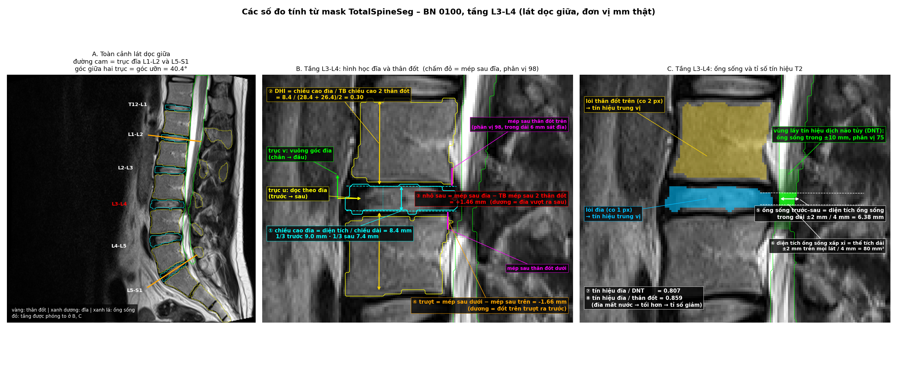

- **A** – toàn cảnh lát dọc giữa: viền thân đốt (vàng), đĩa (xanh dương), ống sống (xanh lá); hai
  đường cam là trục đĩa L1-L2 và L5-S1, góc giữa chúng là `lordosis_deg` (40,4°).
- **B** – hình học một tầng: trục **u** (dọc đĩa, trước → sau) và **v** (vuông góc, chân → đầu);
  ① `disc_height_mm` = diện tích / chiều dài (8,4 mm), kèm 1/3 trước – sau; ② `dhi` = 8,4 / trung
  bình 2 thân đốt (28,4 và 26,4 mm) = 0,30; ③ `disc_post_bulge_mm` = mép sau đĩa (chấm đỏ) − trung
  bình mép sau 2 thân đốt (vạch hồng) = +1,46 mm; ④ `listhesis_mm` = −1,66 mm (âm do sai lệch hệ
  thống ở tầng dưới – xem "Kết quả bước 4").
- **C** – ống sống và tín hiệu: ⑤ `canal_ap_mm` đo trong dải ±2 mm (xanh lá đậm, giữa hai đường gạch)
  = 6,38 mm; ⑥ `canal_csa_approx_mm2` = 80 mm²; vùng xanh lá nhạt (±10 mm) là nơi lấy tín hiệu dịch
  não tủy; lõi đĩa (xanh dương) và lõi thân đốt (vàng) cho tử số / mẫu số của ⑦ `disc_csf_ratio`
  (0,807) và ⑧ `disc_vb_ratio` (0,859).

#### Tín hiệu MRI là gì, vì sao chỉ dùng tỉ số

**Tín hiệu MRI** (signal intensity) là **độ sáng của từng điểm ảnh** – một con số (ảnh 12-bit:
0–4.095). Máy MRI (cộng hưởng từ) dùng từ trường mạnh (1,5 Tesla ở bộ dữ liệu này) để xếp thẳng hàng
các proton hydro trong nước và mỡ, phát xung sóng radio làm chúng lệch đi, rồi thu sóng radio yếu
chúng phát ra khi hồi phục. Mỗi loại mô hồi phục nhanh chậm khác nhau → độ sáng khác nhau.

| Loại ảnh | Sáng | Tối |
|---|---|---|
| T1 (ảnh trọng T1) | Mỡ | Nước, dịch |
| **T2 (ảnh trọng T2) – dự án dùng** | **Nước, dịch** (dịch não tủy, nhân nhầy đĩa khỏe ~80 % nước) | Mô xơ, xương đặc, **đĩa mất nước** |

Trên T2, đĩa đệm thoái hóa mất nước → **tối đi** ("đĩa đen") – đây là dấu hiệu bác sĩ ghi là
`disc_desiccation` (mất nước đĩa đệm).

**Tín hiệu MRI không có đơn vị tuyệt đối** (khác thang Hounsfield cố định của CT – chụp cắt lớp vi
tính): cùng một đĩa có thể sáng hay tối khác nhau tùy máy, cuộn thu, thông số chụp, vị trí so với cuộn
thu và từng lần chụp. Vì vậy "đĩa sáng 400" không có nghĩa; dự án chia cho **mốc nằm cạnh trên cùng
ảnh**, chịu cùng các ảnh hưởng đó nên phần lớn bị triệt tiêu:

- `disc_csf_ratio` – mốc là **dịch não tủy** (gần như nước tinh khiết, luôn sáng). Lấy phân vị 75
  của ống sống để chọn phần dịch sáng, bỏ rễ thần kinh tối nằm trong ống sống.
- `disc_vb_ratio` – mốc là **tủy xương thân đốt** phía trên (mốc thứ hai để đối chiếu).

Tỉ số giảm dần từ trên xuống (trung vị 0,40 ở T12-L1 → 0,20 ở L5-S1), giảm mạnh theo tuổi (ρ = −0,70,
bước 5) và thấp hơn rõ ở tầng bác sĩ ghi mất nước đĩa (AUC 0,77).

### Số đo theo bệnh nhân
| Cột | Cách tính | Gợi ý |
|---|---|---|
| `lordosis_deg` | Góc giữa trục u của đĩa L1-L2 và đĩa L5-S1 (xấp xỉ góc ưỡn thắt lưng) | `muscle_spasm` (cột sống thẳng → góc nhỏ) |
| `age`, `sex` | Từ header DICOM (chuẩn ảnh y tế) của series đã chọn | Biến nhiễu khi so sánh |

### Kiểm tra (QC) của bước 4
- Ảnh overlay vài ca: trục u/v, mép sau đĩa/thân đốt, dải đo ống sống – kiểm tra bằng mắt.
- Phân bố từng số đo theo tầng, so với khoảng tham chiếu y văn (chiều cao đĩa thắt lưng ~ 8–12 mm,
  tăng dần xuống L4-L5; đường kính trước–sau ống sống ~ 12–18 mm; trượt đốt < 3 mm ở đa số).
- Đếm ô thiếu (NaN) theo tầng và lý do (thiếu nhãn, lát giữa không có cấu trúc…).

### Đầu ra
| File | Nội dung |
|---|---|
| `outputs/tables/measurements/level_features.csv` | Mỗi `(patient_id, level)` một dòng + `use_level` |
| `outputs/tables/measurements/patient_features.csv` | Mỗi bệnh nhân một dòng: `lordosis_deg`, `age`, `sex` |
| `outputs/figures/measurements/qc_overlay.png` | Overlay đo đạc trên lát giữa của vài ca |
| `outputs/figures/measurements/qc_distributions.png` | Phân bố số đo theo tầng |
| `outputs/figures/measurements/viz_measures.png` | Hình minh họa cách tính từng số đo trên BN 100, tầng L3-L4 (mục "Minh họa các số đo") |
| `outputs/figures/measurements/viz_metrics.png` | Hình minh họa các độ đo đánh giá: z, ngưỡng, ROC, bảng 2×2 (bước 6) |

### Giới hạn đã biết
- Chỉ dùng sagittal (mặt cắt dọc); ảnh axial (mặt cắt ngang – đo diện tích ống sống thật, lỗ liên hợp trái/phải) để làm thêm
  nếu còn thời gian.
- Lát giữa phụ thuộc tư thế bệnh nhân; vẹo cột sống nặng làm lát giữa không cắt qua giữa mọi đĩa.
- Tín hiệu MRI (cộng hưởng từ) không có đơn vị tuyệt đối → chỉ dùng tỉ số, và vẫn phụ thuộc máy/thông số chụp
  (bộ dữ liệu này chỉ có 1 máy nên ảnh hưởng nhỏ).

### Kết quả bước 4

Chạy: `python src/measurements/s09_level_features.py` (~5 phút, 8 tiến trình).

**Một lỗi phát hiện qua ảnh QC và đã sửa:** lần chạy đầu, mép sau thân đốt nằm **sau ống
sống** (ở mỏm gai) → `disc_post_bulge_mm` ≈ −12 mm, `listhesis_mm` ≈ −24 mm (vô lý). Nguyên
nhân: trên lát giữa, nhãn đốt của TotalSpineSeg gồm cả mỏm gai, và ở ~55 % số đốt mỏm gai vẫn
nối với thân đốt qua cuống (nên "khối liền lớn nhất" không loại được). Sửa: thân đốt = pixel
nhãn đốt **nằm trước thành trước ống sống** (trong cùng dải chiều cao).

**Trung vị theo tầng (513 ca `use_level`):**

| Tầng | Chiều cao đĩa (mm) | DHI (chỉ số chiều cao đĩa) | Tín hiệu đĩa / DNT (dịch não tủy) | Mép sau đĩa vượt thân đốt (mm) | Ống sống trước–sau (mm) | CSA (diện tích cắt ngang) xấp xỉ (mm²) | Trượt (mm) | Chiều cao thân đốt trên (mm) |
|---|---|---|---|---|---|---|---|---|
| T12-L1 | 5,17 | 0,21 | 0,40 | −0,91 | 13,43 | 221 | −0,32 | 23,98 |
| L1-L2 | 6,02 | 0,22 | 0,33 | −0,54 | 12,89 | 218 | −0,51 | 26,49 |
| L2-L3 | 7,04 | 0,25 | 0,29 | −0,24 | 11,56 | 192 | −1,21 | 27,81 |
| L3-L4 | 7,85 | 0,28 | 0,26 | 0,33 | 10,43 | 163 | −1,60 | 28,16 |
| L4-L5 | 8,43 | 0,29 | 0,21 | **0,82** | 9,97 | 142 | −2,00 | 28,91 |
| L5-S1 | 8,34 | 0,27 | 0,20 | −0,40 | 9,84 | 123 | −2,42 | 30,78 |

- Xu hướng khớp giải phẫu: đĩa cao dần từ trên xuống (L4-L5 cao nhất), thân đốt cao dần, ống
  sống hẹp dần, tín hiệu đĩa giảm dần (đĩa dưới thoái hóa nhiều hơn), mép sau đĩa nhô nhiều
  nhất ở L4-L5 (nơi phồng đĩa hay gặp nhất).
- Chiều cao đĩa tuyệt đối (5–8 mm) thấp hơn số liệu X-quang thường gặp (~8–12 mm) vì mask đĩa
  của TotalSpineSeg không gồm phần viền sát tấm tận và do hiệu ứng thể tích từng phần → dùng để
  **so sánh tương đối** (giữa các tầng, giữa có/không bệnh), không áp ngưỡng y văn trực tiếp.
- **Độ trượt** có sai lệch hệ thống âm tăng dần xuống dưới (hình nêm thân đốt vùng cong ưỡn)
  → chỉ dùng so sánh tương đối.
- Góc ưỡn L1-L2 ↔ L5-S1: trung vị 42,1° (IQR 35,5–48,6°). Tuổi 17–89 (trung vị 40), nữ 38,4 %.
- Thiếu dữ liệu: 1 tầng thiếu đĩa (BN 245, L5-S1 – đốt chuyển tiếp, đã loại khỏi `use_level`);
  `canal_ap_mm` thiếu 3 ô, `canal_csa_approx_mm2` 2 ô.

**Kiểm tra nhanh với nhãn rule (tập dev, chưa phải phân tích chính thức – xem bước 5):**

| Nhãn bác sĩ (rule) | Số đo | Tầng có nhãn | Tầng không nhãn |
|---|---|---|---|
| disc_desiccation (mất nước đĩa đệm) (32 tầng) | Tín hiệu đĩa / DNT (dịch não tủy) | **0,13** | 0,28 |
| disc_space_narrowing (hẹp khoang đĩa) (14) | DHI (chỉ số chiều cao đĩa) | **0,13** | 0,25 |
| disc_bulge (phồng đĩa đệm) (419) | Mép sau đĩa vượt thân đốt | **+1,01 mm** | −0,35 mm |
| spondylolisthesis (trượt đốt sống) (19) | Độ trượt | **+0,2 mm** | −1,26 mm |

Cả 4 số đo lệch **đúng chiều** với nhãn bác sĩ → số đo có giá trị để phân tích ở bước 5.

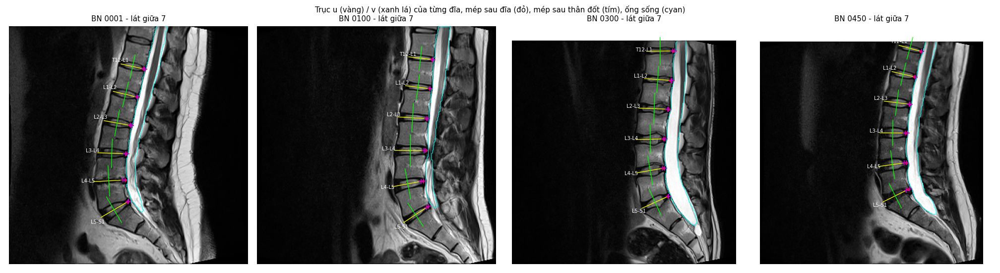

---

## 5. Bước 5 – Ghép ảnh × văn bản, phân tích (`src/analysis/`)

### Câu hỏi cần trả lời
1. **Số đo từ ảnh có khớp với nhận xét của bác sĩ không?** Ở tầng bác sĩ ghi có bệnh, số đo
   khác bao nhiêu so với tầng không ghi?
2. **Ngưỡng nào phân biệt tốt nhất?** So với ngưỡng y văn (nếu có).
3. **Ca lệch nhau** – số đo rất bất thường nhưng báo cáo không nhắc (và ngược lại) – bao nhiêu,
   ở tầng nào? → ý nghĩa cho kiểm soát chất lượng báo cáo (góc MIS).
4. Yếu tố bệnh nhân: tuổi ↔ thoái hóa đĩa; góc ưỡn ↔ co cứng cơ.

### Dữ liệu ghép
- `level_features.csv` (bước 4) – chỉ ca `use_level` (513 BN) và 6 tầng T12-L1 … L5-S1.
- `labels_level.csv` (s08) – ghép theo `(patient_id, level)`; tầng không có trong bảng nhãn
  → mọi bệnh = 0 (**không được nhắc**, nhãn yếu – Q10).
- `labels_patient.csv`, `patient_features.csv` – cho phân tích mức bệnh nhân.

### Cặp số đo ↔ nhãn được kiểm định

| Nhãn bác sĩ | Số đo (bước 4) | Chiều kỳ vọng ở tầng có bệnh |
|---|---|---|
| `disc_desiccation` (mất nước đĩa đệm) | `disc_csf_ratio`, `disc_vb_ratio` | Thấp hơn (đĩa tối) |
| `disc_space_narrowing` (hẹp khoang đĩa) | `dhi`, `disc_height_mm` | Thấp hơn |
| `disc_bulge` (phồng đĩa đệm), `disc_protrusion` (lồi đĩa đệm), `disc_herniation` (thoát vị đĩa đệm) | `disc_post_bulge_mm` | Cao hơn (nhô ra sau) |
| `thecal_sac_compression` (chèn ép bao màng cứng), `spinal_canal_stenosis` (hẹp ống sống) | `canal_ap_mm`, `canal_csa_approx_mm2` | Thấp hơn (ống hẹp) |
| `spondylolisthesis` (trượt đốt sống) | `listhesis_mm` | Cao hơn (trượt ra trước) |
| `foraminal_stenosis` (hẹp lỗ liên hợp), `nerve_root_compression` (chèn ép rễ thần kinh) | `disc_post_bulge_mm`, `dhi` | Gián tiếp – lỗ liên hợp không đo được trên lát sagittal (mặt cắt dọc) giữa |
| `muscle_spasm` (co cứng cơ) (mức bệnh nhân) | `lordosis_deg` | Thấp hơn (cột sống thẳng) |

### Phương pháp
- **Mức tầng khác nhau sẵn** (đĩa L4-L5 cao hơn L1-L2, ống sống hẹp dần xuống dưới…) mà bệnh lại
  tập trung ở L4-L5, L5-S1 → so sánh gộp mọi tầng sẽ lẫn hiệu ứng "tầng". Vì vậy mỗi số đo được
  **chuẩn hóa z trong từng tầng** (trừ trung bình, chia độ lệch chuẩn của tầng đó) trước khi gộp;
  đồng thời báo cáo riêng cho L4-L5 và L5-S1.
- Mỗi cặp: trung vị nhóm có/không, **AUC** (khả năng số đo phân biệt hai nhóm; 0,5 = ngẫu nhiên),
  kiểm định Mann–Whitney, **ngưỡng Youden** (tối đa độ nhạy + độ đặc hiệu − 1) trên giá trị gốc
  của từng tầng chính.
- **Ca lệch** (so trong cùng tầng):
  - "**Nghi bỏ sót**": bác sĩ **không ghi** nhưng số đo **bất thường hơn trung vị của nhóm có
    ghi** – tức trông giống một ca bệnh điển hình.
  - "**Số đo không ủng hộ**": bác sĩ **có ghi** nhưng số đo ở phía **bình thường hơn trung vị của
    nhóm không ghi**.
  - Không dùng phân vị của chính nhóm không ghi làm ngưỡng: khi đó luôn có đúng ~5 % số tầng bị
    đánh dấu theo định nghĩa, kết quả vô nghĩa.
- Mức bệnh nhân: tương quan Spearman tuổi ↔ tín hiệu đĩa (trung bình 5 tầng thắt lưng), tuổi ↔
  số phát hiện; Mann–Whitney + AUC góc ưỡn ↔ co cứng cơ.

### Đầu ra
| File | Nội dung |
|---|---|
| `outputs/tables/analysis/analysis_level_dataset.csv` | Bảng ghép (BN × tầng): số đo, z trong tầng, nhãn |
| `outputs/tables/analysis/analysis_assoc.csv` | Mỗi cặp số đo ↔ nhãn × phạm vi (gộp z / L4-L5 / L5-S1): n, trung vị, AUC, p, ngưỡng |
| `outputs/tables/analysis/analysis_discordance.csv` | Các tầng lệch giữa số đo và báo cáo |
| `outputs/tables/analysis/analysis_patient.csv` | Kết quả mức bệnh nhân (tuổi, góc ưỡn) |
| `outputs/figures/analysis/*.png` | Biểu đồ cho báo cáo |

### Giới hạn
- Nhãn 0 là "không được nhắc", không phải "đã kiểm tra là bình thường" → AUC là **cận dưới**.
- Số đo chỉ trên sagittal (mặt cắt dọc); hẹp lỗ liên hợp / chèn ép rễ chỉ có số đo gián tiếp.
- Đây là phân tích **liên quan**, không phải mô hình chẩn đoán; chưa kiểm định ngoài bộ dữ liệu.

### Kết quả bước 5

Chạy: `python src/analysis/s10_level_analysis.py` (vài giây). 513 bệnh nhân × 6 tầng = 3.078 tầng.

#### 1. Số đo từ ảnh khớp với nhận xét của bác sĩ đến đâu?

AUC gộp 6 tầng (chuẩn hóa z trong tầng; 0,5 = ngẫu nhiên, 1 = phân biệt hoàn hảo):

| Nhãn bác sĩ (số tầng có ghi) | Số đo | AUC | Mức độ khớp |
|---|---|---|---|
| Hẹp khoang đĩa (15) | DHI (chỉ số chiều cao đĩa) | **0,97** | Rất mạnh |
| Hẹp ống sống (47) | Đường kính trước–sau ống sống | **0,88** | Mạnh |
| Lồi đĩa (145) | Nhô sau của đĩa | **0,87** | Mạnh |
| Thoát vị đĩa (10) | Nhô sau của đĩa | 0,83 | Mạnh (ít ca) |
| Mất nước đĩa (40) | Tín hiệu đĩa / dịch não tủy | 0,77 | Khá |
| Hẹp lỗ liên hợp (288) | Nhô sau (gián tiếp) | 0,76 | Khá |
| Phồng đĩa (495) | Nhô sau | 0,65 | Vừa |
| Chèn ép bao màng cứng (485) | Đường kính ống sống | 0,68 | Vừa |
| Chèn ép rễ (191) | Nhô sau (gián tiếp) | 0,64 | Yếu – rễ thần kinh không thấy trên lát sagittal (mặt cắt dọc) giữa |

Mọi cặp đều lệch **đúng chiều** kỳ vọng, p < 0,001 (trừ trượt đốt gộp). Bệnh **mô tả hình thái rõ**
(lồi, hẹp ống, hẹp khoang) khớp mạnh; nhận xét **chung chung** ("diffuse bulge", "compressing the
thecal sac" – gặp ở > 60 % bệnh nhân) khớp yếu hơn.

Theo tầng chính (giá trị gốc, ngưỡng Youden):

| Nhãn – số đo | Tầng | Trung vị có ghi / không ghi | AUC | Ngưỡng | Độ nhạy / đặc hiệu |
|---|---|---|---|---|---|
| Hẹp khoang đĩa – DHI (chỉ số chiều cao đĩa) | L5-S1 | 0,14 / 0,27 | 0,95 | < 0,18 | 0,89 / 0,94 |
| Trượt đốt – độ trượt | **L4-L5** | +2,9 / −2,0 mm | **0,99** | > −0,5 mm | 1,00 / 0,95 |
| Phồng/lồi/thoát vị – nhô sau | L4-L5 | 1,26 / 0,45 mm | 0,78 | > 0,85 mm | 0,68 / 0,78 |
| Phồng/lồi/thoát vị – nhô sau | L5-S1 | 0,45 / −0,73 mm | 0,80 | > −0,20 mm | 0,73 / 0,77 |
| Chèn ép bao màng cứng – ống sống | L4-L5 | 8,4 / 11,2 mm | 0,77 | < 10,8 mm | 0,84 / 0,56 |
| Mất nước đĩa – tín hiệu | L5-S1 | 0,11 / 0,21 | 0,82 | < 0,14 | 0,85 / 0,71 |

Ngưỡng là của **bộ dữ liệu và cách đo này** (thang đo tương đối – xem giới hạn bước 4), không thay
thế ngưỡng y văn.

**Hai số đo không dùng được ở L5-S1** (phát hiện nhờ phân tích theo tầng): độ trượt (AUC 0,35, ngược
chiều – thân đốt dưới là xương cùng, hình học khác) và đường kính ống sống cho chèn ép (AUC 0,56 – bao
màng cứng sắp kết thúc ở đoạn này). Hai cặp này bị loại khỏi phân tích ca lệch.

#### 2. Ca lệch giữa số đo và báo cáo (L4-L5, L5-S1; chỉ cặp có AUC tại tầng ≥ 0,7)

| Nhãn – tầng | Nghi bỏ sót (không ghi nhưng số đo như ca bệnh điển hình) | Số đo không ủng hộ (có ghi nhưng số đo như ca bình thường) |
|---|---|---|
| Mất nước đĩa – L5-S1 | 56 tầng (12,3 %) | 1 (5,0 %) |
| Hẹp khoang đĩa – L5-S1 | 13 (2,6 %) | 0 |
| Phồng/lồi/thoát vị – L4-L5 | 20 (10,7 %) | 49 (16,1 %) |
| Phồng/lồi/thoát vị – L5-S1 | 17 (5,8 %) | 28 (14,4 %) |
| Chèn ép bao màng cứng – L4-L5 | 29 (11,7 %) | 28 (11,2 %) |
| Trượt đốt – L4-L5 | 1 (0,2 %) | 0 |

"Nghi bỏ sót" đã loại các bệnh nhân bác sĩ ghi bệnh đó **không kèm tầng** (vd "dissicating disc
material" – 39 BN ở L5-S1). Danh sách từng ca: `analysis_discordance_cases.csv`.

Ý nghĩa: **mất nước đĩa bị ghi thiếu nhiều nhất** – 1/8 số đĩa L5-S1 không được nhắc có tín hiệu tối
như đĩa được bác sĩ ghi mất nước. Đây đúng là chỗ một hệ thống đo tự động có thể **gợi ý bác sĩ xem
lại** (kịch bản C ở mục Kiến trúc). Ngược lại, 11–16 % tầng ghi phồng đĩa / chèn ép có số đo như bình
thường – phản ánh các nhận xét khuôn mẫu ("diffuse disc bulge … compressing the thecal sac") và giới
hạn của lát sagittal (mặt cắt dọc) giữa.

#### 3. Yếu tố bệnh nhân

- **Tuổi ↔ tín hiệu đĩa: ρ = −0,70** (Spearman, p < 0,001) – rất mạnh. Trung vị tín hiệu đĩa giảm
  từ 0,32 (dưới 30 tuổi) xuống 0,15 (≥ 60 tuổi); tỉ lệ được ghi mất nước đĩa tăng từ 2 % lên 24 %;
  số phát hiện trung bình tăng từ 2,5 lên 4,7.
- **Góc ưỡn ↔ "muscle spasm": AUC 0,50** – **không có liên quan**. Trung vị góc ưỡn 42,2° (có ghi) so
  với 42,0° (không ghi). Nhận xét "co cứng cơ" (44 % ghi chú; 214/227 ghi chú dùng đúng cụm "Feature(s) of muscle
  spasm") có thể là câu khuôn mẫu, không phản ánh độ thẳng cột sống đo được – hoặc góc ưỡn tính từ trục đĩa chưa đủ
  nhạy. Đây là một **kết quả âm tính** đáng nêu.

#### Hình

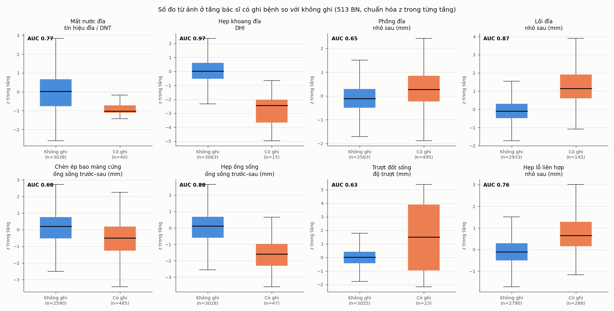
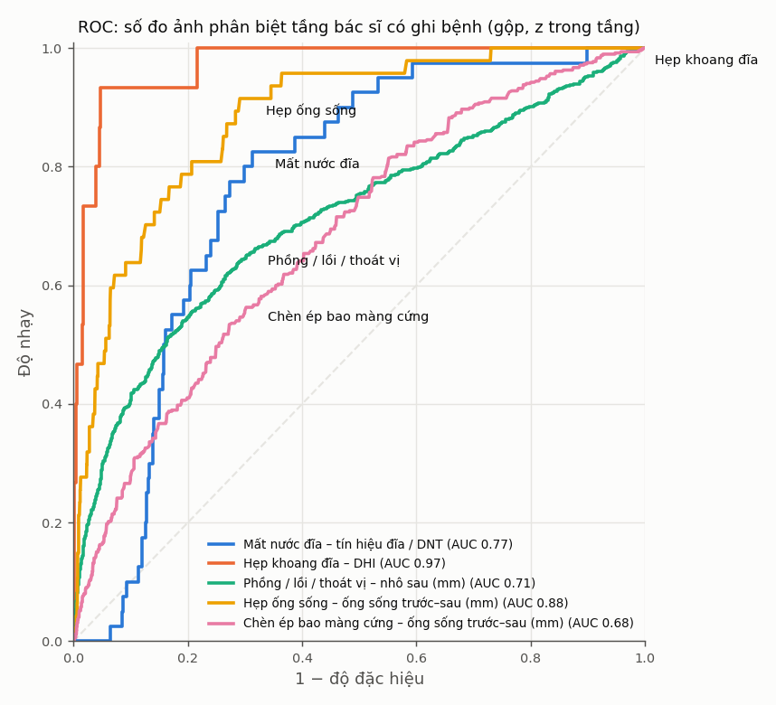
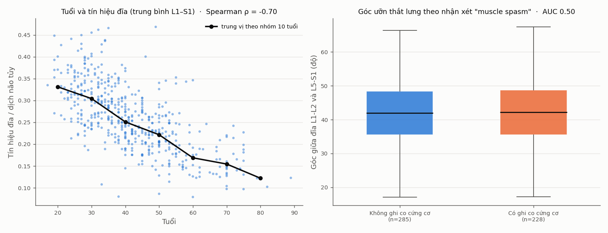
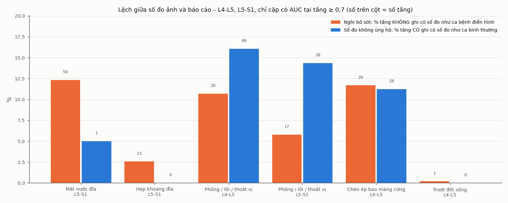

---

## 6. Bước 6 – Gợi ý bệnh theo tầng từ ảnh (`src/analysis/s11_threshold_rules.py`)

### Mục đích
Tình huống: **bệnh nhân mới chỉ có ảnh MRI (chụp cộng hưởng từ), chưa có báo cáo** của bác sĩ
X-quang:

```
Ảnh MRI mới → TotalSpineSeg → số đo theo tầng (s09) → so với bảng ngưỡng học từ 513 BN
            → "nghi <bệnh> tại <tầng>" + độ tin cậy
```

Bước 5 trả lời "số đo có **liên quan** với nhãn không"; bước 6 biến liên quan đó thành **quy tắc
gợi ý** và đo xem quy tắc đúng đến đâu trên bệnh nhân **chưa dùng để học**. Đây là công cụ **sàng
lọc / gợi ý xem lại**, không phải chẩn đoán (xem kịch bản C ở đầu README).

### Đầu vào
- Bảng ghép của s10 (`build_dataset()`): 513 BN `use_level` × 6 tầng = 3.078 tầng.
- 16 cặp bệnh ↔ số đo `PAIRS` của s10, kèm **chiều kỳ vọng** – đặt trước theo kiến thức y khoa,
  không chọn từ dữ liệu.

### Phương pháp
Mỗi gợi ý dựa trên **một** số đo; thứ duy nhất được học là **ngưỡng**. Với mỗi tổ hợp
(bệnh, số đo, phạm vi):

- **Hai loại phạm vi:**
  - **Riêng theo tầng** (vd `L4-L5`): ngưỡng trên giá trị gốc (mm, mm², tỉ số). Chỉ học khi tầng
    đó có ≥ 10 tầng có bệnh (`MIN_POS`).
  - **z chung** (`z_all`): số đo chuẩn hóa z trong từng tầng, **một** ngưỡng cho cả 6 tầng – dùng
    cho các tầng trên, nơi quá ít ca bệnh để học ngưỡng riêng.
- **Ngưỡng Youden** (tối đa độ nhạy + độ đặc hiệu − 1).
- **① Kiểm chứng chéo (cross-validation)** – ngưỡng có dùng được cho bệnh nhân mới không?
  - `StratifiedGroupKFold` 5 phần, **chia theo bệnh nhân** (mọi tầng của một BN cùng một phần,
    tránh rò rỉ giữa các tầng của cùng người), giữ tỉ lệ ca bệnh giữa các phần.
  - Mỗi vòng: học ngưỡng trên 4 phần (~410 BN), gắn cờ "nghi bệnh" trên phần còn lại (~103 BN).
    Với `z_all`, trung bình / độ lệch chuẩn để tính z **chỉ lấy từ phần học**.
  - Gộp dự đoán 5 phần → độ nhạy, độ đặc hiệu, PPV (giá trị dự đoán dương), tỉ lệ bị gắn cờ;
    lặp 5 lần với cách chia khác nhau (seed 2026 + lần lặp), lấy trung bình → cột `cv_*`.
- **② Khoảng tin cậy 95 % của AUC** – bootstrap 1.000 lần **theo bệnh nhân** (bốc BN có hoàn lại,
  giữ cả 6 tầng). AUC của một số đo không phụ thuộc ngưỡng nên không cần tách học / kiểm tra.
- **③ Ngưỡng cuối** – học Youden trên **toàn bộ** 513 BN: đây là ngưỡng dùng thật (cột
  `threshold`). Số liệu trên chính dữ liệu học (`*_insample`) lạc quan; `optimism_j` = J
  in-sample − J kiểm chứng chéo đo độ lạc quan đó.
- **④ Lọc** – dùng tổ hợp khi cận dưới KTC 95 % của AUC ≥ 0,70 (`use`); độ tin cậy **cao** khi
  ≥ 0,80, còn lại **vừa**.

#### Minh họa các độ đo đánh giá

Ví dụ cặp hẹp ống sống (spinal canal stenosis) ↔ `canal_ap_mm` tại L3-L4 (512 tầng, 12 tầng bác sĩ ghi bệnh):

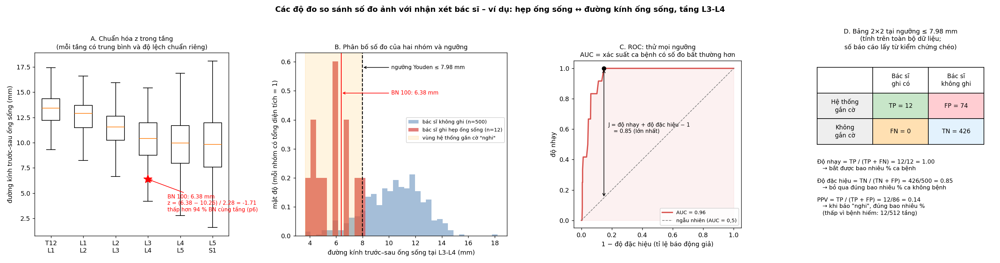

| Độ đo | Cách tính | Ví dụ trên hình |
|---|---|---|
| **z trong tầng** (A) | (giá trị − trung bình của tầng) / độ lệch chuẩn của tầng – so mỗi tầng với chính các tầng cùng vị trí, tránh lẫn hiệu ứng "tầng dưới vốn hẹp hơn" | BN 100: (6,38 − 10,26) / 2,28 = −1,71; thấp hơn 94 % BN cùng tầng (phân vị 6) |
| **Ngưỡng Youden** (B, C) | Thử mọi ngưỡng, chọn ngưỡng có J = độ nhạy + độ đặc hiệu − 1 lớn nhất | ≤ 7,98 mm → "nghi hẹp ống sống"; J = 0,85 |
| **AUC** (C) | Diện tích dưới đường ROC = xác suất một tầng có bệnh có số đo bất thường hơn một tầng không bệnh (0,5 = ngẫu nhiên, 1 = hoàn hảo); tương đương Mann–Whitney U / (n₁ × n₀) | 0,96 |
| **Độ nhạy** (D) | TP / (TP + FN) – bắt được bao nhiêu % ca bệnh | 12/12 = 1,00 |
| **Độ đặc hiệu** (D) | TN / (TN + FP) – bỏ qua đúng bao nhiêu % ca không bệnh | 426/500 = 0,85 |
| **PPV** – giá trị dự đoán dương (D) | TP / (TP + FP) – khi báo "nghi", đúng bao nhiêu % | 12/86 = 0,14 – thấp vì bệnh hiếm (12/512 tầng) dù độ nhạy, độ đặc hiệu đều cao → lý do `ai/analyze.py` ẩn quy tắc có PPV < 0,05 |

Số trên hình tính trên toàn bộ dữ liệu để minh họa; số báo cáo trong `threshold_rules.csv` lấy từ kiểm
chứng chéo (độ nhạy 0,90, độ đặc hiệu 0,86, PPV 0,13).

#### Vì sao không chia train / validation / test cố định
- **Không có gì để tinh chỉnh** → không cần tập validation: cặp và chiều đặt trước, các hằng số
  (`MIN_POS`, `MIN_AUC_LOW`, `HIGH_AUC_LOW`) cố định trước khi chạy.
- **Ít ca bệnh** → tập test cố định quá nhỏ: vd mất nước đĩa đệm (disc desiccation) tại L4-L5 chỉ
  có 18 tầng có bệnh; tách 20 % làm test còn 3–4 ca, độ nhạy chỉ nhận 0 / 33 / 67 / 100 %.
- Kiểm chứng chéo lặp lại cho **mỗi BN đúng một lần làm "bệnh nhân mới"** trong mỗi lần lặp, nên
  vẫn là đánh giá trên dữ liệu chưa thấy nhưng dùng hết 513 BN.

### Đầu ra (`outputs/tables/analysis/`)
| File | Nội dung |
|---|---|
| `threshold_rules.csv` | **Bảng quy tắc gợi ý**: mỗi dòng một tổ hợp (bệnh, số đo, phạm vi) – quy tắc (`<=` / `>=`), ngưỡng, `n_pos` / `n_neg`, AUC + KTC 95 %, số liệu in-sample, `cv_sens` / `cv_spec` / `cv_ppv` / `cv_flag_rate`, `optimism_j`, `use`, `confidence` |
| `threshold_cv_by_level.csv` | Ngưỡng `z_all`: số liệu kiểm chứng chéo tách theo từng tầng |
| `measure_reference.csv` | Trung bình, độ lệch chuẩn, phân vị 5…95 của mỗi số đo theo tầng – để tính z cho BN mới và hiển thị "thấp hơn x % BN cùng tầng" |

### Kết quả bước 6

Chạy: `python src/analysis/s11_threshold_rules.py` (~5 phút, chủ yếu do bootstrap; chạy lại
cho kết quả giống hệt nhờ seed cố định).

**35/54 tổ hợp đủ mạnh để gợi ý** – 19 độ tin cậy cao, 16 vừa, 19 không dùng. Độ lạc quan
`optimism_j` trung vị 0,05 (tối đa 0,18): ngưỡng học trên toàn bộ dữ liệu chỉ tốt hơn một chút so
với trên bệnh nhân chưa thấy.

Một số quy tắc mạnh nhất (độ nhạy / độ đặc hiệu / PPV lấy từ kiểm chứng chéo):

| Bệnh | Quy tắc | Tầng | AUC (KTC 95 %) | Độ nhạy | Độ đặc hiệu | PPV |
|---|---|---|---|---|---|---|
| Trượt đốt sống (spondylolisthesis) | độ trượt ≥ −0,51 mm | L4-L5 | 0,99 (0,98–) | 0,89 | 0,96 | 0,32 |
| Hẹp khoang đĩa (disc space narrowing) | DHI (chỉ số chiều cao đĩa) z ≤ −1,56 | mọi tầng | 0,97 (0,94–) | 0,81 | 0,95 | 0,08 |
| Chèn ép bao màng cứng (thecal sac compression) | ống sống trước–sau ≤ 9,0 mm | L2-L3 | 0,97 (0,95–) | 0,88 | 0,90 | 0,22 |
| Hẹp ống sống (spinal canal stenosis) | ống sống trước–sau ≤ 8,0 mm | L3-L4 | 0,96 (0,93–) | 0,90 | 0,86 | 0,13 |
| Hẹp ống sống | diện tích ống sống ≤ 84 mm² | L4-L5 | 0,90 (0,83–) | 0,79 | 0,87 | 0,24 |
| Lồi đĩa đệm (disc protrusion) | nhô sau ≥ 0,27 mm | L5-S1 | 0,89 (0,86–) | 0,84 | 0,83 | 0,47 |
| Mất nước đĩa đệm (disc desiccation) | tín hiệu đĩa / DNT (dịch não tủy) ≤ 0,14 | L5-S1 | 0,82 (0,74–) | 0,71 | 0,74 | 0,10 |

(AUC là in-sample, chỉ ghi cận dưới KTC; với ngưỡng theo tầng AUC không phụ thuộc việc học.)

Không đạt (cận dưới KTC < 0,70): phồng đĩa đệm (disc bulge) ở L4-L5 / L5-S1, chèn ép bao màng
cứng ở L5-S1, hẹp lỗ liên hợp (foraminal stenosis) theo DHI, chèn ép rễ thần kinh (nerve root
compression) ở L4-L5 – khớp với bước 5: các bệnh này chỉ có số đo gián tiếp hoặc rất phổ biến
ở tầng dưới nên khó tách bằng một ngưỡng.

### Giới hạn
- **PPV thấp ở bệnh hiếm**: vd mất nước đĩa đệm theo ngưỡng `z_all` có PPV ≈ 0,03 – phần lớn
  tầng bị gắn cờ là báo động giả. Chỉ dùng để gợi ý xem lại, luôn hiển thị kèm độ tin cậy.
- **Ngưỡng `z_all` gắn cờ gần như cùng tỉ lệ ở mọi tầng**, kể cả tầng hầu như không có bệnh: vd hẹp
  ống sống theo đường kính trước–sau gắn cờ 26–30 % số tầng ở mọi tầng, cả T12-L1 (0 ca bệnh)
  (`threshold_cv_by_level.csv`). Ưu tiên ngưỡng riêng theo tầng khi có.
- **Lọc `use` dùng KTC tính trên toàn bộ dữ liệu** → số liệu của các tổ hợp được giữ có thể hơi lạc
  quan (chọn "người thắng" rồi báo cáo điểm của chính họ). Mức lệch nhỏ vì lọc theo cận dưới KTC;
  chặt chẽ hơn thì cần đưa bước lọc vào trong kiểm chứng chéo (nested CV).
- AUC tính trong kiểm chứng chéo chưa được lưu ra file (chỉ lưu độ nhạy / độ đặc hiệu / PPV).
- Kế thừa giới hạn bước 5: nhãn 0 là "không được nhắc"; chỉ số đo sagittal (mặt cắt dọc); chưa
  kiểm định ngoài bộ dữ liệu.

## 7. Bước 7 – So với ngưỡng y văn (`src/analysis/s12_literature_compare.py`)

### Mục đích
Ngưỡng của bước 6 học từ chính dữ liệu, với đáp án là những gì bác sĩ ghi. Bước này đặt chúng
**cạnh các ngưỡng đã công bố** để trả lời hai câu hỏi:

1. **Ngưỡng học được có hợp lý không**, hay chỉ là con số ngẫu nhiên khớp với dữ liệu?
2. **Thang đo của s09 có lệch so với cách đo trong y văn không?** Nếu lệch thì không áp thẳng
   ngưỡng sách vào số đo của hệ thống được.

Bảng ngưỡng y văn (`LIT_CUTOFFS`) cũng được `ai/analyze.py` dùng lại để hiện dòng
**"theo y văn: …"** bên cạnh mỗi gợi ý (xem cuối mục).

### Ngưỡng y văn được so
Chỉ các số đo **có ngưỡng y văn dạng số**:

| Số đo (s09) | Ngưỡng y văn | Cách đo trong y văn | Cách s09 đo |
|---|---|---|---|
| `canal_ap_mm` – đường kính trước–sau ống sống | < 10 mm hẹp **tuyệt đối**; 10–12 mm hẹp **tương đối** (một số nguồn dùng 13 mm khi đo trên CT) | Đường kính trước–sau của ống sống trên lát giữa sagittal | Bề dày mask ống sống của TotalSpineSeg (nhãn 1 + 2) trong dải ±2 mm quanh tâm đĩa, trên lát giữa |
| `canal_csa_approx_mm2` – diện tích ống sống | **Schönström**: < 75 mm² hẹp tuyệt đối, 75–99 mm² hẹp tương đối, ≥ 100 mm² bình thường | Diện tích cắt ngang **bao màng cứng** (dural sac, túi chứa dịch não tủy và rễ thần kinh) đo trên ảnh **axial** | **Xấp xỉ** từ ảnh sagittal: thể tích ống sống trong dải ±2 mm quanh đĩa / chiều cao dải |
| `listhesis_mm` – độ trượt đốt sống | ≥ 3 mm: mốc lâm sàng hay dùng (mất vững, chỉ định mổ), **không phải định nghĩa chẩn đoán**. Phân độ Meyerding dùng % (độ I ≤ 25 %) | Độ dịch chuyển của đốt trên so với đốt dưới | Chênh lệch mép sau thân đốt trên và dưới, trên lát giữa |

**Schönström** là tên tác giả (Nils Schönström, chỉnh hình, Thụy Điển). Trong các nghiên cứu năm
1984–1985, nhóm ông đề xuất một **diện tích tới hạn khoảng 75 mm²** của bao màng cứng ở tầng L3:
nhỏ hơn mức này thì áp lực lên rễ thần kinh tăng rõ. Từ đó có hai mốc 75 / 100 mm² dùng để phân
loại hẹp ống sống.

Không so: mất nước đĩa đệm, hẹp khoang đĩa, phồng / lồi đĩa. Các bệnh này được phân độ theo
**hình thái** (ví dụ phân độ Pfirrmann cho thoái hóa đĩa), không có ngưỡng số chuẩn.

### Phương pháp
- Dùng cùng dữ liệu, cùng tầng, cùng đáp án với bước 6: `build_dataset()` của s10; chỉ xét tầng có
  ≥ 10 tầng có bệnh (`MIN_POS` của s11).
- Ngưỡng y văn là **cố định**, không học từ dữ liệu này, nên chấm thẳng trên toàn bộ 513 BN mà không
  cần kiểm chứng chéo. Ngưỡng của bước 6 dùng số liệu **kiểm chứng chéo** (`cv_*`), để so công bằng.
- Thêm **trung vị số đo** ở nhóm có bệnh và nhóm không bệnh, để thấy thang đo của s09 lệch so với
  y văn hay không.

Chạy: `python src/analysis/s12_literature_compare.py` (vài giây).

### Kết quả bước 7

**① Đường kính ống sống của s09 nhỏ hơn thang y văn khoảng 2 mm.**

| Bệnh | Tầng | Trung vị (có bệnh / không bệnh) | Y văn < 10 mm: độ nhạy / độ đặc hiệu / PPV | Tỉ lệ tầng bị gắn cờ | Ngưỡng học (CV): độ nhạy / độ đặc hiệu / PPV |
|---|---|---|---|---|---|
| Hẹp ống sống | L3-L4 | 6,1 / 10,5 mm | 1,00 / 0,59 / 0,06 | 43 % | ≤ 7,98 mm: 0,90 / 0,86 / 0,13 |
| Hẹp ống sống | L4-L5 | 5,6 / 10,1 mm | 0,96 / 0,51 / 0,09 | 52 % | ≤ 8,37 mm: 0,79 / 0,73 / 0,14 |
| Chèn ép bao màng cứng | L3-L4 | 7,5 / 10,8 mm | 0,85 / 0,64 / 0,27 | 43 % | ≤ 9,17 mm: 0,69 / 0,80 / 0,34 |

Khoảng **một nửa số tầng bình thường** có số đo dưới 10 mm. Nguyên nhân: s09 đo trên mask ống sống
của TotalSpineSeg, cho số nhỏ hơn đường kính mà y văn dùng. Áp thẳng ngưỡng 10 mm thì gắn cờ khoảng
một nửa số tầng (ngưỡng 12 mm: khoảng 80 %). Ngưỡng học được thấp hơn khoảng 2 mm, tức là **tự hiệu
chỉnh độ lệch thang đo**.

**② Diện tích ống sống khớp với Schönström.**

| Bệnh | Tầng | Trung vị (có bệnh / không bệnh) | Y văn < 100 mm²: độ nhạy / độ đặc hiệu / PPV | Y văn < 75 mm²: độ nhạy / độ đặc hiệu | Ngưỡng học (CV) |
|---|---|---|---|---|---|
| Hẹp ống sống | L3-L4 | 82 / 165 mm² | 0,83 / 0,91 / 0,18 | 0,50 / 0,98 | ≤ **109** mm²: 0,83 / 0,89 / 0,15 |
| Hẹp ống sống | L4-L5 | 56 / 146 mm² | 0,85 / 0,78 / 0,17 | 0,65 / 0,91 | ≤ **84** mm²: 0,79 / 0,87 / 0,24 |

Ngưỡng học được (109 và 84 mm²) **nằm quanh hai mốc 75 / 100 mm²** của Schönström, và hiệu năng
gần như ngang nhau. Đây là bằng chứng tốt nhất rằng ngưỡng của bước 6 không phải số ngẫu nhiên,
dù s09 chỉ đo diện tích xấp xỉ từ ảnh sagittal.

**③ "Chèn ép bao màng cứng" là mức nhẹ hơn "hẹp ống sống".** Với chèn ép bao màng cứng, mốc
Schönström quá chặt: độ nhạy chỉ 0,18–0,22 (< 75 mm²) và 0,37–0,47 (< 100 mm²) ở L2-L3 … L5-S1.
Ngưỡng học được là 133–143 mm². Bác sĩ ghi "thecal sac compression" từ mức hẹp nhẹ hơn nhiều so
với mức Schönström coi là hẹp.

**④ Độ trượt đốt cũng có độ lệch nền.** Tại L4-L5 (11 tầng có trượt đốt):

| | Trung vị (có / không trượt) | Độ nhạy | Độ đặc hiệu | PPV |
|---|---|---|---|---|
| Y văn ≥ 3 mm | 2,95 / **−2,01** mm | 0,27 | 1,00 | 0,75 |
| Ngưỡng học ≥ −0,51 mm (CV) | | 0,89 | 0,96 | 0,32 |

Tầng không trượt có trung vị **−2,0 mm**, không phải 0: cách đo của s09 (so mép sau hai thân đốt)
có độ lệch nền. Ngưỡng học được (−0,51 mm) tương ứng khoảng 1,5 mm trên mức nền, còn mốc 3 mm chỉ
bắt được 27 % ca được ghi trượt đốt.

**Kết luận:** so với y văn **ủng hộ** việc học ngưỡng từ dữ liệu ở bước 6. Thang đo của s09 có độ
lệch hệ thống (khoảng −2 mm với đường kính ống sống và độ trượt), nên áp thẳng ngưỡng sách sẽ sai.
Ở chỗ thang đo khớp y văn (diện tích ống sống), ngưỡng học được rơi đúng vào vùng ngưỡng y văn.

### Dùng trong `ai/analyze.py`
`LIT_CUTOFFS` trong `src/analysis/literature.py` là nơi **duy nhất** khai báo ngưỡng y văn. File này cố
ý không import gì, để BE không phải cài scikit-learn. s12 và `ai/analyze.py` cùng import bảng này;
`ai/analyze.py` thêm trường `literature` vào mỗi gợi ý: giá trị rơi vào mức nào theo y văn.

| Ví dụ (BN 100, BN 154) | Ý nghĩa |
|---|---|
| `"theo y văn: < 10 mm - hẹp tuyệt đối"` | Đường kính ống sống 6,38 mm |
| `"theo y văn: < 100 mm² - hẹp tương đối (Schönström)"` | Diện tích ống sống 80,4 mm² |
| `"theo y văn: chưa tới ngưỡng ≥ 3 mm"` | Độ trượt 2,50 mm: ngưỡng học gắn cờ, mốc y văn thì chưa |

Với số đo không có ngưỡng y văn, trường này là `null`. Dòng này **chỉ để tham khảo**: theo kết quả ①
và ④, nó hay báo nặng hơn thực tế với đường kính ống sống và nhẹ hơn với độ trượt.

### Đầu ra (`outputs/tables/analysis/`)
| File | Nội dung |
|---|---|
| `literature_compare.csv` | Mỗi dòng một (bệnh, số đo, tầng, ngưỡng y văn): `n_pos`, trung vị có / không bệnh, `lit_sens` / `lit_spec` / `lit_ppv` / `lit_flag_rate` của ngưỡng y văn; `data_threshold`, `data_use`, `data_cv_sens` / `data_cv_spec` / `data_cv_ppv` của ngưỡng bước 6 |

### Giới hạn
- **Nguồn y văn là nguồn thứ cấp**, chưa đối chiếu bài gốc của Schönström (1984, 1985). Các nguồn
  hơi khác nhau ở chỗ 75 / 100 mm² là mốc cắt hay biên của khoảng, và mốc hẹp tương đối của đường
  kính ống sống là 12 hay 13 mm.
- **Cách đo khác nhau**: y văn đo bao màng cứng trên ảnh axial; s09 đo mask ống sống (gồm cả tủy)
  trên ảnh sagittal. Kết quả ② cho thấy khớp, nhưng không phải cùng một đại lượng.
- Ngưỡng y văn được chấm với **đáp án là ghi chú bác sĩ** (nhãn yếu, tầng không được nhắc coi như
  không bệnh), giống bước 6. Độ nhạy / độ đặc hiệu ở đây là độ khớp với cách bác sĩ ghi, không phải
  với chẩn đoán xác định.
- Một nghiên cứu năm 2017 ghi rằng chưa có nghiên cứu nào xác định ngưỡng tối ưu về mặt lâm sàng
  cho diện tích bao màng cứng, và mức độ hẹp liên quan kém với triệu chứng.
- Mốc trượt 3 mm là ngưỡng mất vững, không phải định nghĩa chẩn đoán; phân độ Meyerding dùng % và
  được xây dựng trên phim X-quang.

### Nguồn
**Bài gốc gắn với từng ngưỡng.** Đây là link hiện bên cạnh dòng "theo y văn" trên giao diện
(`LIT_SOURCES` trong `src/analysis/literature.py`, trường `literature_source` của `analyze()`):

| Ngưỡng | Bài | Mức chắc chắn |
|---|---|---|
| Diện tích bao màng cứng ~75 mm² | Schönström và cộng sự, *Spine* 1984: đo "diện tích tới hạn" trên mẫu tử thi, 76,9 / 71,5 / 64,8 mm² ở L2 / L3 / L4 ([PMID 6495030](https://pubmed.ncbi.nlm.nih.gov/6495030/)) | ✅ Đúng là bài đề ra mốc ~75 mm². Mốc 100 mm² đến từ bài CT năm 1985 của cùng nhóm (*Spine* 10: 806–811), chưa tìm được PMID |
| Đường kính trước–sau < 10 / 12 mm | Verbiest, *J Bone Joint Surg Br* 1954; 36-B: 230–237 ([doi:10.1302/0301-620X.36B2.230](https://doi.org/10.1302/0301-620X.36B2.230)): bài kinh điển định nghĩa hẹp ống sống do phát triển | ⚠️ Chưa xác nhận bài này ghi đúng mốc 10 / 12 mm; mốc được gán cho Verbiest qua nguồn thứ cấp |
| Trượt ≥ 3 mm | Không có một bài đề xuất duy nhất; ví dụ một nghiên cứu dùng mốc này: *Front Surg* 2022 ([doi:10.3389/fsurg.2022.860865](https://doi.org/10.3389/fsurg.2022.860865)) | ⚠️ Nguồn minh họa |

Nguồn thứ cấp đã dùng (truy cập 10/2026):

- Đường kính ống sống:
  [Alomedika – Lumbar Spinal Stenosis](https://www.alomedika.com/penyakit/ortopedi/lumbar-spinal-stenosis),
  [Jordan Medical Journal](https://jjournals.ju.edu.jo/index.php/JMJ/article/download/2073/1123/26011),
  [Coluna/Columna (SciELO)](https://scielo.br/j/coluna/a/hQmQDsZd58Z3fRtRckD4HXC/?lang=en),
  [Physiotutors – Lumbar Spinal Stenosis](https://www.physiotutors.com/da/conditions/lumbar-spinal-stenosis/).
- Diện tích bao màng cứng (Schönström):
  [Dural sac area is a more sensitive parameter… (PMC5728944)](https://www.ncbi.nlm.nih.gov/pmc/articles/PMC5728944/),
  [Acta Orthopaedica](https://actaorthop.org/actao/article/download/21890/25819/70319),
  [JCDR 5097](https://www.jcdr.net/ReadXMLFile.aspx?id=5097),
  [Dovepress 40586](https://dovepress.com/article/download/40586).
- Trượt đốt sống:
  [ISSLS – Degenerative spondylolisthesis](https://www.wheelessonline.com/ISSLS/section-15-chapter-1-degenerative-spondylolisthesis-pathogenesis-natural-history-and-classifications/),
  [PMC3486675](https://pmc.ncbi.nlm.nih.gov/articles/PMC3486675),
  [Frontiers in Surgery 2022](https://www.frontiersin.org/journals/surgery/articles/10.3389/fsurg.2022.860865/pdf).

Trước khi trích trong báo cáo, cần đọc toàn văn: bài CT năm 1985 của Schönström (mốc 100 mm²) và
bài của Verbiest (xem có ghi mốc 10 / 12 mm hay mốc này đến từ bài khác).
