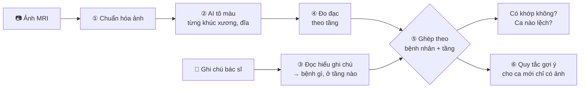
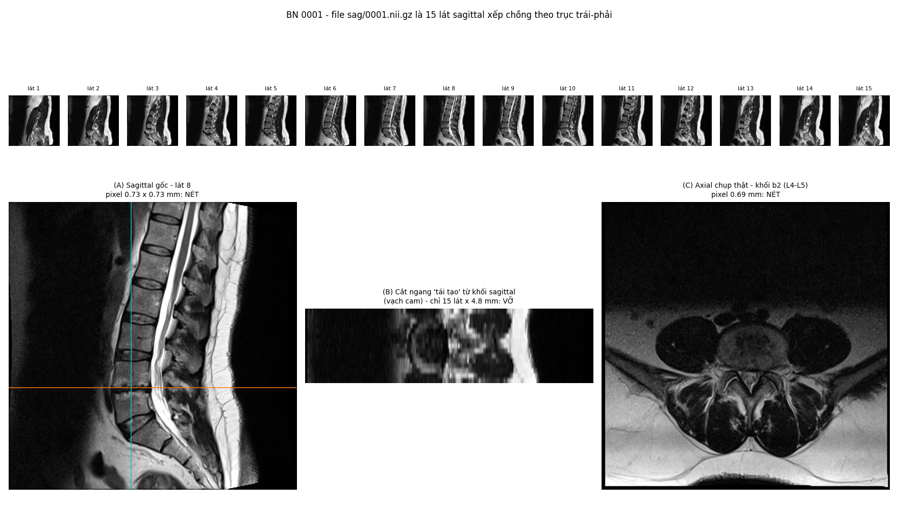

# Tổng quan pipeline

> Bản tóm tắt để trình bày. Chi tiết kỹ thuật xem [`README.md`](README.md).

## Một câu

**Máy tự "đọc" ảnh MRI cột sống lưng và tự "đọc" ghi chú của bác sĩ, rồi đối chiếu hai bên
xem có khớp nhau không — và gợi ý chỗ bác sĩ có thể bỏ sót.**

## Dữ liệu đầu vào

- **515 bệnh nhân** đau lưng, mỗi người có:
  - 📷 **Ảnh MRI** cột sống thắt lưng (~12,5 GB tổng).
  - 📝 **Một ghi chú** tiếng Anh của bác sĩ, ví dụ:
    > *"Diffuse disc bulges noted at L4/L5 & L5/S1, mildly compressing the thecal sac"*
    > (Phồng đĩa đệm lan tỏa ở L4/L5 và L5/S1, chèn ép nhẹ bao màng cứng)

Cột sống lưng có **6 "tầng" đĩa đệm** (T12-L1, L1-L2, …, L4-L5, L5-S1) — như 6 tấm đệm
cao su kẹp giữa các khúc xương. Mọi kết quả đều được tính **theo từng tầng**.

## Toàn cảnh: 2 nhánh rồi gặp nhau



Mấu chốt: biến cả **ảnh** lẫn **chữ** về cùng một dạng **bảng** có chung "địa chỉ"
`(bệnh nhân, tầng)` — khi đó mới so sánh được.

---

## Từng bước, kèm ví dụ

### ① Chuẩn hóa ảnh — "chọn đúng ảnh, đổi sang định dạng dễ dùng"

Mỗi lần chụp MRI ra hàng trăm file (định dạng DICOM), có nhiều kiểu chụp khác nhau. Máy tự
**chọn đúng loại ảnh cần** (ảnh dọc T2 — nước hiện sáng) và **gộp thành 1 khối 3D** (NIfTI).

Giống như từ một album ảnh lộn xộn, lấy đúng bộ ảnh chụp nghiêng và đóng thành một cuốn.



### ② AI tô màu cột sống — "phân đoạn"

Dùng mô hình AI có sẵn **TotalSpineSeg**: nhìn ảnh và **tô mỗi khúc xương, mỗi đĩa đệm, ống
sống một màu riêng**, có ghi tên.

- Chạy trên GPU Kaggle: **~18 giây/ca**, cả 515 ca mất ~2 giờ 41 phút.
- Kiểm tra lại: **514/515 ca tô đúng**.


### ③ Đọc hiểu ghi chú bác sĩ — "biến câu chữ thành bảng"

Máy đọc ghi chú theo các quy tắc (không dùng AI tạo sinh), trả lời 3 câu hỏi: **bệnh gì? ở tầng
nào? có hay không?**

Ví dụ bệnh nhân 4:

> *"Feature of muscle spasm. Diffuse disc bulges noted at L4/L5 & L5/S1 levels, mildly
> compressing the thecal sac…"*

| Tầng | Bệnh | Có? | Mức độ |
|---|---|---|---|
| (không rõ tầng) | Co cứng cơ | ✅ | – |
| L4-L5 | Phồng đĩa đệm | ✅ | – |
| L4-L5 | Chèn ép bao màng cứng | ✅ | nhẹ |
| L5-S1 | Phồng đĩa đệm | ✅ | – |
| L5-S1 | Chèn ép bao màng cứng | ✅ | nhẹ |

Cái khó là **câu phủ định**: *"**no** evidence of herniation"* → thoát vị = **KHÔNG**. Máy
cũng tự sửa lỗi chính tả hay gặp (`compresiing`, `nerrve`…).

👉 Độ chính xác khi chấm trên 80 ghi chú mẫu: **F1 ≈ 0,96** (gần như đọc đúng hết).

### ④ Đo đạc trên ảnh — "lấy thước đo từng tầng"

Từ hình đã tô màu, máy đo **13 con số cho mỗi tầng**, ví dụ:

| Số đo | Ý nghĩa đời thường | Liên quan bệnh |
|---|---|---|
| Chiều cao đĩa | Tấm đệm dày hay bị ép mỏng | Hẹp khoang đĩa |
| Độ sáng đĩa | Đĩa còn nước (sáng) hay khô (tối) | Mất nước đĩa đệm |
| Độ nhô ra sau | Tấm đệm có bị phình ra không | Phồng / lồi / thoát vị đĩa |
| Bề rộng ống sống | "Đường ống" chứa dây thần kinh rộng hay hẹp | Hẹp ống sống |
| Độ trượt | Khúc xương trên có trượt khỏi khúc dưới | Trượt đốt sống |


### ⑤ Ghép và so sánh — "số đo trên ảnh có khớp với lời bác sĩ không?"

**Bước 5a – Ghép hai bảng thành một.** Mỗi dòng là một tầng của một bệnh nhân: bên trái là số đo
từ ảnh (bước ④), bên phải là bác sĩ có ghi bệnh ở tầng đó hay không (bước ③). Ví dụ minh họa với
bệnh **mất nước đĩa đệm** (đĩa khô thì tối đi trên ảnh):

| Bệnh nhân | Tầng | Độ sáng đĩa (đo từ ảnh) | Bác sĩ ghi "mất nước đĩa"? |
|---|---|---|---|
| 12 | L5-S1 | 0,09 | ✅ Có |
| 37 | L5-S1 | 0,12 | ✅ Có |
| 58 | L5-S1 | 0,24 | ❌ Không |
| 91 | L5-S1 | 0,08 | ❌ Không ← **đáng ngờ** |
| … | … | … | … |

Cả bộ dữ liệu có **3.078 dòng** (513 bệnh nhân × 6 tầng).

**Bước 5b – Chia làm hai nhóm rồi so.** Lấy riêng tầng L5-S1, chia các đĩa thành nhóm *bác sĩ có
ghi bệnh* và nhóm *không ghi*, rồi xem độ sáng điển hình (trung vị) của mỗi nhóm:

| Nhóm | Độ sáng đĩa điển hình |
|---|---|
| Bác sĩ **có ghi** mất nước | **0,11** (tối) |
| Bác sĩ **không ghi** | **0,21** (sáng gấp đôi) |

→ Hai nhóm khác nhau rõ, nghĩa là **số đo máy tính ra khớp với nhận xét của bác sĩ**.

**Đo "khớp đến đâu" bằng một con số – AUC.** Bốc ngẫu nhiên 1 đĩa có ghi bệnh và 1 đĩa không ghi,
hỏi: đĩa có bệnh có tối hơn không? Lặp lại thật nhiều lần, **tỉ lệ trả lời "có" chính là AUC**.
0,5 = như tung đồng xu (số đo vô dụng); 1 = lần nào cũng đúng.

| Bệnh bác sĩ ghi | Số đo dùng | AUC |
|---|---|---|
| Hẹp khoang đĩa | Chiều cao đĩa | **0,97** |
| Hẹp ống sống | Bề rộng ống sống | **0,88** |
| Lồi đĩa | Độ nhô ra sau | **0,87** |
| Mất nước đĩa | Độ sáng đĩa | 0,77 |

**Bước 5c – Tìm ca lệch.** Quay lại bệnh nhân 91 ở bảng trên: bác sĩ **không ghi** mất nước,
nhưng đĩa **tối hơn cả mức điển hình của nhóm có bệnh** (0,08 < 0,11). Những ca như vậy được đánh
dấu **"nghi bỏ sót"**.

→ Ở L5-S1 có **56 đĩa** như vậy, tức **cứ khoảng 8 đĩa không được ghi thì có 1 đĩa** trông giống
đĩa bệnh. Đây là danh sách để bác sĩ **xem lại**.

**Thêm một kiểm tra:** tuổi càng cao thì đĩa càng tối (tương quan rất mạnh, ρ = −0,70). Điều này
đúng với y văn, nên phép đo đáng tin.


### ⑥ Quy tắc gợi ý cho bệnh nhân mới — "khi chỉ có ảnh, chưa có ghi chú"

Mục tiêu: có một bệnh nhân mới, máy tự nói được *"nghi hẹp ống sống ở tầng L3-L4"*. Mỗi quy tắc
chỉ có dạng **"số đo ≤ ngưỡng → nghi bệnh"**. Thứ duy nhất máy phải **học** là **con số ngưỡng**.

**Học ngưỡng = thử mọi mức cắt, chọn mức tốt nhất.** Ví dụ đơn giản với 10 tầng L3-L4, đo bề
rộng ống sống (mm), 3 tầng bác sĩ ghi hẹp ống sống (🔴), 7 tầng không ghi (⚪):

```
  6,5🔴  7,2🔴  7,5⚪  7,9🔴  8,6⚪  9,4⚪  10,1⚪  10,8⚪  11,5⚪  12,3⚪
```

Máy thử từng mức cắt và đếm:

| Quy tắc thử | Bắt được ca bệnh | Báo nhầm ca không bệnh | Điểm = bắt được − báo nhầm |
|---|---|---|---|
| ≤ 6,5 mm | 1/3 = 33% | 0/7 = 0% | 0,33 |
| ≤ 7,2 mm | 2/3 = 67% | 0/7 = 0% | 0,67 |
| ≤ 7,5 mm | 2/3 = 67% | 1/7 = 14% | 0,52 |
| **≤ 7,9 mm** | **3/3 = 100%** | **1/7 = 14%** | **0,86 ← cao nhất** |
| ≤ 8,6 mm | 3/3 = 100% | 2/7 = 29% | 0,71 |

→ Chọn ngưỡng **≈ 8 mm**: cắt thấp quá thì sót ca bệnh, cắt cao quá thì báo nhầm nhiều. Cách
chọn điểm cân bằng này gọi là **chỉ số Youden**. Trên dữ liệu thật (512 tầng L3-L4), máy cũng ra
được **≤ 8,0 mm**.

**Kiểm tra quy tắc có dùng được cho người mới không.** Nếu học và chấm trên cùng dữ liệu thì
điểm sẽ đẹp giả tạo, nên máy làm như sau:

1. Chia 513 bệnh nhân thành **5 nhóm**.
2. Học ngưỡng trên 4 nhóm, đem áp lên nhóm thứ 5 (coi như **bệnh nhân mới chưa từng thấy**).
3. Xoay vòng 5 lần để nhóm nào cũng được làm "người mới" một lần, rồi cộng kết quả.

Gọi là **kiểm chứng chéo** (cross-validation). Ví dụ quy tắc trên khi chấm theo cách này: **bắt
được 90% ca bệnh**, và **86% ca không bệnh không bị báo nhầm**.

**Lọc.** Có 54 quy tắc ứng viên (bệnh × số đo × tầng), chỉ giữ quy tắc nào chắc chắn có AUC ≥ 0,70
→ **giữ 35/54**, mỗi quy tắc gắn độ tin cậy **cao / vừa**.


---

## Tóm lại để nói với mọi người

1. **Đầu vào:** ảnh MRI + ghi chú bác sĩ của 515 bệnh nhân.
2. **AI tô màu cột sống** → **đo đạc** từng tầng đĩa.
3. **Đọc ghi chú** → bảng "bệnh gì, tầng nào".
4. **Đối chiếu:** số đo khớp với bác sĩ (AUC tới 0,97), và **tìm được ca nghi bị ghi thiếu**.
5. **Ứng dụng:** với ca mới, hệ thống **gợi ý** "nghi bệnh X tại tầng Y" để bác sĩ xem lại.

## Giới hạn cần nói rõ

- Đây là **công cụ gợi ý / kiểm tra chéo**, **không phải chẩn đoán**.
- Bệnh hiếm → nhiều báo động giả (khi máy báo "nghi", đôi khi chỉ đúng 10–30%).
- Chỉ đo trên ảnh cắt dọc; một số bệnh (chèn ép rễ thần kinh) không đo trực tiếp được.
- Mới kiểm tra trên một bộ dữ liệu, chưa thử ở bệnh viện khác.
