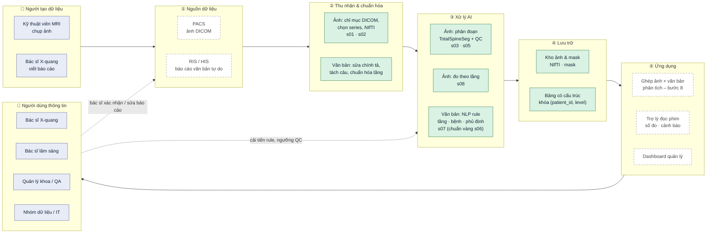
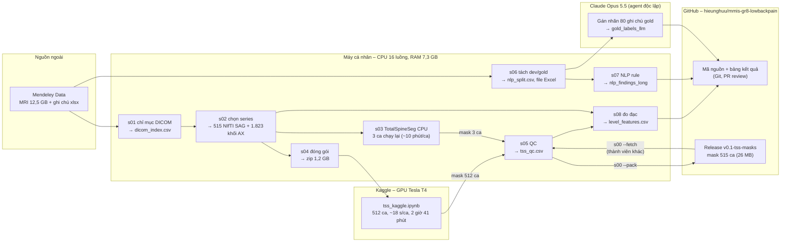
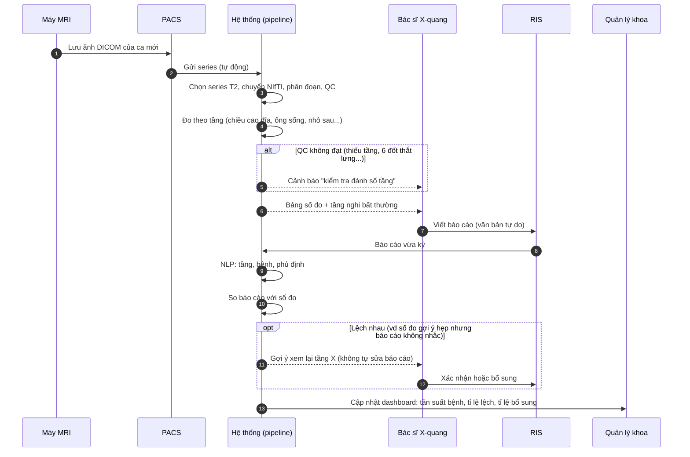
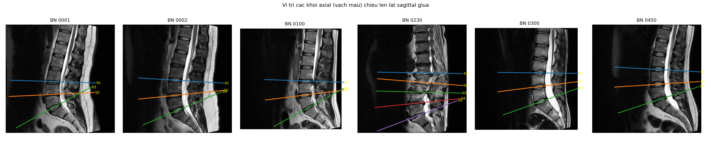
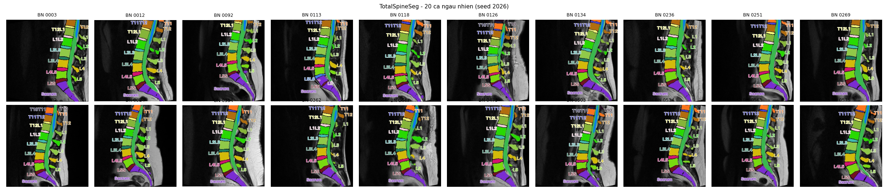

# Pipeline xử lý dữ liệu – MRI cột sống thắt lưng + ghi chú bác sĩ

Mã nguồn cho assignment môn **Modern Management Information Systems (CO5111)**, đề tài
*More Precise Diagnosis for Low Back Pain*.

**Ý tưởng chung:** đưa cả ảnh lẫn văn bản về **bảng có cấu trúc dùng chung khóa
`(patient_id, level)`** rồi mới ghép lại để phân tích:

```
MRI (DICOM) ─► s01 lập chỉ mục ─► s02 chọn series + NIfTI ─► TotalSpineSeg ─► mask ─► số đo / tầng ─┐
                                                                                                  ├─► ghép (patient_id, level) ─► insight
Ghi chú (xlsx) ─► NLP: tầng + bệnh + phủ định ─────────────────────────────────────► nhãn / tầng ──┘
```

Giải thích về bộ dữ liệu, giải phẫu và thuật ngữ y khoa: xem [`../data/README.md`](../data/README.md).

| Bước | Script | Trạng thái |
|---|---|---|
| 1 | `s01_index_dicom.py` – lập chỉ mục header DICOM | ✅ Xong |
| 2 | `s02_select_convert.py` – chọn series T2, chuyển sang NIfTI | ✅ Xong |
| 3 | `s03_tss_pilot.py` – cài TotalSpineSeg, chạy thử trên CPU (BN 1: phân đoạn tốt, **~15 phút/ca**) | ✅ Xong |
| 3b | `s04_pack_for_kaggle.py` + [`kaggle/`](kaggle/README.md) – chạy trên Kaggle GPU (T4): **514/515 ca, ~18 s/ca, 2 giờ 41 phút**. Ca thiếu (BN 515) do chọn nhầm series phóng to → sửa quy tắc bước 2, chạy lại riêng ca này trên CPU | ✅ Xong |
| 4 | `s05_tss_qc.py` – gộp kết quả 515 ca, QC phân đoạn: **514/515 đạt, 513 dùng được theo tầng** – [mục 4](#4-bước-4--qc-kết-quả-phân-đoạn-totalspineseg-s05_tss_qcpy) | ✅ Xong |
| 5 | NLP ghi chú → nhãn theo tầng, **bằng rule** (LLM tạm hoãn) – thiết kế: [mục 5](#5-bước-5--trích-xuất-nhãn-từ-ghi-chú-bác-sĩ-bằng-rule-thiết-kế) | 🔄 Đang làm |
| 5a | `s06_gold_sample.py` – tách 435 dev / 80 gold, tạo `data/gold/gold_annotation.xlsx` | ✅ Xong – **chờ nhóm gán nhãn gold** |
| 5b | `nlp_rules.py` + `s07_nlp_extract.py` – bộ rule, lặp 4 vòng trên dev ([mục 5.10](#510-bước-5b--cài-đặt-và-kết-quả-trên-tập-dev)) | ✅ Xong (dev) – chấm trên gold ở 5d |
| 6 | Tải kết quả Kaggle về, kiểm tra đủ 515 ca – gộp vào bước 4 | ✅ Xong |
| 7 | `s08_level_features.py` – 13 số đo theo tầng + góc ưỡn – [mục 7](#7-bước-7--tính-số-đo-theo-tầng-từ-mask-s08_level_featurespy--thiết-kế) | ✅ Xong |
| 8 | Ghép, phân tích, biểu đồ | ⏳ |

---

## Kiến trúc hệ thống

Ba góc nhìn: (A) kiến trúc tổng thể theo tầng, đọc từ trái sang phải theo mô hình **đầu vào → xử
lý → đầu ra** – phần **đã xây** nền xanh lá, phần **đề xuất** viền đứt, người dùng nền xanh dương; (B) luồng dữ liệu đã hiện thực trong project; (C) kịch bản sử dụng khi
triển khai tại khoa chẩn đoán hình ảnh.

Ảnh PNG để chèn vào báo cáo / slide: `outputs/figures/arch_a.png`, `arch_b.png`, `arch_c.png`
(render từ chính các khối Mermaid dưới đây bằng `npx @mermaid-js/mermaid-cli`).

### A. Kiến trúc tổng thể theo tầng



| Tầng | Thành phần | Vai trò trong hệ thống thông tin | Trạng thái |
|---|---|---|---|
| ① Nguồn | Máy MRI, PACS, RIS/HIS | Dữ liệu giao dịch hằng ngày của khoa (ảnh + báo cáo). Project dùng bộ dữ liệu công khai thay cho PACS/RIS thật | Thay bằng dữ liệu Mendeley |
| ② Thu nhận | s01, s02, nạp ghi chú | Làm sạch, chuẩn hóa – biến dữ liệu thô không đồng nhất thành dạng máy xử lý được | ✅ |
| ③ Xử lý AI | TotalSpineSeg, QC, đo đạc; NLP rule, bộ chuẩn vàng | Biến ảnh và văn bản thành **dữ liệu có cấu trúc** theo cùng khóa `(patient_id, level)` | ✅ (5d chờ chấm) |
| ④ Lưu trữ | Kho ảnh/mask; bảng có cấu trúc | Ảnh lớn tách khỏi bảng nhỏ; bảng là "kho dữ liệu" cho phân tích | ✅ (dạng file) |
| ⑤ Ứng dụng | Phân tích, dashboard, trợ lý đọc phim, màn hình duyệt | Tạo **thông tin** cho từng nhóm người dùng; vòng phản hồi cải tiến hệ thống | Bước 8 + đề xuất |

### B. Luồng dữ liệu đã hiện thực (môi trường chạy)



Điểm thiết kế đáng chú ý:
- **Tách tính toán nặng ra GPU đám mây** (Kaggle): CPU cá nhân ~15 phút/ca → GPU ~18 s/ca.
- **Ảnh y tế không vào Git**; chỉ mã nguồn + bảng nhỏ. Kết quả tốn kém (mask) chia sẻ qua
  Release có kiểm tra SHA-256 – thành viên khác không cần GPU.
- **Kiểm soát chất lượng ở mọi chặng**: QC hình học (s02), QC phân đoạn (s05), QC đo đạc (ảnh
  overlay s08), bộ chuẩn vàng cho NLP (s06/5d).

### C. Kịch bản sử dụng đề xuất: hỗ trợ bác sĩ đọc một ca mới



Hệ thống **không thay bác sĩ chẩn đoán**: nó chuẩn hóa dữ liệu, đo lường, và **gợi ý** chỗ cần
xem lại; mọi kết luận do bác sĩ ký (human-in-the-loop). Dashboard biến dữ liệu vận hành thành
thông tin quản lý (chất lượng báo cáo, phân bố bệnh, năng suất).

---

## 0. Chuẩn bị

```
mmis-gr8-lowbackpain/      # gốc repo
├── data/
│   ├── MRI_Data/01_MRI_Data/0001 … 0575/    # ảnh DICOM (.ima), 515 bệnh nhân
│   └── Radiologists Report.xlsx
└── totalspineseg/                            # thư mục này (code + kết quả)
    ├── src/
    └── outputs/                              # do script sinh ra
```

```bash
pip install -r requirements.txt
cd totalspineseg
python src/s01_index_dicom.py        # ~2 phút
python src/s02_select_convert.py     # ~2 phút
```

### Nguồn dữ liệu và trích dẫn

Dữ liệu **không** nằm trong Git (12,5 GB, dữ liệu y tế). Tải về và đặt vào `data/` ở gốc repo theo cấu trúc trên:

| Dữ liệu | Nguồn |
|---|---|
| Ảnh MRI (`MRI_Data/`) | *Lumbar Spine MRI Dataset* – https://data.mendeley.com/datasets/k57fr854j2/2 (DOI 10.17632/k57fr854j2.2) |
| Ghi chú bác sĩ (`Radiologists Report.xlsx`) | *Radiologists' Notes* – https://data.mendeley.com/datasets/s6bgczr8s2/2 (DOI 10.17632/s6bgczr8s2.2) |

Khi sử dụng, trích dẫn:
- Sudirman S. *et al.*, "Lumbar Spine MRI Dataset", Mendeley Data V2, 2019. doi: 10.17632/k57fr854j2.2
- Sudirman S. *et al.*, "Radiologists' Notes for Lumbar Spine MRI Dataset", Mendeley Data V2, 2019. doi: 10.17632/s6bgczr8s2.2
- Natalia F. *et al.*, "Automated measurement of anteroposterior diameter and foraminal widths in MRI images for lumbar spinal stenosis diagnosis", *PLoS ONE* 15(11), 2020.
- TotalSpineSeg: https://github.com/neuropoly/totalspineseg

### Dữ liệu dùng chung trong nhóm

| Dữ liệu | Lấy ở đâu | Ghi chú |
|---|---|---|
| Ảnh MRI + ghi chú bác sĩ (12,5 GB) | Mendeley (bảng trên) → đặt vào `data/` | Nguồn chính thức, mỗi người tự tải |
| **Mask TotalSpineSeg 515 ca** (~29 MB) | **GitHub Release `v0.1-tss-masks`** của repo | Tốn ~2,7 giờ GPU + 30 phút CPU để tạo lại → tải về thay vì chạy lại bước 3 |
| Preview mask (1 ảnh/ca, tùy chọn) | Cùng release | Để xem QC bằng mắt |
| NIfTI (2,1 GB) | Tự tạo: `python src/s02_select_convert.py` (~2 phút) | Không chia sẻ |
| Bảng kết quả, hình, nhãn gold | Git | – |

Tải mask (không cần GPU, không cần cài TotalSpineSeg):

```bash
python src/s00_shared_data.py --fetch              # mask -> outputs/tss/sag/, kiem tra SHA-256
python src/s00_shared_data.py --fetch --previews   # them anh preview
```

Sau đó chạy tiếp `s05` → `s08` (cần ảnh gốc + `s01`, `s02` cho bước đo tín hiệu ở `s08`).
Người tạo release dùng `python src/s00_shared_data.py --pack` để đóng gói lại từ
`outputs/tss/sag/` (zip + `MANIFEST.json` ghi commit, ngày, số ca, SHA-256 từng file).

Mọi đường dẫn khai báo trong `src/common.py`. Các script dùng đa tiến trình (16 luồng
CPU); thời gian ở trên đo trên máy CPU 16 luồng, RAM 7,3 GB.

---

## 1. Bước 1 – Lập chỉ mục header DICOM (`s01_index_dicom.py`)

### Mục đích
Đọc **chỉ phần header** (không đọc pixel) của toàn bộ 48.345 file `.ima` để biết mỗi
bệnh nhân có những series nào, mặt cắt gì, T1 hay T2 – làm cơ sở chọn series ở bước 2.

### DICOM: mỗi file = header + pixel

```
┌──────────────────────────────────────────────┐
│ HEADER: hàng trăm tag (thông tin mô tả)      │  ← bước 1 chỉ đọc phần này
├──────────────────────────────────────────────┤
│ PIXEL DATA: ma trận ví dụ 384×384, 12-bit    │  ← bước 2 mới đọc
└──────────────────────────────────────────────┘
```

Tổ chức dữ liệu theo 4 cấp:

| Cấp | Ví dụ (BN 0001) | Ý nghĩa |
|---|---|---|
| Bệnh nhân | `0001/` | Một người |
| Study | `L-SPINE_LSS_20160309_091629_240000/` | Một lần vào máy chụp |
| **Series** | `T2_TSE_SAG_384_0002/` | Một lượt quét liên tục, cùng cài đặt (T2, sagittal) |
| Instance | `T2_TSE_SAG__0001_001.ima` | Một lát cắt 2D |

### Các tag được đọc

| Nhóm | Tag | Dùng để |
|---|---|---|
| Bệnh nhân | `PatientAge`, `PatientSex` | Thông tin nhân khẩu. `PatientID` **đã bị ẩn danh (rỗng)**, nên mã BN lấy từ **tên thư mục** |
| Tổ chức | `StudyInstanceUID`, `SeriesInstanceUID`, `SeriesNumber`, `SeriesDescription`, `InstanceNumber` | Nhóm lát thành series, nhận diện loại chuỗi xung |
| **Hình học** | `ImageOrientationPatient`, `ImagePositionPatient`, `PixelSpacing`, `SliceThickness`, `SpacingBetweenSlices` | Xác định mặt cắt, vị trí lát trong không gian, quy đổi pixel ra mm |
| Chụp | `EchoTime`, `RepetitionTime`, `MagneticFieldStrength` | Kiểm tra chéo T1/T2 (T2 có TE > 60 ms) |

### Quy tắc xác định mặt cắt
**Không tin tên thư mục.** Mặt cắt tính từ `ImageOrientationPatient` (6 số = 2 vector
hướng hàng và hướng cột của ảnh, trong hệ tọa độ bệnh nhân LPS: x → trái, y → sau
lưng, z → lên đầu):

- Pháp tuyến của lát = tích có hướng của 2 vector.
- Pháp tuyến gần trục **x** → **SAG**; trục **y** → COR; trục **z** → **AX**.

Ví dụ BN 0001: T2 SAG có hàng (0, 1, 0), cột (−0,03, 0, −1) → pháp tuyến ≈ (−1, 0, 0)
→ sagittal.

Đồng thời đánh cờ `is_localizer` (ảnh định vị) và `is_posdisp` (ảnh phụ trợ máy tự
sinh) để loại.

### Đầu ra
`outputs/tables/dicom_index.csv` – 48.345 dòng × 38 cột (mỗi file `.ima` một dòng).
In lại tóm tắt mà không đọc lại file: `python src/s01_index_dicom.py --summary`.

### Kết quả

| Chỉ số | Giá trị |
|---|---|
| Bệnh nhân | 515 |
| Tổng lát | 48.345 = 5.544 localizer + 1.895 POSDISP + **40.922 ảnh chính** |
| Có T2 TSE SAG / T2 TSE AX | **515 / 515** và **515 / 515** |
| BN có > 1 study | 38 (vd BN 230 có thêm một study **chụp bụng**) |
| BN có > 1 series T2 TSE SAG / AX | 31 / 57 |

### Phát hiện về dữ liệu
1. **Tên series có thể sai:** 75 lát của 4 BN (169, 230, 243, 532) tên `t2_tse_sag_…`
   nhưng hướng thực tế **không phải sagittal** → xác nhận phải dùng tag hướng.
2. **Không phải cứ tên có "t2" là T2 chuẩn:** 1.445 lát như `t2_tirm` (STIR, TE 35 ms),
   `t2_trufi`, `t2_ciss3d` có độ tương phản khác → **chỉ dùng `t2_tse`**.
3. **Thứ tự thư mục không nói lên study nào là cột sống:** `ABDOMEN_…` đứng trước
   `L-SPINE_…` theo bảng chữ cái → chọn study theo nội dung, không theo thứ tự.

---

## 2. Bước 2 – Chọn series và chuyển sang NIfTI (`s02_select_convert.py`)

### Vì sao phải chuyển DICOM → NIfTI

| | DICOM (gốc) | NIfTI (sau chuyển) |
|---|---|---|
| Cách lưu | **Mỗi lát một file**, hình học rải rác trong từng header | **Một file = cả khối 3D**, hình học gói trong một header |
| Ai dùng | Máy chụp, PACS bệnh viện | nnU-Net, **TotalSpineSeg**, SimpleITK, nibabel |

1. **TotalSpineSeg (nnU-Net) chỉ nhận `.nii.gz` 3D.**
2. **Làm sạch một lần, dùng chung cho mọi bước sau:** sắp lát, bỏ lát trùng, tách khối
   axial, loại series sai tên – nếu không thì mỗi bước sau phải tự xử lý lại.
3. **Gọn hơn:** 12,5 GB DICOM → 2,1 GB NIfTI nén (chỉ giữ T2 cần dùng).

NIfTI giữ nguyên pixel và hình học (spacing, hướng, gốc tọa độ mm). Thông tin bệnh
nhân/series nằm ở `dicom_index.csv`, `series_selected.csv`. DICOM gốc không bị sửa.

### Quy tắc chọn series

Chỉ xét ảnh chính, tên chứa `t2_tse`, mặt cắt theo **hướng thực tế**.

| | Thứ tự ưu tiên |
|---|---|
| **SAG** | study `L-SPINE*` → **trường nhìn (FOV = `Rows` × `PixelSpacing`) ≥ 250 mm** → **tâm series cách tâm vùng ảnh axial (cùng study) ≤ 100 mm** → nhiều **vị trí lát khác nhau** nhất → series chụp sau (`SeriesNumber` lớn hơn, thường là chụp lại do lần đầu bị rung) |
| **AX** | **cùng study với SAG đã chọn** (để chung hệ tọa độ) → study `L-SPINE*` → nhiều vị trí lát nhất → chụp sau |

Kết quả: 0 ca AX khác study với SAG.

**Vì sao cần điều kiện FOV:** phiên bản đầu chỉ ưu tiên "nhiều lát nhất" nên với BN 515
đã chọn `t2_tse_sag_448` – ảnh **chụp phóng to** (25 lát, pixel 0,42 mm, FOV chỉ 160 mm)
thay vì `t2_tse_sag_384` chuẩn (15 lát, FOV 280 mm). Ảnh phóng to không đủ mốc giải phẫu
nên TotalSpineSeg không đánh số tầng được (ca duy nhất thất bại trên Kaggle). Sau khi thêm
điều kiện FOV ≥ 250 mm, chỉ BN 515 đổi series; 514 ca còn lại giữ nguyên (đã đối chiếu
`series_selected.csv` và `nifti_volumes.csv` trước/sau). FOV của series SAG được chọn:
510 ca 280 mm, 4 ca 260–300 mm.

**Vì sao cần điều kiện gần vùng axial:** QC ở bước 4 phát hiện 2 ca có hai series T2 SAG
đặt ở **hai vùng khác nhau** và quy tắc cũ chọn nhầm: BN 420 chọn series vùng **ngực**
(C7–T12, tâm cách vùng axial 237 mm thay vì series thắt lưng cách 3 mm); BN 542 chọn series
**lệch xuống chậu** (chỉ thấy L3 → xương cùng, cách 109 mm thay vì 11 mm). Ảnh axial luôn
được chụp tại các đĩa thắt lưng nên dùng làm mốc: series SAG đúng là series có tâm gần vùng
axial. Dùng **ngưỡng 100 mm** thay vì "gần nhất" để không đổi lựa chọn của các BN có series
chụp lại cùng vị trí (chỉ lệch vài mm). Kết quả: chỉ BN 420 và 542 đổi series; mọi series
SAG được chọn cách vùng axial tối đa 66 mm (trung vị 25 mm). Tâm lát tính theo z (đầu–chân):
`ImagePositionPatient` + nửa số hàng × hướng cột + nửa số cột × hướng hàng.

### Vì sao ảnh axial có nhiều khối

Đây là **quy trình chụp chuẩn**, không phải lỗi dữ liệu:

- Cột sống thắt lưng cong ưỡn → các đĩa **nghiêng khác nhau** (L5-S1 nghiêng nhất, ≈ 29°
  ở BN 0001). Kỹ thuật viên xoay mặt cắt **song song với từng đĩa** để lát cắt vuông góc
  qua đĩa; cắt chéo sẽ làm méo hình (đĩa trông như phồng, diện tích ống sống đo sai).
- Bệnh tập trung ở 3 đĩa dưới → chụp mỗi đĩa một khối 4–5 lát (≈ 16–20 mm) thay vì phủ
  liên tục ~150 mm → tiết kiệm khoảng 2/3 thời gian chụp.

```
        ┌──┐
        │L3│
        └──┘
   ━━━━ ════ ━━━━   ← khối b1: gần như nằm ngang
        ┌──┐
        │L4│
        └──┘
   ━━━━ ════ ━━━━   ← khối b2: hơi nghiêng
        ┌──┐
        │L5│
     ╲╲╲╲ ════ ╲╲╲  ← khối b3: nghiêng nhiều
           ╲S1╲
```

Vì vậy **không được gộp cả series axial thành một khối 3D** (như chồng 3 xấp giấy
nghiêng khác nhau rồi coi là một ram thẳng → hình học sai). Mỗi khối thành một NIfTI riêng.

### Các bước xử lý

1. **Tách khối axial:** gom lát theo hướng (`ImageOrientationPatient` làm tròn 2 chữ số),
   rồi tách tiếp nếu có **khoảng nhảy vị trí > 1,5 lần khoảng cách thường** (hai khối cho
   hai đĩa khác nhau tình cờ trùng góc nghiêng). Series SAG có > 1 hướng thì giữ khối lớn nhất.
2. **Sắp lát theo vị trí thật** dọc pháp tuyến (`ImagePositionPatient · pháp tuyến`),
   không theo `InstanceNumber`.
3. **Bỏ lát trùng** (cùng vị trí).
4. **Ghép thành khối 3D** và gắn hình học: spacing = (`PixelSpacing` cột, hàng, khoảng cách
   lát trung vị), gốc = vị trí lát đầu, hướng = (vector hàng, vector cột, pháp tuyến).
   SimpleITK tự đổi hệ LPS (DICOM) sang RAS (NIfTI) khi ghi file.
5. **Kiểm tra** khoảng cách giữa các lát có đều không (sai lệch < 0,1 mm).
6. **Ảnh QC:** chiếu lát giữa của từng khối axial lên lát sagittal giữa bằng tọa độ mm thật.

### Đầu ra

| File | Nội dung |
|---|---|
| `outputs/nifti/sag/0001.nii.gz` | 515 khối sagittal |
| `outputs/nifti/ax/0001_b1.nii.gz`, `_b2`, … | 1.823 khối axial; `b1` = khối cao nhất (gần đầu), số tăng dần xuống dưới |
| `outputs/tables/series_selected.csv` | Series được chọn cho mỗi BN, số ứng viên, có cùng study không |
| `outputs/tables/nifti_volumes.csv` | Mỗi file NIfTI một dòng: số lát, spacing, số lát trùng đã bỏ, QC khoảng cách |
| `outputs/figures/qc_s02_geometry.png` | Vị trí các khối axial chiếu lên ảnh sagittal |

`outputs/nifti/` nằm trong `.gitignore` (ảnh y tế, ~2,1 GB).

### Kết quả

| | Sagittal | Axial |
|---|---|---|
| Số file | 515 | 1.823 khối |
| Số lát | 13–15 | đa số 4–5 / khối |
| Kích thước pixel | 0,68–0,88 mm | 0,50–0,89 mm |
| Khoảng cách lát | 4,8–5,4 mm | 3,6–6,0 mm |
| Khoảng cách lát không đều | 0 | 0 |

Số khối axial mỗi bệnh nhân:

| Số khối | 1 | 2 | **3** | 4 | 5 | 6 |
|---|---|---|---|---|---|---|
| Số BN | 18 | 1 | **272** | 135 | 87 | 2 |

- **3 khối** = quy trình chuẩn (L3-L4, L4-L5, L5-S1).
- **4–5 khối** = chụp thêm tầng trên (L2-L3, L1-L2).
- **1 khối** (18 BN) = quy trình khác: một chồng 15–25 lát song song phủ cả vùng.

→ Ảnh axial chỉ có ở **3–5 tầng dưới**; tầng trên (L1-L2) thường chỉ có sagittal.

### Các vấn đề dữ liệu đã gặp và cách xử lý

| Vấn đề | Số ca | Xử lý |
|---|---|---|
| **Mỗi lát bị lưu 2 lần** (pixel giống hệt, chỉ khác `SOPInstanceUID`) – gây lỗi "spacing = 0" | 19 BN, 618 lát thừa | Bỏ lát trùng vị trí; khi chọn series đếm **số vị trí lát khác nhau** thay vì số file |
| **Hai khối axial trùng góc nghiêng** bị gộp → khoảng nhảy 9–81 mm | 32 khối | Tách theo khoảng nhảy vị trí |
| Nhiều series ứng viên | 45 BN (SAG), 57 BN (AX) | Quy tắc ưu tiên ở trên, ghi lại trong `series_selected.csv` |
| Series tên "sag" nhưng thực tế không phải SAG | 4 BN | Chọn theo hướng thực tế |
| Series SAG **phóng to** (FOV 160 mm) có nhiều lát hơn series chuẩn | 1 BN (515) | Ưu tiên FOV ≥ 250 mm trước số lát |
| Hai series T2 SAG ở **hai vùng khác nhau** (ngực / chậu) | 2 BN (420, 542) | Ưu tiên series có tâm cách vùng axial ≤ 100 mm |

### Kiểm tra hình học (QC)



Các vạch màu (vị trí khối axial b1, b2, …) rơi **đúng vào các đĩa thắt lưng dưới** trên
ảnh sagittal → tọa độ ảnh sagittal và axial **khớp nhau** sau khi chuyển đổi (ảnh được vẽ
từ chính file NIfTI). Đây là điều kiện để sau này biết mỗi khối axial thuộc tầng đĩa nào.

### Lưu ý cho bước sau
Mỗi khối axial chỉ 4–5 lát (16–20 mm) – có thể quá mỏng để TotalSpineSeg tự phân đoạn
tốt. Bước 3 sẽ chạy thử để kiểm chứng; nếu không ổn, dùng mask sagittal để xác định tầng
của từng khối bằng phép chiếu tọa độ như ảnh QC ở trên.

---

## 4. Bước 4 – QC kết quả phân đoạn TotalSpineSeg (`s05_tss_qc.py`)

### Mục đích
Kiểm tra mask của **cả 515 ca** trước khi dùng để đo đạc: mask sai tầng thì mọi số đo ở
bước 7 bị ghép nhầm với nhãn của tầng khác ở bước 8.

### Đầu vào
- `outputs/kaggle/tss_sag_results.zip` – 514 ca chạy trên Kaggle (không cần giải nén tay).
- Các ca **chạy lại trên CPU** sau khi sửa quy tắc chọn series (bước 2), **ghi đè** kết quả
  Kaggle của chính ca đó: `outputs/tss_pilot/sag_0515/output/` (BN 515 – điều kiện FOV),
  `outputs/tss_pilot/sag_0420_0542/output/` (BN 420, 542 – điều kiện gần vùng axial).
  Mỗi ca ~10 phút trên CPU.
- `outputs/nifti/sag/*.nii.gz` – ảnh gốc, để so kích thước.

### Các kiểm tra tự động (mỗi ca)

| Mã lỗi | Kiểm tra | Vì sao |
|---|---|---|
| `geom` | Mask cùng kích thước, spacing, gốc tọa độ với ảnh gốc | Mask lệch → mọi số đo sai |
| `missing_vert` | Có đủ đốt L1–L5 (41–45) và xương cùng (50) | Thiếu đốt → không đo được tầng đó |
| `missing_disc` | Có đủ đĩa L1-L2, L2-L3, L3-L4, L4-L5, L5-S (92–95, 100) | Như trên; T12-L1 (91) không bắt buộc |
| `missing_canal` | Có ống sống (2) | Cần để đo hẹp ống sống |
| `order` | Theo trục đầu–chân (z): L1 > đĩa L1-L2 > L2 > … > L5 > đĩa L5-S > xương cùng (tọa độ trọng tâm, mm) | Thứ tự sai = đánh số tầng sai |
| `fragmented` | Khối liền lớn nhất chiếm ≥ **90 %** thể tích nhãn (**đĩa**) / ≥ **70 %** (**đốt**) | Một nhãn nằm ở hai chỗ → khả năng gán nhầm nhãn |
| `volume_outlier` | Thể tích mỗi đốt/đĩa so với phân bố 515 ca: lệch quá 4 MAD so với trung vị, hoặc < 25 % trung vị | Mask quá nhỏ/quá to bất thường |
| `transitional` | Có nhãn **L6** (46) = 6 đốt thắt lưng (đốt sống chuyển tiếp) | Không chắc ghép đúng tầng với ghi chú bác sĩ (xem dưới) |

- Ca **đạt** (`qc_pass`) = không có lỗi `geom` → `fragmented`. `volume_outlier` chỉ là
  **cảnh báo** (có thể là bệnh thật, vd đĩa xẹp), không loại ca.
- **`use_level`** = đạt QC **và** không `transitional` → dùng cho phân tích **theo tầng** ở
  bước 8. Ca `transitional` vẫn dùng cho phân tích **mức bệnh nhân**.

### Vì sao ngưỡng `fragmented` khác nhau cho đốt và đĩa
Lần chạy đầu dùng chung 90 % → **323 ca bị gắn cờ sai**. Phân tích lại:
- **Đĩa** luôn liền một khối (5 % thấp nhất vẫn ≥ 0,999).
- **Đốt**: phân bố hai nhóm – 55 % đốt ≥ 0,99 (liền khối), **26 % ở 0,80–0,90**, chỉ 2 đốt
  < 0,80. Kiểm tra 40 đốt bị tách ngẫu nhiên: phần tách ra **luôn nằm phía sau** thân đốt
  (trung vị 34 mm), **đúng đường giữa** (lệch trái/phải 1,8 mm), thấp hơn ~19 mm và trên
  các **lát giữa** → đó là **mỏm gai / bản sống**. Thân đốt và mỏm gai chỉ nối với nhau qua
  **cuống sống ở hai bên** (cách đường giữa ~10–15 mm); với lát sagittal cách nhau 4,8 mm,
  cầu nối mảnh này thường rơi vào khe giữa hai lát → mask tách thành 2 khối. Đây là giới hạn
  độ dày lát, không phải lỗi phân đoạn.
- Một ca bị gắn cờ nếu **bất kỳ** đốt nào trong 5 đốt dưới ngưỡng → 323/515 ca.
- Ngưỡng 0,7 cho đốt nằm giữa nhóm bình thường (≥ 0,8) và nhóm bất thường thật.
- **Hệ quả cho bước 7:** khi đo thân đốt, chỉ giữ khối liền lớn nhất (thân đốt), bỏ mỏm gai.

### Đốt sống chuyển tiếp (6 đốt thắt lưng) – BN 113, 245
TotalSpineSeg đếm từ trên xuống (từ T12) và gán nhãn L6 cho đốt dưới cùng. Bác sĩ chụp riêng
thắt lưng thường đếm từ dưới lên (từ xương cùng). Với 6 đốt, **cùng một đĩa có thể mang hai
tên** (vd "L4-L5" của bác sĩ = "L5-L6" của TotalSpineSeg). Không ghi chú nào trong 515 ghi chú
nhắc biến thể này (tìm "lumbarization", "sacralization", "transitional", "L6": 0 kết quả)
→ không biết bác sĩ đếm theo cách nào → loại 2 ca khỏi phân tích theo tầng (`use_level =
False`), giữ ở mức bệnh nhân. Đây cũng là một phát hiện cho báo cáo: báo cáo X-quang không
ghi lại biến thể giải phẫu – rủi ro sai tầng mà hệ thống tự động có thể cảnh báo.

### Đầu ra
| File | Nội dung |
|---|---|
| `outputs/tss/sag/step2_output/`, `step1_levels/`, `preview/` | Kết quả gộp 515 ca, một nơi duy nhất cho các bước sau |
| `outputs/tables/tss_qc.csv` | Mỗi ca một dòng: các cờ lỗi, `issues`, `qc_pass`, `transitional`, `use_level` |
| `outputs/tables/tss_label_stats.csv` | Mỗi (ca, nhãn) một dòng: thể tích mm³, trọng tâm (x, y, z) mm, tỉ lệ khối liền lớn nhất – dùng lại ở bước 7 |
| `outputs/figures/qc_s05_random.png` | Preview 20 ca ngẫu nhiên (seed 2026) |
| `outputs/figures/qc_s05_flagged.png` | Preview các ca bị gắn cờ (tối đa 20) |

Chạy: `python src/s05_tss_qc.py` (~1 phút)

### Kết quả

| Chỉ số | Giá trị |
|---|---|
| Số ca | 515 (514 Kaggle + 3 ca chạy lại trên CPU, ghi đè) |
| **Đạt QC** | **514 / 515** |
| Lỗi hình học / thứ tự tầng / thiếu ống sống | **0 / 0 / 0** |
| Lỗi còn lại | BN 245 – thiếu nhãn đĩa L5-S1, do có 6 đốt thắt lưng |
| Đốt chuyển tiếp (L6) | 2 (BN 113, 245) |
| Cảnh báo thể tích | 4 (BN 113, 229, 344, 570) – xem ảnh thấy bình thường |
| Có đĩa T12-L1 | 515 / 515 |
| **Dùng cho phân tích theo tầng (`use_level`)** | **513 / 515** |

Thể tích trung vị (mm³) hợp lý về giải phẫu – thân đốt to dần từ L1 xuống L4, đĩa L4-L5
lớn nhất:

| L1 | L2 | L3 | L4 | L5 | xương cùng | ống sống |
|---|---|---|---|---|---|---|
| 30.709 | 36.275 | 40.601 | 41.357 | 39.915 | 100.083 | 38.784 |

| T12-L1 | L1-L2 | L2-L3 | L3-L4 | L4-L5 | L5-S1 |
|---|---|---|---|---|---|
| 4.504 | 6.526 | 8.858 | 10.683 | 11.076 | 8.969 |

**Quá trình QC đã phát hiện và sửa 3 lỗi chọn series ở bước 2** (BN 515, 420, 542 – xem
bước 2): cả 3 đều thấy rõ trên ảnh preview (vùng ngực, vùng chậu, ảnh phóng to) và sau khi
sửa đều đạt QC. Kiểm tra bằng mắt 20 ca ngẫu nhiên (`qc_s05_random.png`): cả 20 đánh số
tầng đúng thứ tự.



---

## 5. Bước 5 – Trích xuất nhãn từ ghi chú bác sĩ bằng rule (thiết kế)

> Trạng thái: **thiết kế, chưa cài đặt.** Phần này là hợp đồng chung cho ba bên:
> (1) code rule, (2) người gán nhãn bộ chuẩn vàng, (3) một phương pháp LLM có thể thêm
> sau (5c, tạm hoãn). Cả ba phải dùng **cùng định nghĩa** ở mục 5.4–5.6 thì so sánh mới có ý nghĩa.

### 5.1. Mục tiêu

Biến 515 ghi chú tự do (tiếng Anh) trong `data/Radiologists Report.xlsx` thành nhãn có cấu
trúc **theo từng tầng đĩa đệm**, để bước 8 ghép với số đo từ ảnh theo khóa
`(patient_id, level)`.

| | |
|---|---|
| Đầu vào | `Radiologists Report.xlsx` – cột `Patient ID`, `Clinician's Notes`; 575 dòng, **515 có ghi chú** (60 dòng trống = 60 ID không có ảnh) |
| Đầu ra chính | `labels_level.csv` (bệnh nhân × tầng × bệnh), `labels_patient.csv` (bệnh nhân × bệnh) |
| Đầu ra phụ | `nlp_findings_long_<tập>.csv` (mỗi phát hiện 1 dòng, có câu trích dẫn), `nlp_unmatched_<tập>.csv` (câu rule chưa hiểu); `<tập>` = `dev` hoặc `all` |
| Phương pháp | Rule (regex + từ điển + NegEx), **không dùng LLM** ở giai đoạn này |

### 5.2. Đặc điểm dữ liệu (quét thực tế 515 ghi chú)

| Đặc điểm | Số liệu | Hệ quả cho rule |
|---|---|---|
| Độ dài | trung bình 182 ký tự, dài nhất 855; tổng ~94.000 ký tự | Ngắn, khuôn mẫu → rule khả thi |
| Kiểu viết tầng | `L4-L5` 175 · `L4/L5` 152 · `L5-S1` 124 · `L5/S1` 97 · `L3-L4` 59 · `L4-5` 13 · dính liền `L4/L5&L5/S1` | Phải chuẩn hóa về một dạng |
| Nhắc đốt đơn lẻ | `S1` 22 · `L5` 18 · `L4` 14 … | Phần lớn là **tên rễ thần kinh** ("Lt S1 nerve root") hoặc **thân đốt** ("L2 vertebral body"), **không phải tầng đĩa** |
| Ngắt câu | xuống dòng 1.595 · dấu chấm 1.019 · `//` 10 · `;` 1 | Tách mệnh đề theo các dấu này |
| Phủ định | `no significant` 103 · `no evidence of` 65 · `no` 36 · `no definite` 5 · `without` 3 · `not` 2 | NegEx với phạm vi trong mệnh đề |
| Câu "bình thường" | `adequate` 74 ("adequate spinal canal") · `normal` 5 · `preserved` 3 | Là **phủ định gián tiếp** |
| Không nhắc tầng nào | 98 ghi chú | Thường là ca bình thường hoặc chỉ có co cứng cơ → `UNSPEC` |
| Lỗi chính tả | `tehcal`, `compresiing`, `encraoching`, `nerrve`, `notred`, `noted ar`, `sequeatrated`, `veretbral`, `Difffuse` … | Bảng sửa lỗi + regex chịu lỗi |
| "herniation" | 77 ghi chú, **luôn trong câu phủ định** | Nhưng thoát vị vẫn xuất hiện dưới tên khác: `sequestrated` 6, `extruded` 2 (xem quy ước Q3) |
| Ngoài 17 nhãn cũ | nang Tarlov 10 · gãy/lún đốt 10 (`fracture`, `wedging`) · gai xương 6 · nang khác | Thêm nhãn phụ (mục 5.4.2) |

### 5.3. Pipeline 6 bước

Ví dụ xuyên suốt – **bệnh nhân 4**:
> *Feature of muscle spasm.↵Diffuse disc bulges noted at L4/L5 &L5/S1 levels, mildly
> compressing the thecal sac and encroaching exit nerve roots*

#### ① Chuẩn hóa văn bản
- Chữ thường, gộp khoảng trắng; sửa lỗi chính tả theo **bảng sửa lỗi** lập từ dữ liệu
  (`TYPO_FIXES` trong code; mỗi lần sửa ghi đếm vào `nlp_typo_hits.csv`).
- Chuẩn hóa tầng bằng regex: `L4/L5`, `L4-5`, `L4 5`, `l4-l5` → `L4-L5`; `L5/S1`, `L5-S`,
  `L5S1` → `L5-S1`; `T12/L1` → `T12-L1`. Dải tầng `L3-L4 to L5-S1` → liệt kê đủ L3-L4, L4-L5, L5-S1.

#### ② Tách mệnh đề
Tách theo xuống dòng, dấu chấm (không tách số thập phân như `3.2 cm`), `//`, `;`. Mỗi
mệnh đề xử lý riêng → phủ định không lan sang câu khác.

```
[1] feature of muscle spasm
[2] diffuse disc bulges noted at L4-L5 & L5-S1 levels, mildly compressing the thecal sac and encroaching exit nerve roots
```

#### ③ Gán tầng cho mệnh đề

| Tình huống | Quy tắc |
|---|---|
| Có ≥ 1 tầng đĩa | Gán **mọi** tầng trong mệnh đề ([2] → L4-L5 **và** L5-S1) |
| Không có tầng, mệnh đề liền trước (cùng đoạn) có tầng | **Kế thừa** tầng đó. VD BN 1: *"L4-5: … bulge … // … torn annulus"* → câu sau vẫn là L4-L5 |
| Không có tầng nào | `UNSPEC` ([1] muscle spasm) |
| Đốt đơn + `nerve root` (`Lt S1 nerve root`) | **Không** phải tầng; ghi vào cột `root` |
| Đốt đơn + `vertebral body` / `endplate` / `fracture` (`L2 vertebral body`) | Ghi vào cột `vertebra`; `level = UNSPEC` trừ khi mệnh đề có tầng đĩa |
| Trượt đốt `L5 over S1`, `L4 on L5` | → tầng `L5-S1`, `L4-L5` |

Tầng hợp lệ: `T12-L1`, `L1-L2`, `L2-L3`, `L3-L4`, `L4-L5`, `L5-S1`, `UNSPEC`.

#### ④ Nhận diện bệnh (từ điển regex)
Xem mục 5.4. Mỗi bệnh có danh sách mẫu, chịu được lỗi chính tả phổ biến.
→ [2] khớp `disc_bulge`, `thecal_sac_compression`, `nerve_root_compression`.

#### ⑤ Phủ định (kiểu NegEx)
- **Từ kích hoạt (trước):** `no`, `no evidence of`, `no significant`, `no definite`,
  `no obvious`, `without`, `not`, `negative for`, `free of`.
- **Phạm vi:** từ sau từ kích hoạt đến **hết mệnh đề**, hoặc tới từ cắt `but`, `however`,
  `although`, `except`.
- **Phủ định gián tiếp (câu bình thường):** `adequate (spinal )?canal` → `spinal_canal_stenosis`
  = phủ định; `normal`/`preserved` + đối tượng tương ứng.
- Bệnh trong phạm vi phủ định → `present = False` (vẫn ghi lại, không bỏ).

VD BN 5 (`L5-S1`): *"… indenting thecal sac **but not causing significant nerve root
compression** …"* → `thecal_sac_compression` = True (trước `but`), `nerve_root_compression`
= False (sau `not`).

#### ⑥ Mức độ và bên
Tìm trong cùng mệnh đề, ưu tiên từ gần bệnh nhất:
- **Mức độ:** `mild/mildly/minimal/small` → mild · `moderate` → moderate ·
  `severe/significant/marked/largely` → severe · không có → unspecified.
- **Bên:** `left/lt` → left · `right/rt` → right · `both/bilateral` → bilateral ·
  `central/median` → central · `paracentral/paramedian` + bên → bên đó · không có → unspecified.

### 5.4. Danh mục nhãn

#### 5.4.1. 17 nhãn chính

| Nhãn | Mẫu nhận diện (ví dụ) | Ghi chú |
|---|---|---|
| `disc_bulge` | `bulg(e\|es\|ing)` | |
| `disc_protrusion` | `protru(sion\|ding)` | |
| `disc_herniation` | `herniat\w*`, `extru(sion\|ded)`, `sequest\w*` | Xem Q3 |
| `thecal_sac_compression` | `(compress\|indent\|displac)\w*` + `thecal\|dural sac` | `abut` **không** tính (Q1) |
| `nerve_root_compression` | `(compress\|encroach\|impinge\|displac)\w*` + `nerve ?root\|exit(ing)? nerve` | |
| `foraminal_stenosis` | `(narrow\|encroach\|compress)\w*` + `foram(en\|ina\|inal)\|exit canal` | |
| `spinal_canal_stenosis` | `canal stenosis`, `narrow\w* (spinal )?canal`, `lateral recess` | `adequate canal` = phủ định |
| `annular_tear` | `annular tear`, `torn annulus`, `(hyperintense\|high) signal … annul` , `fissure` | |
| `disc_desiccation` | `desiccat\w*`, `dehydrat\w*`, `degenerat\w* disc`, `loss of (t2 )?signal` | |
| `muscle_spasm` | `muscle spasm`, `straighten\w* … lordosis` | Gần như luôn `UNSPEC` |
| `spondylolisthesis` | `\w*listhesis` | Tầng từ "X over Y" |
| `endplate_degeneration` | `end ?plate (degenerat\|irregular\|change)`, `modic` | |
| `schmorl_nodes` | `schmorl` | Thường ghi theo đốt |
| `bone_marrow_lesion` | `marrow (edema\|oedema\|signal\|lesion)`, `ha?emangioma` | Theo đốt |
| `ligamentum_flavum_hypertrophy` | `(ligament\w* flavum\|flavum) … hypertroph\w*` | |
| `facet_arthropathy` | `facet\w* (arthropath\|hypertroph\|degenerat\|arthros)` | |
| `scoliosis` | `scolio\w*` | `UNSPEC` |

#### 5.4.2. Nhãn phụ (mới, ngoài bộ cũ)

| Nhãn | Mẫu | Số ghi chú (ước tính) |
|---|---|---|
| `tarlov_cyst` | `tarlov`, `perineural cyst` | ~10 |
| `vertebral_fracture` | `fracture`, `wedg\w*`, `collapse` + vertebra/body | ~10 |
| `osteophyte` | `osteophyt\w*`, `spur` | ~6 |
| `disc_space_narrowing` | `narrow\w* disc space`, `narrowed <tầng>` | ~6 trong dev – thêm ở 5b vì **đo được trực tiếp** từ mask (chiều cao đĩa, bước 7) |

Mệnh đề không khớp nhãn nào và không phải câu phủ định/bình thường → ghi vào
`nlp_unmatched_<tập>.csv` để người xem và bổ sung mẫu.

### 5.5. Quy ước gán nhãn (dùng chung cho rule + người gán nhãn + LLM)

| Mã | Câu hỏi | Quy ước | Lý do |
|---|---|---|---|
| Q1 | `abutting the thecal sac / nerve root` có phải chèn ép? | **Không** – ghi `present=False` cho compression, không tạo nhãn mới | "Chạm" ≠ "đè"; giữ nhãn chèn ép đúng nghĩa |
| Q2 | `encroaching (exit) nerve roots` | **Có** – `nerve_root_compression = True` | Bác sĩ dùng thay cho "compressing" |
| Q3 | `sequestrated / extruded disc fragment` | `disc_herniation = True` | Theo danh pháp Fardon: extrusion, sequestration là dạng thoát vị |
| Q4 | `disc protrusion on top of disc bulge` | Gán **cả hai** `disc_protrusion` và `disc_bulge` | Hai hình thái cùng tồn tại |
| Q5 | `compressing … exit canal` | `foraminal_stenosis = True` | Exit canal = lỗ liên hợp |
| Q6 | `adequate spinal canal` | `spinal_canal_stenosis = False` (phủ định tường minh) | Câu bình thường |
| Q7 | Không nhắc tầng | `UNSPEC`, chỉ dùng ở mức bệnh nhân | Không ghép được với ảnh theo tầng |
| Q8 | `multilevel … noticeably at L3-L4 & L4-L5` | Chỉ gán các tầng **được nêu tên** | Không suy diễn tầng không được viết |
| Q9 | Tầng được nhắc chỉ để định vị (`posterior to L5 vertebral body below L4/L5 level`) | Gán tầng đĩa được nêu (L4-L5) | |
| Q10 | Nhãn mức tầng không được nhắc | `0` = **không được nhắc**, **không** có nghĩa đã kiểm tra là bình thường | Bác sĩ chủ yếu ghi tầng bất thường (nhãn yếu) |
| Q11 | `nerve roots` / `exit nerve roots` (số nhiều) không nói bên | `side = bilateral` | Số nhiều = rễ hai bên; khác `Lt S1 nerve root` (một bên) |

Phát hiện quy ước mới khi làm → thêm dòng vào bảng này **trước** khi sửa code.

### 5.6. Định dạng đầu ra

#### `nlp_findings_long.csv` – mỗi phát hiện một dòng
| Cột | Kiểu | Ví dụ |
|---|---|---|
| `patient_id` | int | 4 |
| `clause_id` | int | 2 |
| `level` | T12-L1 … L5-S1 / UNSPEC | L4-L5 |
| `vertebra` | L1 … S1 / rỗng | |
| `root` | VD `S1` / rỗng | |
| `finding` | nhãn mục 5.4 | nerve_root_compression |
| `present` | bool | True |
| `severity` | mild / moderate / severe / unspecified | unspecified |
| `side` | left / right / bilateral / central / unspecified | bilateral |
| `evidence` | chuỗi trích nguyên văn mệnh đề | "diffuse disc bulges noted at …" |

#### `labels_level.csv` – bệnh nhân × tầng
Một dòng cho mỗi `(patient_id, level)` có ít nhất một phát hiện được nhắc; mỗi bệnh một
cột: `1` = khẳng định, `0` = không nhắc hoặc phủ định. Có thêm cột `n_negated` để phân biệt.

#### `labels_patient.csv` – bệnh nhân
Gộp mọi tầng (kể cả `UNSPEC`) bằng OR. Thêm `n_findings`, `normal_study` (không có phát
hiện khẳng định nào), `multilevel`.

### 5.7. Chia dữ liệu và đánh giá

| Tập | Số ghi chú | Dùng để |
|---|---|---|
| **Phát triển (dev)** | 435 | Viết và chỉnh rule, đọc `nlp_unmatched_dev.csv` |
| **Chuẩn vàng (gold)** | 80 | **Chỉ để chấm điểm** – không nhìn khi viết rule (tránh thổi phồng F1) |

- **Lấy mẫu gold phân tầng theo tỉ lệ** (seed 2026, script `s06_gold_sample.py`). Mỗi ghi
  chú được xếp vào **một** nhóm bằng regex đơn giản, độc lập với bộ rule (ưu tiên từ trên xuống):

  | Nhóm | Định nghĩa | Số ghi chú | Lấy vào gold |
  |---|---|---|---|
  | `uncommon` | Có từ khóa bệnh ít gặp: listhesis, schmorl, modic, endplate, hemangioma, marrow, tarlov, fracture, wedg, sequest, extru, facet, flavum, scolio, annul/tear, desicca/dehydrat, osteophyt, cyst | 165 | 26 |
  | `multi` | Nhắc ≥ 2 tầng đĩa khác nhau | 119 | 18 |
  | `single` | Nhắc đúng 1 tầng | 137 | 21 |
  | `no_level` | Không nhắc tầng nào (87 % có câu phủ định – chủ yếu ca bình thường) | 94 | 15 |
  | | **Tổng** | **515** | **80** |

  Chia **theo tỉ lệ** để F1 trên gold phản ánh đúng phân bố dữ liệu thật; mỗi nhóm vẫn đủ ca.
  Kết quả: 435 dev / 80 gold; 20/80 ghi chú gold có câu phủ định. Ví dụ mẫu trong file Excel
  là BN 4 (thuộc dev).
- **Kỷ luật "không nhìn gold":** script tách mẫu không in nội dung ghi chú; khi viết rule
  (5b) chỉ đọc ghi chú thuộc tập dev. Nếu lỡ sửa rule dựa trên ghi chú gold thì F1 bị thổi
  phồng và phải ghi rõ trong báo cáo.
- **Gán nhãn gold:** nhóm gán tay theo mục 5.4–5.5 trong file Excel `data/gold/gold_annotation.xlsx`:

  | Sheet | Nội dung |
  |---|---|
  | `HuongDan` | Cách gán nhãn, danh sách nhãn, quy ước Q1–Q10 |
  | `ViDu` | Một ghi chú **thuộc tập dev** đã gán nhãn mẫu |
  | `Notes` | 80 ghi chú gold (`patient_id`, `note`) |
  | `Labels` | Bảng trống để điền – mỗi phát hiện một dòng: `patient_id`, `level`, `vertebra`, `root`, `finding`, `present`, `severity`, `side`, `comment`; các cột có danh sách chọn sẵn (data validation) để tránh gõ sai |

  Quy tắc điền: ghi **mọi** phát hiện được nhắc, **kể cả phát hiện bị phủ định**
  (`present = FALSE`) để chấm được phần phủ định; ghi chú không có phát hiện nào → một dòng
  `finding = none`. Lý tưởng: **2 người gán độc lập** (copy thành `gold_labels_A.xlsx`,
  `gold_labels_B.xlsx`) → tính Cohen's κ, bàn và thống nhất các ca lệch thành bản cuối
  `gold_labels_final.xlsx`.
- **Chỉ số:** precision, recall, F1 cho từng bệnh ở hai mức – `(patient, level, finding)` và
  `(patient, finding)`; tổng hợp micro và macro F1. Đánh giá riêng độ đúng của `present`
  (phủ định), `severity`, `side`.
- **Phân tích lỗi:** liệt kê mọi FP/FN của tập gold theo nguyên nhân (sai tầng, sai phủ định,
  thiếu mẫu, lỗi chính tả, quy ước mơ hồ).

### 5.8. Các bước con

| Bước | Việc | Đầu ra |
|---|---|---|
| **5a** | `s06_gold_sample.py` – tách 80 ghi chú gold (phân tầng theo tỉ lệ) + tạo file Excel để nhóm gán nhãn | `outputs/tables/nlp_split.csv`, `data/gold/gold_annotation.xlsx` |
| **5b** | `nlp_rules.py` + `s07_nlp_extract.py` – cài đặt rule, chạy trên tập dev, đọc câu chưa khớp, lặp | `nlp_findings_long_dev.csv`, `nlp_sentences_dev.csv`, `nlp_unmatched_dev.csv`, `nlp_typo_hits_dev.csv` |
| **5c** | *(Tạm hoãn)* trích xuất bằng LLM theo cùng schema + quy ước | – |
| **5d** | Khi có gold: chấm rule, phân tích lỗi; chạy rule trên toàn bộ 515 → nhãn cuối | `nlp_eval_*.csv`, `labels_level.csv`, `labels_patient.csv` |

### 5.9. Giới hạn đã biết của rule

- Câu dài nhiều tầng và nhiều bệnh đan xen → có thể gán bệnh nhầm tầng (do gán **mọi** tầng
  trong mệnh đề).
- Cách viết chưa gặp trong 435 ghi chú dev → bỏ sót (đo bằng recall trên gold).
- Phạm vi phủ định là xấp xỉ (đến hết mệnh đề / từ cắt) → câu kiểu "no compression of X, Y is
  compressed" có thể sai.
- Nhãn `0` ở mức tầng là nhãn yếu (Q10) – ảnh hưởng trực tiếp tới cách diễn giải ở bước 8.
- Không có nhãn cho: thoái hóa chung ("degenerative spondylotic changes"), hậu phẫu, viêm đĩa
  đệm, nang màng não cùng, phát hiện ngoài cột sống (nang thận/buồng trứng, u xơ, khớp cùng-chậu).
- Thuộc tính (mức độ, bên) lấy theo cụm từ – đúng với câu mẫu phổ biến nhưng có thể nhầm khi
  một cụm không bị ngắt bởi dấu phẩy/"and" mà vẫn mô tả hai bệnh.

### 5.10. Bước 5b – cài đặt và kết quả trên tập dev

Chạy: `python src/s07_nlp_extract.py` (mặc định **chỉ tập dev**, vài giây; `--all` dùng ở 5d).

**Cài đặt** (`nlp_rules.py`, đúng 6 bước của mục 5.3):

| Bước | Cài đặt |
|---|---|
| ① Chuẩn hóa | 34 mẫu sửa lỗi chính tả (`TYPO_FIXES`, chỉ đếm khi từ thực sự bị đổi); regex tầng → token `<L4-L5>`; dải `<L3-L4> to <L5-S1>` → liệt kê đủ; chấp nhận dính chữ (`l5/s1levels`) |
| ② Tách câu | xuống dòng, `.` (không tách số thập phân), `//`, `;` |
| ③ Gán tầng | mọi tầng trong câu; không có → kế thừa câu gần nhất có tầng; `muscle_spasm`, `scoliosis` luôn `UNSPEC`; `L5 over S1` → `L5-S1`; đốt đơn + nerve root / vertebral body → cột `root` / `vertebra` |
| ④ Bệnh | regex cho 21 nhãn (17 chính + 4 phụ); 3 nhãn chèn ép (`thecal_sac`, `nerve_root`, `foraminal`) cần **đối tượng + động từ** trong cùng đoạn |
| ⑤ Phủ định | NegEx: từ kích hoạt trước (`no`, `not`, `without`…) và sau (`not seen`, `absent`); phạm vi cắt ở `but`/`however`/…; câu "bình thường" (`adequate canal`, `adequate thecal sac`) = phủ định; `abutting` = phủ định chèn ép (Q1) |
| ⑥ Mức độ / bên | Chỉ tìm trong **cụm từ riêng** của bệnh (cắt ở `,` / `and` / `with` / `associated`); với chèn ép, mức độ lấy từ **động từ chi phối** ("**mildly** compressing A and B" → cả A, B đều mild); Q11 cho "nerve roots" số nhiều |

**Quá trình lặp trên dev** (chỉ đọc ghi chú dev):

| Vòng | Phát hiện khi đọc câu chưa khớp / kiểm tra mẫu | Sửa |
|---|---|---|
| 1 | 196 câu chưa khớp. ~35 câu "dissicating / dissecating / discating disc material" (= desiccating) bị bỏ sót | Thêm mẫu mất nước đĩa chịu lỗi chính tả |
| 1 | "narrowed disc space(s)" ~6 câu | **Thêm nhãn mới `disc_space_narrowing`** (đo được ở bước 7; ghi vào 5.4.2 và file Excel gold trước khi sửa code) |
| 1 | `modec`, `end palte`, `schorls`, `hemngioma`, `hyperatrophy`, `musclespasm`… | Thêm vào bảng sửa lỗi chính tả |
| 1 | "adequate thecal sac", "no significant thecal sac or nerve roots" (thiếu "compression") | Thêm phủ định gián tiếp / câu phủ định viết thiếu |
| 1 | Đếm sửa lỗi chính tả bị thổi phồng (911 lần) vì mẫu khớp cả từ viết đúng | Chỉ đếm khi từ bị đổi → 85 lần |
| 2 | Hẹp lỗ liên hợp tăng 93 → 179 BN → kiểm tra: do "exit **neural** canal(s)" (~130 câu) trước bị bỏ sót – cải thiện thật | – |
| 2 | `lateral recess` bị tính là lỗ liên hợp, trái với 5.4.1; "extending to lateral recess" chỉ là vị trí | Chuyển sang hẹp ống sống, bắt buộc có từ chỉ hẹp/chèn ép |
| 3 | Kiểm tra tay 40 phát hiện ngẫu nhiên: **bệnh 39/40, tầng 40/40, phủ định 40/40, mức độ/bên 33/40** – lỗi hệ thống "mượn nhầm" thuộc tính của bệnh khác (vd "*largely* compressing" gán cho protrusion) | Thuộc tính theo cụm từ (bước ⑥); thêm "neural canals", "exit nerve canal" |
| 4 | "exit **nerve canal**" bị nhận nhầm là chèn ép rễ | Mẫu rễ loại trường hợp có "canal" theo sau |

Kết quả cuối trên **435 ghi chú dev**: 1.514 câu, 2.321 phát hiện (1.927 khẳng định, 394 phủ
định); câu chưa khớp **196 → 121**, trong đó chỉ ~37 câu liên quan cột sống và phần lớn thuộc
nhóm không có nhãn (mục 5.9). 253 dòng có tầng kế thừa từ câu trước.

| Bệnh (số BN dev) | Khẳng định | Phủ định |
|---|---|---|
| disc_bulge | 289 | 1 |
| thecal_sac_compression | 286 | 120 |
| muscle_spasm | 199 | 0 |
| foraminal_stenosis | 183 | 2 |
| nerve_root_compression | 127 | 103 |
| disc_protrusion | 116 | 15 |
| disc_desiccation | 60 | 0 |
| spinal_canal_stenosis | 26 | 57 |
| disc_herniation | **8** | 67 |
| disc_space_narrowing | 13 | 0 |
| các nhãn khác (≤ 27 BN mỗi nhãn) | | |

- **Thoát vị đĩa đệm không còn là 0 ca:** 8 BN dev khẳng định – các ca "sequestrated / extruded
  / detached disc" theo quy ước Q3; chữ "herniation" vẫn luôn nằm trong câu phủ định (67 BN).
- Phân bố tầng của phát hiện khẳng định: L4-L5 804, L5-S1 473, L3-L4 229, L2-L3 69, L1-L2 16,
  T12-L1 3, UNSPEC 333 – tập trung ở 2 tầng dưới, khớp y văn.
- Đây là **tự kiểm tra trên dev**, chưa phải đánh giá chính thức – F1 thật sẽ đo trên 80 ghi chú
  gold ở bước 5d, khi nhóm gán nhãn xong.

---

## 7. Bước 7 – Tính số đo theo tầng từ mask (`s08_level_features.py`) – thiết kế

### Mục đích
Biến mask TotalSpineSeg (bước 4) thành **số đo định lượng cho từng tầng đĩa** – để bước 8 so
với nhãn bác sĩ (bước 5) theo khóa `(patient_id, level)`.

### Đầu vào
- `outputs/tss/sag/step2_output/*.nii.gz` – mask 515 ca; `outputs/nifti/sag/*.nii.gz` – ảnh T2 gốc (để đo tín hiệu).
- `outputs/tables/tss_qc.csv` – cột `use_level` (513 ca dùng được theo tầng).

### Nguyên tắc đo
- **Chỉ đo trên mặt phẳng sagittal** của các lát **giữa** (lát có nhiều voxel ống sống nhất và
  2 lát kề): trong mặt phẳng, pixel 0,68–0,88 mm (đủ nét); theo trái–phải các lát cách nhau
  4,8 mm nên không đo hướng đó (trừ diện tích ống sống gần đúng, ghi rõ là xấp xỉ).
- Đo trong **tọa độ mm thật** (từ header: gốc, hướng, spacing) – không đo theo pixel.
- **Hệ trục riêng cho từng tầng** (vì cột sống cong, mỗi đĩa nghiêng khác nhau): trục **u** =
  trục dài của đĩa (PCA trên pixel đĩa, hướng trước → sau), trục **v** = vuông góc (hướng chân →
  đầu). Mọi số đo của tầng đó tính theo (u, v) → không phụ thuộc góc nghiêng của đĩa.
- **Thân đốt = khối liền lớn nhất** của nhãn đốt (bỏ mỏm gai bị tách – xem bước 4).
- Đo trên từng lát giữa (tối đa 3 lát) rồi lấy **trung vị**.

### Số đo theo tầng (T12-L1 … L5-S1)

| Cột | Cách tính | Gợi ý liên quan tới nhãn |
|---|---|---|
| `disc_volume_mm3` | Thể tích nhãn đĩa (3D) | – |
| `disc_height_mm` | Chiều cao trung bình đĩa = diện tích đĩa / chiều dài theo u (lát giữa) | `disc_space_narrowing`, thoái hóa |
| `disc_height_ant_mm`, `disc_height_post_mm` | Như trên nhưng cho 1/3 trước, 1/3 sau của đĩa | Đĩa xẹp phía sau |
| `dhi` | Disc Height Index = `disc_height_mm` / trung bình chiều cao 2 thân đốt kề | Chuẩn hóa theo vóc người |
| `disc_csf_ratio` | Tín hiệu T2 trung vị của đĩa (mask co 1 pixel để tránh viền) / tín hiệu dịch não tủy (phân vị 75 của ống sống quanh tầng) | `disc_desiccation` (đĩa mất nước → tối hơn) |
| `disc_vb_ratio` | Tín hiệu đĩa / tín hiệu thân đốt trên | Như trên, mốc chuẩn hóa khác |
| `disc_post_bulge_mm` | Mép sau đĩa (phân vị 98 theo u) − trung bình mép sau 2 thân đốt kề (sát đĩa) | `disc_bulge`, `disc_protrusion`, `disc_herniation` |
| `canal_ap_mm` | Đường kính trước–sau ống sống ngang tầng đĩa (dải ±2 mm quanh tâm đĩa theo v): diện tích ống sống trong dải / chiều cao dải | `spinal_canal_stenosis`, `thecal_sac_compression` |
| `canal_csa_approx_mm2` | Diện tích cắt ngang ống sống **xấp xỉ** = thể tích ống sống trong dải (mọi lát) / chiều cao dải | Như trên (thô vì lát cách 4,8 mm) |
| `listhesis_mm`, `listhesis_pct` | Mép sau thân đốt dưới − mép sau thân đốt trên theo u (dương = đốt trên trượt ra trước); % so với chiều sâu trước–sau thân đốt dưới | `spondylolisthesis` (Meyerding: I < 25 %) |
| `vb_upper_height_mm`, `vb_lower_height_mm` | Chiều cao thân đốt trên / dưới theo v | `vertebral_fracture` (lún) |

Với L5-S1, "thân đốt dưới" là phần trên của xương cùng (S1).

### Số đo theo bệnh nhân
| Cột | Cách tính | Gợi ý |
|---|---|---|
| `lordosis_deg` | Góc giữa trục u của đĩa L1-L2 và đĩa L5-S1 (xấp xỉ góc ưỡn thắt lưng) | `muscle_spasm` (cột sống thẳng → góc nhỏ) |
| `age`, `sex` | Từ header DICOM của series đã chọn | Biến nhiễu khi so sánh |

### Kiểm tra (QC) của bước 7
- Ảnh overlay vài ca: trục u/v, mép sau đĩa/thân đốt, dải đo ống sống – kiểm tra bằng mắt.
- Phân bố từng số đo theo tầng, so với khoảng tham chiếu y văn (chiều cao đĩa thắt lưng ~ 8–12 mm,
  tăng dần xuống L4-L5; đường kính trước–sau ống sống ~ 12–18 mm; trượt đốt < 3 mm ở đa số).
- Đếm ô thiếu (NaN) theo tầng và lý do (thiếu nhãn, lát giữa không có cấu trúc…).

### Đầu ra
| File | Nội dung |
|---|---|
| `outputs/tables/level_features.csv` | Mỗi `(patient_id, level)` một dòng + `use_level` |
| `outputs/tables/patient_features.csv` | Mỗi bệnh nhân một dòng: `lordosis_deg`, `age`, `sex` |
| `outputs/figures/qc_s08_overlay.png` | Overlay đo đạc trên lát giữa của vài ca |
| `outputs/figures/qc_s08_distributions.png` | Phân bố số đo theo tầng |

### Giới hạn đã biết
- Chỉ dùng sagittal; ảnh axial (đo diện tích ống sống thật, lỗ liên hợp trái/phải) để làm thêm
  nếu còn thời gian.
- Lát giữa phụ thuộc tư thế bệnh nhân; vẹo cột sống nặng làm lát giữa không cắt qua giữa mọi đĩa.
- Tín hiệu MRI không có đơn vị tuyệt đối → chỉ dùng tỉ số, và vẫn phụ thuộc máy/thông số chụp
  (bộ dữ liệu này chỉ có 1 máy nên ảnh hưởng nhỏ).

### Kết quả bước 7

Chạy: `python src/s08_level_features.py` (~5 phút, 8 tiến trình).

**Một lỗi phát hiện qua ảnh QC và đã sửa:** lần chạy đầu, mép sau thân đốt nằm **sau ống
sống** (ở mỏm gai) → `disc_post_bulge_mm` ≈ −12 mm, `listhesis_mm` ≈ −24 mm (vô lý). Nguyên
nhân: trên lát giữa, nhãn đốt của TotalSpineSeg gồm cả mỏm gai, và ở ~55 % số đốt mỏm gai vẫn
nối với thân đốt qua cuống (nên "khối liền lớn nhất" không loại được). Sửa: thân đốt = pixel
nhãn đốt **nằm trước thành trước ống sống** (trong cùng dải chiều cao).

**Trung vị theo tầng (513 ca `use_level`):**

| Tầng | Chiều cao đĩa (mm) | DHI | Tín hiệu đĩa / DNT | Mép sau đĩa vượt thân đốt (mm) | Ống sống trước–sau (mm) | CSA xấp xỉ (mm²) | Trượt (mm) | Chiều cao thân đốt trên (mm) |
|---|---|---|---|---|---|---|---|---|
| T12-L1 | 5,17 | 0,21 | 0,40 | −0,91 | 13,43 | 221 | −0,32 | 23,98 |
| L1-L2 | 6,02 | 0,22 | 0,33 | −0,54 | 12,89 | 218 | −0,51 | 26,49 |
| L2-L3 | 7,04 | 0,25 | 0,29 | −0,24 | 11,56 | 192 | −1,21 | 27,81 |
| L3-L4 | 7,85 | 0,28 | 0,26 | 0,33 | 10,43 | 163 | −1,60 | 28,16 |
| L4-L5 | 8,43 | 0,29 | 0,21 | **0,82** | 9,97 | 142 | −2,00 | 28,91 |
| L5-S1 | 8,34 | 0,27 | 0,20 | −0,40 | 9,84 | 123 | −2,42 | 30,78 |

- Xu hướng khớp giải phẫu: đĩa cao dần từ trên xuống (L4-L5 cao nhất), thân đốt cao dần, ống
  sống hẹp dần, tín hiệu đĩa giảm dần (đĩa dưới thoái hóa nhiều hơn), mép sau đĩa nhô nhiều
  nhất ở L4-L5 (nơi phồng đĩa hay gặp nhất).
- Chiều cao đĩa tuyệt đối (5–8 mm) thấp hơn số liệu X-quang thường gặp (~8–12 mm) vì mask đĩa
  của TotalSpineSeg không gồm phần viền sát tấm tận và do hiệu ứng thể tích từng phần → dùng để
  **so sánh tương đối** (giữa các tầng, giữa có/không bệnh), không áp ngưỡng y văn trực tiếp.
- **Độ trượt** có sai lệch hệ thống âm tăng dần xuống dưới (hình nêm thân đốt vùng cong ưỡn)
  → chỉ dùng so sánh tương đối.
- Góc ưỡn L1-L2 ↔ L5-S1: trung vị 42,1° (IQR 35,5–48,6°). Tuổi 17–89 (trung vị 40), nữ 38,4 %.
- Thiếu dữ liệu: 1 tầng thiếu đĩa (BN 245, L5-S1 – đốt chuyển tiếp, đã loại khỏi `use_level`);
  `canal_ap_mm` thiếu 3 ô, `canal_csa_approx_mm2` 2 ô.

**Kiểm tra nhanh với nhãn rule (tập dev, chưa phải phân tích chính thức – xem bước 8):**

| Nhãn bác sĩ (rule) | Số đo | Tầng có nhãn | Tầng không nhãn |
|---|---|---|---|
| disc_desiccation (32 tầng) | Tín hiệu đĩa / DNT | **0,13** | 0,28 |
| disc_space_narrowing (14) | DHI | **0,13** | 0,25 |
| disc_bulge (419) | Mép sau đĩa vượt thân đốt | **+1,01 mm** | −0,35 mm |
| spondylolisthesis (19) | Độ trượt | **+0,2 mm** | −1,26 mm |

Cả 4 số đo lệch **đúng chiều** với nhãn bác sĩ → số đo có giá trị để phân tích ở bước 8.


